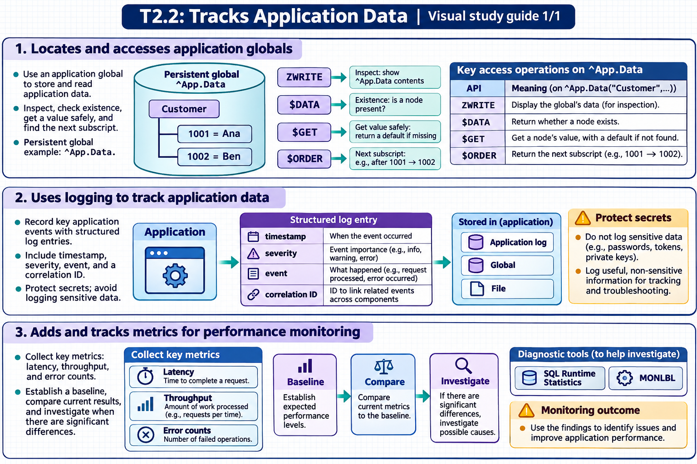

[All topics](../../index.md) · [Practice quiz](quiz.md)

# T2.2: Tracks Application Data

[Approfondimenti dagli esercizi](<Approfondimenti esercizi/README.md>)

Saved 2 November 2026 from [exam-prep.es](https://exam-prep.es/exams/objectscript/knowledge/T2.2.html). Reference links require internet access.

### Contents

1. [Locates and accesses application globals](#1-locates-and-accesses-application-globals)
2. [Uses logging to track application data](#2-uses-logging-to-track-application-data)
3. [Adds and tracks metrics for performance monitoring](#3-adds-and-tracks-metrics-for-performance-monitoring)

### Visual study guide — sections 1–3



[View all chapter diagrams](visuals.md) · [Technical review notes](../../visual-technical-notes.md)

## 1. Locates and accesses application globals

### Key Points

- **Globals (^name)**: Persistent multidimensional arrays stored in databases; the fundamental storage mechanism in InterSystems IRIS
- **ZWRITE**: Displays the contents of a global or subtree in a readable format
- **$DATA**: Tests whether a global node exists and whether it has descendants
- **$ORDER**: Iterates through global subscripts at a given level
- **$GET**: Safely retrieves a global node value, returning a default if the node does not exist
- **Management Portal**: System Explorer &gt; Globals provides a visual global viewer and editor

### Detailed Notes

#### Understanding Global Structure

Globals are sparse, hierarchical, multidimensional arrays stored on disk. They persist across process boundaries and system restarts. Every persistent class stores its data in globals -- understanding the underlying global structure is essential for debugging and performance analysis.

```objectscript
 // Setting global nodes
 SET ^Customer(1, "Name") = "John Smith"
 SET ^Customer(1, "Email") = "john@example.com"
 SET ^Customer(2, "Name") = "Jane Doe"
 SET ^Customer(2, "Email") = "jane@example.com"

 // Display entire global tree
 ZWRITE ^Customer
 // Output:
 // ^Customer(1,"Email")="john@example.com"
 // ^Customer(1,"Name")="John Smith"
 // ^Customer(2,"Email")="jane@example.com"
 // ^Customer(2,"Name")="Jane Doe"
```

#### Navigating Globals with $ORDER

$ORDER returns the next subscript at a given level, enabling traversal of global nodes:

```objectscript
 // Iterate through all customer IDs
 SET id = ""
 FOR {
     SET id = $ORDER(^Customer(id))
     QUIT:id=""
     WRITE "Customer ", id, ": ", ^Customer(id, "Name"), !
 }
```

#### Using $DATA to Check Node Existence

$DATA returns a value indicating whether a node exists and/or has children:

- 0 = node does not exist and has no descendants
- 1 = node exists but has no descendants
- 10 = node does not exist but has descendants
- 11 = node exists AND has descendants

```objectscript
 IF $DATA(^Customer(1)) {
     WRITE "Customer 1 exists", !
 }
 // Use $DATA to check before accessing
 IF $DATA(^Config("settings", "timeout"))#2 {
     SET timeout = ^Config("settings", "timeout")
 }
```

#### Management Portal Global Viewer

Navigate to System Explorer &gt; Globals to browse, search, and edit globals. You can:

- View globals across all namespaces
- Filter by global name prefix
- Drill into subscript levels
- Export and import global data
- Delete globals or individual nodes

#### Locating Class Data Globals

Find the active `DataLocation` in the class's storage definition. For example, a generated standard layout may use `^MyApp.CustomerD`, while a layout generated with `USEEXTENTSET = 1` may use a short name such as `^EW3K.DuIo.1`. Use the actual name from the definition in both cases.

`ZWRITE` inspects nodes through the current namespace. To find which database directory those nodes are mapped to, call `GetGlobalDest` using the same namespace.

```objectscript
Set dest = ##class(%SYS.Namespace).GetGlobalDest($NAMESPACE, "EW3K.DuIo.1")
Write dest, !
```

Read the result as `system^directory`. An empty system part means a local database. A subscript-specific mapping can send a branch to a different destination. In that case, supply the relevant subscript as the third argument or inspect **Global Mappings** for that namespace in the Management Portal.

### Documentation References

- [Introduction to Globals](https://docs.intersystems.com/irislatest/csp/docbook/DocBook.UI.Page.cls?KEY=GGBL_intro)
- [Global Structure](https://docs.intersystems.com/irislatest/csp/docbook/DocBook.UI.Page.cls?KEY=GGBL_structure)
- [$ORDER Function](https://docs.intersystems.com/irislatest/csp/docbook/DocBook.UI.Page.cls?KEY=RCOS_forder)
- [$DATA Function](https://docs.intersystems.com/irislatest/csp/docbook/DocBook.UI.Page.cls?KEY=RCOS_fdata)
- [%SYS.Namespace class reference](https://docs.intersystems.com/irislatest/csp/documatic/%25CSP.Documatic.cls?CLASSNAME=%25SYS.Namespace&LIBRARY=%25SYS)
- [Adding global mappings to a namespace](https://docs.intersystems.com/irislatest/csp/docbook/DocBook.UI.Page.cls?KEY=GSA_config_namespace_addmap)
- [Namespaces and databases](https://docs.intersystems.com/irislatest/csp/docbook/DocBook.UI.Page.cls?KEY=GORIENT_enviro)

## 2. Uses logging to track application data

### Key Points

- **^%ISCLOG**: Built-in diagnostic logging used by InterSystems framework code (CSP gateway, web services, productions); controlled by the ^%ISCLOG global, entries stored in ^ISCLOG in %SYS namespace
- **Custom logging globals**: Application-defined globals (e.g., ^MyApp.Log) for structured application-level logging
- **%Library.File**: Write log data to external files for integration with external log management systems
- **$HOROLOG / $ZTIMESTAMP**: Timestamps for log entries; $ZTIMESTAMP includes UTC time with fractional seconds
- **Log levels**: Implement severity levels (ERROR, WARN, INFO, DEBUG) for filtering and analysis

### Detailed Notes

#### ^%ISCLOG: Built-In Diagnostic Logging

^%ISCLOG is a diagnostic logging facility used by **InterSystems framework code** — CSP gateway, web services, Interoperability productions, and other system components. It is not typically called directly by application code; instead, system code calls the `$$$ISCLOG` and `$$$SysLog` macros (defined in `%occDiagnostics.inc`) to generate log entries.

**How it works:**

- The **^%ISCLOG** global (top-level value) controls the logging level: 0=disabled, 1=errors only, 2=warnings and errors, 3=all messages (most verbose)
- Log entries are written to the **^ISCLOG** global (without the % prefix) in the **%SYS namespace**
- Entries can be viewed using the **%Library.SysLog** class or by doing `ZWRITE ^ISCLOG` in the %SYS namespace

```objectscript
 // Enable diagnostic logging at maximum verbosity
 SET ^%ISCLOG = 3

 // Optionally limit the log size (default is unlimited)
 SET ^%ISCLOG("MaxLogEntries") = 10000

 // After troubleshooting, disable logging (impacts performance when enabled)
 SET ^%ISCLOG = 0
```

```objectscript
 // View log entries — switch to %SYS namespace first
 ZN "%SYS"
 ZWRITE ^ISCLOG

 // Or use the %Library.SysLog class to query entries programmatically
 SET rs = ##class(%Library.SysLog).FindAll()
 WHILE rs.%Next() {
     WRITE rs.%Get("TimeStamp"), " ", rs.%Get("Message"), !
 }
```

**Important:** Remember to set ^%ISCLOG back to 0 after troubleshooting, as verbose logging consumes disk space and impacts performance.

#### Building Custom Application Logs

For application-specific logging, create structured globals with timestamps, severity, and context. Unlike ^%ISCLOG (which is for system/framework diagnostics), custom logging globals give you full control over what your application records:

```objectscript
ClassMethod Log(level As %String, message As %String, context As %String = "")
{
    SET seq = $INCREMENT(^MyApp.Log)
    SET ^MyApp.Log(seq) = $LISTBUILD(
        $ZTIMESTAMP,
        level,
        $USERNAME,
        $JOB,
        context,
        message
    )
    // Also maintain a date-based index for efficient retrieval
    SET date = +$HOROLOG
    SET ^MyApp.Log("date", date, seq) = ""
}
```

```objectscript
 // Usage
 DO ##class(MyApp.Logger).Log("INFO", "Order created", "OrderId=1234")
 DO ##class(MyApp.Logger).Log("ERROR", "Payment failed: timeout", "OrderId=1234")
```

#### Retrieving and Analyzing Log Data

```objectscript
 // Iterate through recent log entries
 SET id = ""
 FOR {
     SET id = $ORDER(^MyApp.Log(id), -1)  // Reverse order (newest first)
     QUIT:id=""
     SET entry = ^MyApp.Log(id)
     SET timestamp = $LISTGET(entry, 1)
     SET level = $LISTGET(entry, 2)
     SET message = $LISTGET(entry, 6)
     WRITE id, " [", level, "] ", message, !
 }
```

#### File-Based Logging

For integration with external log management systems, write to files:

```objectscript
 SET file = ##class(%Library.File).%New("/var/log/myapp/application.log")
 DO file.Open("WSA")   // Write, Stream, Append
 DO file.WriteLine($ZDATETIME($ZTIMESTAMP, 3, 1) _ " [INFO] Application started")
 DO file.Close()
```

### Documentation References

- [Using ^%ISCLOG](https://docs.intersystems.com/irislatest/csp/docbook/DocBook.UI.Page.cls?KEY=GCM_monitor)
- [$ZTIMESTAMP Special Variable](https://docs.intersystems.com/irislatest/csp/docbook/DocBook.UI.Page.cls?KEY=RCOS_vztimestamp)
- [%Library.File](https://docs.intersystems.com/irislatest/csp/docbook/DocBook.UI.Page.cls?KEY=RCOS_file)

## 3. Adds and tracks metrics for performance monitoring

### Key Points

- **$SYSTEM.Process**: Provides per-process performance counters (global references, lines executed, etc.)
- **^IRIS.Temp globals**: Temporary globals for storing transient metrics without journaling overhead
- **$SYSTEM.SQL.Stats**: SQL query statistics and performance data
- **^%SYS.MONLBL**: Line-by-line monitoring data for code profiling
- **%SYSTEM.Process.GetMetric()**: Retrieve specific process-level metrics programmatically

### Detailed Notes

#### Process-Level Metrics with $SYSTEM.Process

$SYSTEM.Process provides access to detailed process performance counters:

```objectscript
 // Get global references count for current process
 WRITE $SYSTEM.Process.GlobalReferences(), !

 // Get lines of ObjectScript executed
 WRITE $SYSTEM.Process.LinesExecuted(), !

 // Get disk read count
 WRITE $SYSTEM.Process.DiskReadCount(), !

 // Measure performance of a code block
 SET startGref = $SYSTEM.Process.GlobalReferences()
 SET startLines = $SYSTEM.Process.LinesExecuted()
 SET startTime = $ZHOROLOG  // High-precision timestamp

 // ... code being measured ...
 DO ##class(MyApp.DataLoader).ProcessBatch()

 SET elapsedTime = $ZHOROLOG - startTime
 SET globalRefs = $SYSTEM.Process.GlobalReferences() - startGref
 SET linesExec = $SYSTEM.Process.LinesExecuted() - startLines

 WRITE "Time: ", elapsedTime, " seconds", !
 WRITE "Global refs: ", globalRefs, !
 WRITE "Lines executed: ", linesExec, !
```

#### Using ^IRIS.Temp for Transient Metrics

^IRIS.Temp globals reside in the IRISTEMP database, which is never journaled. This makes them ideal for storing performance counters and temporary metrics without impacting transaction performance or journal volume:

```objectscript
 // Track API call counts by endpoint
 SET ^IRIS.Temp.Metrics("API", endpoint, $PIECE($HOROLOG, ",", 1)) =
     $INCREMENT(^IRIS.Temp.Metrics("API", endpoint, $PIECE($HOROLOG, ",", 1)))

 // Track method execution times
 SET startTime = $ZHOROLOG
 // ... method execution ...
 SET elapsed = $ZHOROLOG - startTime
 SET ^IRIS.Temp.Metrics("Timing", methodName, $JOB) = elapsed
```

#### SQL Performance Statistics

Use $SYSTEM.SQL.Stats to analyze SQL query performance:

```objectscript
 // Get SQL statistics
 DO $SYSTEM.SQL.Stats.DisplayStats()

 // For a specific query, examine the query plan
 SET stmt = ##class(%SQL.Statement).%New()
 SET sc = stmt.%Prepare("SELECT * FROM MyApp.Customer WHERE State = ?")
 DO stmt.%ShowPlan()
```

#### Line-by-Line Monitoring

Enable line-by-line monitoring to profile code execution:

```objectscript
 // Enable monitoring for a routine
 DO $SYSTEM.Monitor.LineLevelMonStart("MyApp.DataLoader")

 // Run the code
 DO ##class(MyApp.DataLoader).ProcessBatch()

 // Stop monitoring and view results
 DO $SYSTEM.Monitor.LineLevelMonStop()

 // Results stored in ^%SYS.MONLBL
 ZWRITE ^%SYS.MONLBL
```

#### Building a Performance Dashboard

Combine metrics for a comprehensive view:

```objectscript
ClassMethod CollectMetrics() As %Status
{
    SET timestamp = $ZTIMESTAMP
    SET metrics = $LISTBUILD(
        $SYSTEM.Process.GlobalReferences(),
        $SYSTEM.Process.LinesExecuted(),
        $SYSTEM.Process.DiskReadCount(),
        $SYSTEM.Process.JournalEntryCount()
    )
    SET ^IRIS.Temp.PerfLog($INCREMENT(^IRIS.Temp.PerfLog)) =
        $LISTBUILD(timestamp) _ metrics
    RETURN $$$OK
}
```

### Documentation References

- [$SYSTEM.Process](https://docs.intersystems.com/irislatest/csp/docbook/DocBook.UI.Page.cls?KEY=RCOS_vsystem_process)
- [Monitoring Performance](https://docs.intersystems.com/irislatest/csp/docbook/DocBook.UI.Page.cls?KEY=GCM_monitor)
- [SQL Performance Analysis](https://docs.intersystems.com/irislatest/csp/docbook/DocBook.UI.Page.cls?KEY=GSQLOPT)

## Exam Preparation Summary

### Critical Concepts to Master:

1. **Global navigation**: Fluency with $ORDER, $DATA, $GET, and ZWRITE for examining and traversing globals
2. **$DATA return values**: Know what 0, 1, 10, and 11 mean and how to use modular arithmetic (#2, #10) to test specific conditions
3. **Logging strategies**: Understand ^%ISCLOG for system/framework diagnostics vs custom logging globals for application data vs file-based logging for external integration
4. **Performance counters**: Know how to use $SYSTEM.Process methods to measure global references, lines executed, and timing
5. **^IRIS.Temp**: Understand that IRISTEMP globals are not journaled, making them ideal for transient data and metrics

### Common Exam Scenarios:

- Writing $ORDER loops to iterate through a global structure
- Interpreting $DATA return values for various global node configurations
- Choosing appropriate logging mechanisms for different scenarios
- Measuring code performance using $SYSTEM.Process counters and $ZHOROLOG
- Identifying the correct global name for a persistent class's data storage
- Using ZWRITE to debug global contents

### Hands-On Practice Recommendations:

- Create globals with various structures and practice navigating them with $ORDER at different subscript levels
- Build a simple logging class and test it with different log levels
- Use $SYSTEM.Process.GlobalReferences() to compare performance of different data access patterns
- Explore the Management Portal's global viewer (System Explorer &gt; Globals) across different namespaces
- Enable ^%ISCLOG at different levels, then switch to %SYS namespace to examine ^ISCLOG entries
- Write code that stores metrics in ^IRIS.Temp and verify that the data is not journaled
