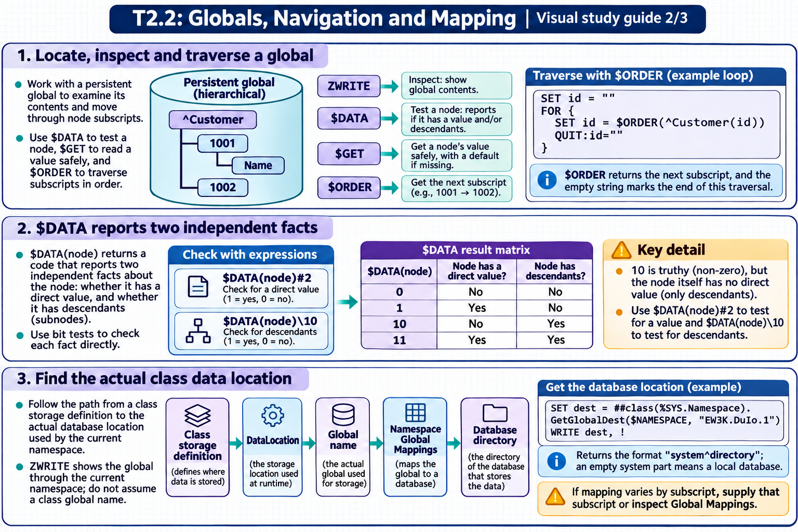
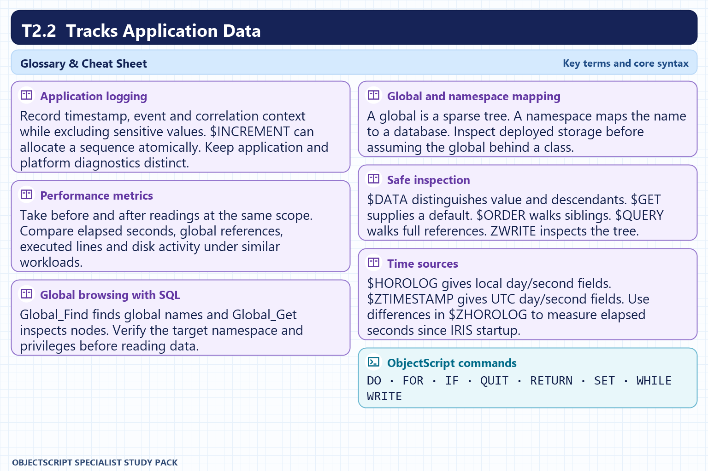
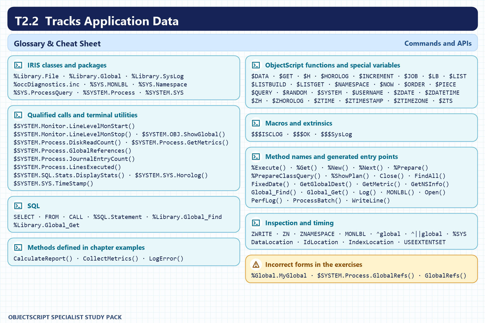

[All topics](../../index.md) · [Practice quiz](quiz.md)

# T2.2: Tracks Application Data

[Approfondimenti dagli esercizi](<Approfondimenti esercizi/README.md>)

Saved 2 November 2026 from [exam-prep.es](https://exam-prep.es/exams/objectscript/knowledge/T2.2.html). Reference links require internet access.

### Contents

1. [Locates and accesses application globals](#1-locates-and-accesses-application-globals)
2. [Uses logging to track application data](#2-uses-logging-to-track-application-data)
3. [Adds and tracks metrics for performance monitoring](#3-adds-and-tracks-metrics-for-performance-monitoring)

[Glossary & Cheat Sheet](#glossary--cheat-sheet)

### Visual study guide — sections 1–3


[View all chapter diagrams](visuals.md) · [Technical review notes](../../visual-technical-notes.md)

## 1. Locates and accesses application globals



### Key Points

- **Globals (^name)**: Persistent multidimensional arrays stored in databases; the fundamental storage mechanism in InterSystems IRIS
- **ZWRITE**: Displays the contents of a global or subtree in a readable format
- **$DATA**: Tests whether a global node exists and whether it has descendants
- **$ORDER**: Iterates through global subscripts at a given level
- **$QUERY**: Traverses nodes across levels and returns each full node reference
- **$GET**: Safely retrieves a global node value, returning a default if the node does not exist
- **%Library.Global**: Provides `Find` and `Get` class queries for searching or reading globals without a persistent class definition
- **Management Portal**: System Explorer &gt; Globals provides a visual global viewer and editor

### Detailed Notes

#### Understanding Global Structure

Globals are sparse, hierarchical, multidimensional arrays stored on disk. They persist across process boundaries and system restarts. Every persistent class stores its data in globals -- understanding the underlying global structure is essential for debugging and performance analysis.

```objectscript
 // Setting global nodes
 SET ^Customer(1, "Name") = "John Smith"
 SET ^Customer(1, "Email") = "john@example.com"
 SET ^Customer(2, "Name") = "Jane Doe"
 SET ^Customer(2, "Email") = "jane@example.com"

 // Display entire global tree
 ZWRITE ^Customer
 // Output:
 // ^Customer(1,"Email")="john@example.com"
 // ^Customer(1,"Name")="John Smith"
 // ^Customer(2,"Email")="jane@example.com"
 // ^Customer(2,"Name")="Jane Doe"
```

#### Navigating Globals with $ORDER

$ORDER returns the next subscript at a given level, enabling traversal of global nodes:

```objectscript
 // Iterate through all customer IDs
 SET id = ""
 FOR {
     SET id = $ORDER(^Customer(id))
     QUIT:id=""
     WRITE "Customer ", id, ": ", ^Customer(id, "Name"), !
 }
```

#### Searching globals with `%Library.Global`

An IRIS global does not need a persistent class definition to be searched through the `%Library.Global` class queries. `Find` and `Get` can be invoked directly with SQL `CALL` syntax. These `CALL` statements belong in an SQL context; from the ObjectScript prompt in IRIS Terminal, prepare the class query with `%PrepareClassQuery`. For example, search under `^Persons` for the `Email` subscript, or request the value at a reference containing that subscript:

```sql
CALL %Library.Global_Find('USER', '^Persons', 'Email')
CALL %Library.Global_Get('USER', '^Persons(,"Email"', '')
```

The same class queries can be prepared and executed from ObjectScript with `%SQL.Statement`:

```objectscript
 SET statement = ##class(%SQL.Statement).%New()
 SET status = statement.%PrepareClassQuery("%Library.Global", "Find")
 SET resultset = statement.%Execute("USER", "^Persons", "Email")
```

To invoke `Get`, prepare the `Get` query and pass its global reference as a string. In an ObjectScript string, double the quotes that are part of the global reference:

```objectscript
 SET statement = ##class(%SQL.Statement).%New()
 SET status = statement.%PrepareClassQuery("%Library.Global", "Get")
 SET resultset = statement.%Execute("USER", "^Persons(,""Email""")
```

These are dedicated class queries for accessing global data. They do not make an arbitrary global a table that can be queried with syntax such as `SELECT * FROM %Global.MyGlobal`.

#### Choosing a traversal strategy

Use `ZWRITE` for a readable snapshot of a global or a selected subtree. Use `$ORDER` when you need to control the keys you visit, apply a condition, or stop early. `$ORDER` returns siblings at the level named in the reference; it does not descend into every child automatically. To walk selected levels with `$ORDER`, nest one loop per level.

When the structure is nested and you want to visit nodes at all levels in one loop, `$QUERY` returns each full node reference. Indirection (`@ref`) then reads the value at that reference:

```objectscript
 SET ref = "^Customer"
 FOR {
     SET ref = $QUERY(@ref)
     QUIT:ref=""
     WRITE ref, " = ", @ref, !
 }
```

The starting reference is a position in the traversal; if the global root itself has a value, inspect it separately. For a quick inspection in the Terminal, `ZWRITE ^Customer` is often the simplest choice. For a filtered or partial scan, use `$ORDER`; for a traversal across nested levels, use nested `$ORDER` loops or `$QUERY`.

#### Using $DATA to Check Node Existence

$DATA returns a value indicating whether a node exists and/or has children:

- 0 = node does not exist and has no descendants
- 1 = node exists but has no descendants
- 10 = node does not exist but has descendants
- 11 = node exists AND has descendants

```objectscript
 IF $DATA(^Customer(1)) {
     WRITE "Customer 1 exists", !
 }
 // Use $DATA to check before accessing
 IF $DATA(^Config("settings", "timeout"))#2 {
     SET timeout = ^Config("settings", "timeout")
 }
```

#### Management Portal Global Viewer

Navigate to System Explorer &gt; Globals to browse, search, and edit globals. You can:

- View globals across all namespaces
- Filter by global name prefix
- Drill into subscript levels
- Export and import global data
- Delete globals or individual nodes

#### Locating Class Data Globals

Find the active `DataLocation` in the class's storage definition. For example, a generated standard layout may use `^MyApp.CustomerD`, while a layout generated with `USEEXTENTSET = 1` may use a short name such as `^EW3K.DuIo.1`. Use the actual name from the definition in both cases.

`ZWRITE` inspects nodes through the current namespace. To find which database directory those nodes are mapped to, call `GetGlobalDest` using the same namespace.

```objectscript
Set dest = ##class(%SYS.Namespace).GetGlobalDest($NAMESPACE, "EW3K.DuIo.1")
Write dest, !
```

Read the result as `system^directory`. An empty system part means a local database. A subscript-specific mapping can send a branch to a different destination. In that case, supply the relevant subscript as the third argument or inspect **Global Mappings** for that namespace in the Management Portal.

### Documentation References

- [Introduction to Globals](https://docs.intersystems.com/irislatest/csp/docbook/DocBook.UI.Page.cls?KEY=GGBL_intro)
- [Global Structure](https://docs.intersystems.com/irislatest/csp/docbook/DocBook.UI.Page.cls?KEY=GGBL_structure)
- [$ORDER Function](https://docs.intersystems.com/irislatest/csp/docbook/DocBook.UI.Page.cls?KEY=RCOS_forder)
- [$QUERY Function](https://docs.intersystems.com/irislatest/csp/docbook/DocBook.UI.Page.cls?KEY=RCOS_fquery)
- [Search within globals without class definitions](https://community.intersystems.com/post/search-within-globals-without-class-definitions)
- [$DATA Function](https://docs.intersystems.com/irislatest/csp/docbook/DocBook.UI.Page.cls?KEY=RCOS_fdata)
- [%SYS.Namespace class reference](https://docs.intersystems.com/irislatest/csp/documatic/%25CSP.Documatic.cls?CLASSNAME=%25SYS.Namespace&LIBRARY=%25SYS)
- [Adding global mappings to a namespace](https://docs.intersystems.com/irislatest/csp/docbook/DocBook.UI.Page.cls?KEY=GSA_config_namespace_addmap)
- [Namespaces and databases](https://docs.intersystems.com/irislatest/csp/docbook/DocBook.UI.Page.cls?KEY=GORIENT_enviro)

## 2. Uses logging to track application data


### Key Points

- **^%ISCLOG**: Built-in diagnostic logging used by InterSystems framework code (CSP gateway, web services, productions); controlled by the ^%ISCLOG global, entries stored in ^ISCLOG in %SYS namespace
- **Custom logging globals**: Application-defined globals (e.g., ^MyApp.Log) for structured application-level logging
- **%Library.File**: Write log data to external files for integration with external log management systems
- **Time sources for logs**: `$HOROLOG` is local date/time at whole-second precision; `$ZTIMESTAMP` is UTC date/time with fractional seconds for cross-time-zone event stamps. Neither is the elapsed-time counter; see [the comparison in section 3](#choosing-a-clock-timestamp-or-elapsed-timer).
- **Log levels**: Implement severity levels (ERROR, WARN, INFO, DEBUG) for filtering and analysis

### Detailed Notes

#### ^%ISCLOG: Built-In Diagnostic Logging

^%ISCLOG is a diagnostic logging facility used by **InterSystems framework code** — CSP gateway, web services, Interoperability productions, and other system components. It is not typically called directly by application code; instead, system code calls the `$$$ISCLOG` and `$$$SysLog` macros (defined in `%occDiagnostics.inc`) to generate log entries.

**How it works:**

- The top-level **^%ISCLOG** value controls diagnostic logging; 0 disables it. Interpret nonzero levels for the specific logger or feature. For CSP logging, levels 1, 2, and 3 mean exceptional events, detailed information, and raw request data, respectively.
- Log entries are written to the **^ISCLOG** global (without the % prefix) in the **%SYS namespace**
- Entries can be viewed using the **%Library.SysLog** class or by doing `ZWRITE ^ISCLOG` in the %SYS namespace

```objectscript
 // Enable diagnostic logging at maximum verbosity
 SET ^%ISCLOG = 3

 // Optionally limit the log size (default is unlimited)
 SET ^%ISCLOG("MaxLogEntries") = 10000

 // After troubleshooting, disable logging (impacts performance when enabled)
 SET ^%ISCLOG = 0
```

```objectscript
 // View log entries — switch to %SYS namespace first
 ZN "%SYS"
 ZWRITE ^ISCLOG

 // Or use the %Library.SysLog class to query entries programmatically
 SET rs = ##class(%Library.SysLog).FindAll()
 WHILE rs.%Next() {
     WRITE rs.%Get("TimeStamp"), " ", rs.%Get("Message"), !
 }
```

**Important:** Remember to set ^%ISCLOG back to 0 after troubleshooting, as verbose logging consumes disk space and impacts performance.

#### Building Custom Application Logs

For application-specific logging, create structured globals with timestamps, severity, and context. Unlike ^%ISCLOG (which is for system/framework diagnostics), custom logging globals give you full control over what your application records:

```objectscript
ClassMethod Log(level As %String, message As %String, context As %String = "")
{
    SET seq = $INCREMENT(^MyApp.Log)
    SET ^MyApp.Log(seq) = $LISTBUILD(
        $ZTIMESTAMP,
        level,
        $USERNAME,
        $JOB,
        context,
        message
    )
    // Also maintain a date-based index for efficient retrieval
    SET date = +$HOROLOG
    SET ^MyApp.Log("date", date, seq) = ""
}
```

```objectscript
 // Usage
 DO ##class(MyApp.Logger).Log("INFO", "Order created", "OrderId=1234")
 DO ##class(MyApp.Logger).Log("ERROR", "Payment failed: timeout", "OrderId=1234")
```

#### Retrieving and Analyzing Log Data

```objectscript
 // Iterate through recent log entries
 SET id = ""
 FOR {
     SET id = $ORDER(^MyApp.Log(id), -1)  // Reverse order (newest first)
     QUIT:id=""
     SET entry = ^MyApp.Log(id)
     SET timestamp = $LISTGET(entry, 1)
     SET level = $LISTGET(entry, 2)
     SET message = $LISTGET(entry, 6)
     WRITE id, " [", level, "] ", message, !
 }
```

#### File-Based Logging

For integration with external log management systems, write to files:

```objectscript
 SET file = ##class(%Library.File).%New("/var/log/myapp/application.log")
 DO file.Open("WSA")   // Write, Stream, Append
 DO file.WriteLine($ZDATETIME($ZTIMESTAMP, 3, 1) _ " [INFO] Application started")
 DO file.Close()
```

### Documentation References

- [Using ^%ISCLOG](https://docs.intersystems.com/irislatest/csp/docbook/DocBook.UI.Page.cls?KEY=GCM_monitor)
- [Enabling CSP logging and interpreting its levels](https://docs.intersystems.com/irislatest/csp/docbook/DocBook.UI.Page.cls?KEY=GCSP_LOGGING)
- [$HOROLOG](https://docs.intersystems.com/irislatest/csp/docbook/DocBook.UI.Page.cls?KEY=RCOS_vhorolog)
- [$ZTIMESTAMP Special Variable](https://docs.intersystems.com/irislatest/csp/docbook/DocBook.UI.Page.cls?KEY=RCOS_vztimestamp)
- [$NOW](https://docs.intersystems.com/irislatest/csp/docbook/DocBook.UI.Page.cls?KEY=RCOS_fnow)
- [Date and time values](https://docs.intersystems.com/irislatest/csp/docbook/DocBook.UI.Page.cls?KEY=GCOS_datetime)
- [%Library.File](https://docs.intersystems.com/irislatest/csp/docbook/DocBook.UI.Page.cls?KEY=RCOS_file)

## 3. Adds and tracks metrics for performance monitoring

### Key Points

- **$SYSTEM.Process**: Provides per-process performance counters (global references, lines executed, etc.)
- **$ZHOROLOG**: Counts elapsed seconds since the latest IRIS startup, with fractional seconds; take an after-minus-before difference to measure a duration.
- **%SYS.ProcessQuery**: Exposes per-process counters such as `GlobalReferences` through SQL
- **^IRIS.Temp globals**: Temporary globals for storing transient metrics without journaling overhead
- **$SYSTEM.SQL.Stats**: SQL query statistics and performance data
- **^%SYS.MONLBL**: Line-by-line monitoring data for code profiling
- **%SYSTEM.Process.GetMetric()**: Retrieve specific process-level metrics programmatically

### Detailed Notes

#### Process-Level Metrics with $SYSTEM.Process

$SYSTEM.Process provides access to detailed process performance counters:

```objectscript
 // Get global references count for current process
 WRITE $SYSTEM.Process.GlobalReferences(), !

 // Get lines of ObjectScript executed
 WRITE $SYSTEM.Process.LinesExecuted(), !

 // Get disk read count
 WRITE $SYSTEM.Process.DiskReadCount(), !

 // Measure performance of a code block
 SET startGref = $SYSTEM.Process.GlobalReferences()
 SET startLines = $SYSTEM.Process.LinesExecuted()
 SET startTime = $ZHOROLOG  // Elapsed-seconds counter; subtract the starting value

 // ... code being measured ...
 DO ##class(MyApp.DataLoader).ProcessBatch()

 SET elapsedTime = $ZHOROLOG - startTime
 SET globalRefs = $SYSTEM.Process.GlobalReferences() - startGref
 SET linesExec = $SYSTEM.Process.LinesExecuted() - startLines

 WRITE "Time: ", elapsedTime, " seconds", !
 WRITE "Global refs: ", globalRefs, !
 WRITE "Lines executed: ", linesExec, !
```

#### Choosing a clock, timestamp, or elapsed timer

These values answer different questions. `$HOROLOG`, `$ZTIMESTAMP`, and `$NOW()` describe a date and time; `$ZHOROLOG` measures elapsed time.

| Value | What it represents | Good use | Important limit |
| --- | --- | --- | --- |
| `$HOROLOG` (`$H`) | Local IRIS date and time as `days,seconds`; whole seconds only. It applies local seasonal time changes such as DST. | Local date/time fields and date-based indexes when second precision is enough. | It is wall-clock time. A clock, time-zone, or DST change can affect comparisons across that boundary. |
| `$ZTIMESTAMP` (`$ZTS`) | Current UTC date and time in IRIS storage format, with fractional seconds. | Consistent event timestamps in logs read across time zones. | It is a wall-clock timestamp, not a duration counter. Fractional precision depends on the platform clock. |
| `$ZHOROLOG` (`$ZH`) | Floating-point seconds elapsed since the most recent IRIS startup; independent of wall-clock changes and midnight. | Benchmarking: save a start value and subtract it from the end value. | It is not a calendar timestamp. Windows hibernate or standby can make readings unpredictable. |
| `$NOW()` / `$NOW(tzmins)` | Current process date and time with fractional seconds, in IRIS storage format; uses `$ZTIMEZONE` by default or the supplied offset. `$NOW(0)` returns UTC. | A fractional-second timestamp at the process's local offset or an explicit offset. | `$NOW()` does not apply DST or other seasonal local-time changes, so it may differ from the wall clock. It is not an elapsed timer. |

Use `$ZDATETIME`, `$ZDATE`, and `$ZTIME` to format or convert date/time values; these functions do not read a clock. `$SYSTEM.SYS.Horolog()` is a callable alternative to `$HOROLOG`; `$SYSTEM.SYS.TimeStamp()` and `##class(%SYSTEM.SYS).TimeStamp()` are alternatives to `$ZTIMESTAMP`. `$ZTIMEZONE` is a fixed offset: it affects `$HOROLOG` and the default `$NOW()`, while `$HOROLOG` separately applies the operating system's seasonal-time rules.

For date-dependent tests, `%SYSTEM.Process.FixedDate()` overrides the date portion of `$HOROLOG` for the current process while the time of day continues. It does not change the system clock or the values of `$NOW()` and `$ZTIMESTAMP`; pass `0` to restore the current date:

```objectscript
 DO ##class(%SYSTEM.Process).FixedDate(12345)  // Set a test date for this process
 // ... run date-dependent code ...
 DO ##class(%SYSTEM.Process).FixedDate(0)      // Restore the current date
```

#### Reading per-process counters with SQL

The `%SYS.ProcessQuery` SQL projection can retrieve the global-reference count for a process:

```sql
SELECT GlobalReferences
FROM %SYS.ProcessQuery
WHERE PID = :pid
```

`GlobalReferences` is cumulative for the process. To estimate the references made during an operation, take two readings around it and subtract; the process may end before the second reading.

#### Using ^IRIS.Temp for Transient Metrics

^IRIS.Temp globals reside in the IRISTEMP database, which is never journaled. This makes them ideal for storing performance counters and temporary metrics without impacting transaction performance or journal volume:

```objectscript
 // Track API call counts by endpoint
 SET ^IRIS.Temp.Metrics("API", endpoint, $PIECE($HOROLOG, ",", 1)) =
     $INCREMENT(^IRIS.Temp.Metrics("API", endpoint, $PIECE($HOROLOG, ",", 1)))

 // Track method execution times
 SET startTime = $ZHOROLOG  // Elapsed seconds, not a calendar timestamp
 // ... method execution ...
 SET elapsed = $ZHOROLOG - startTime
 SET ^IRIS.Temp.Metrics("Timing", methodName, $JOB) = elapsed
```

#### SQL Performance Statistics

Use $SYSTEM.SQL.Stats to analyze SQL query performance:

```objectscript
 // Get SQL statistics
 DO $SYSTEM.SQL.Stats.DisplayStats()

 // For a specific query, examine the query plan
 SET stmt = ##class(%SQL.Statement).%New()
 SET sc = stmt.%Prepare("SELECT * FROM MyApp.Customer WHERE State = ?")
 DO stmt.%ShowPlan()
```

#### Line-by-Line Monitoring

Enable line-by-line monitoring to profile code execution:

```objectscript
 // Enable monitoring for a routine
 DO $SYSTEM.Monitor.LineLevelMonStart("MyApp.DataLoader")

 // Run the code
 DO ##class(MyApp.DataLoader).ProcessBatch()

 // Stop monitoring and view results
 DO $SYSTEM.Monitor.LineLevelMonStop()

 // Results stored in ^%SYS.MONLBL
 ZWRITE ^%SYS.MONLBL
```

#### Building a Performance Dashboard

Combine metrics for a comprehensive view:

```objectscript
ClassMethod CollectMetrics() As %Status
{
    SET timestamp = $ZTIMESTAMP
    SET metrics = $LISTBUILD(
        $SYSTEM.Process.GlobalReferences(),
        $SYSTEM.Process.LinesExecuted(),
        $SYSTEM.Process.DiskReadCount(),
        $SYSTEM.Process.JournalEntryCount()
    )
    SET ^IRIS.Temp.PerfLog($INCREMENT(^IRIS.Temp.PerfLog)) =
        $LISTBUILD(timestamp) _ metrics
    RETURN $$$OK
}
```

### Documentation References

- [$SYSTEM.Process](https://docs.intersystems.com/irislatest/csp/docbook/DocBook.UI.Page.cls?KEY=RCOS_vsystem_process)
- [$ZHOROLOG](https://docs.intersystems.com/irislatest/csp/docbook/DocBook.UI.Page.cls?KEY=RCOS_vzhorolog)
- [$ZDATETIME](https://docs.intersystems.com/irislatest/csp/docbook/DocBook.UI.Page.cls?KEY=RCOS_fzdatetime)
- [$NOW](https://docs.intersystems.com/irislatest/csp/docbook/DocBook.UI.Page.cls?KEY=RCOS_fnow)
- [$HOROLOG and $ZTIMESTAMP](https://docs.intersystems.com/irislatest/csp/docbook/DocBook.UI.Page.cls?KEY=RCOS_vhorolog)
- [%SYS.ProcessQuery class reference](https://docs.intersystems.com/irislatest/csp/documatic/%25CSP.Documatic.cls?CLASSNAME=%25SYS.ProcessQuery&LIBRARY=%25SYS)
- [Monitoring Performance](https://docs.intersystems.com/irislatest/csp/docbook/DocBook.UI.Page.cls?KEY=GCM_monitor)
- [SQL Performance Analysis](https://docs.intersystems.com/irislatest/csp/docbook/DocBook.UI.Page.cls?KEY=GSQLOPT)

## Exam Preparation Summary

### Critical Concepts to Master:

1. **Global navigation**: Fluency with $ORDER, $DATA, $GET, and ZWRITE for examining and traversing globals
2. **$DATA return values**: Know what 0, 1, 10, and 11 mean and how to use modular arithmetic (#2, #10) to test specific conditions
3. **Logging strategies**: Understand ^%ISCLOG for system/framework diagnostics vs custom logging globals for application data vs file-based logging for external integration
4. **Performance counters and time sources**: Use $SYSTEM.Process methods for operation counts; use $ZHOROLOG differences for elapsed duration; distinguish these from the wall-clock values $HOROLOG, $ZTIMESTAMP, and $NOW()
5. **^IRIS.Temp**: Understand that IRISTEMP globals are not journaled, making them ideal for transient data and metrics

### Common Exam Scenarios:

- Writing $ORDER loops to iterate through a global structure
- Interpreting $DATA return values for various global node configurations
- Choosing appropriate logging mechanisms for different scenarios
- Measuring code performance with $SYSTEM.Process counters and $ZHOROLOG, and selecting a calendar timestamp with $HOROLOG, $ZTIMESTAMP, or $NOW()
- Identifying the correct global name for a persistent class's data storage
- Using ZWRITE to debug global contents

### Hands-On Practice Recommendations:

- Create globals with various structures and practice navigating them with $ORDER at different subscript levels
- Build a simple logging class and test it with different log levels
- Use $SYSTEM.Process.GlobalReferences() to compare performance of different data access patterns
- Explore the Management Portal's global viewer (System Explorer &gt; Globals) across different namespaces
- Enable ^%ISCLOG at different levels, then switch to %SYS namespace to examine ^ISCLOG entries
- Write code that stores metrics in ^IRIS.Temp and verify that the data is not journaled

## Glossary & Cheat Sheet

### Key terms

- **Global and namespace mapping**
  - **Global** — Stores data in a sparse subscript tree.
  - **Namespace mapping** — Resolves a global name to a database.
  - **Deployed storage** — Identifies the actual globals used by a class.
- **Safe inspection**
  - `$DATA` — Checks whether a node has a value, descendants or both.
  - `$GET` — Reads a node with a default for an undefined value.
  - `$ORDER` — Returns the next or previous sibling subscript.
  - `$QUERY` — Returns the next or previous full node reference.
  - `ZWRITE` — Displays values and subscripts for inspection.
- **Application logging**
  - **Correlation context** — Associates events from the same operation.
  - `$INCREMENT` — Atomically allocates the next numeric sequence value.
  - **Data minimization** — Keeps secrets and sensitive fields out of log records.
- **Time sources**
  - `$HOROLOG` — Gives local day and second fields.
  - `$ZTIMESTAMP` — Gives UTC day and fractional-second fields.
  - `$ZHOROLOG` — Reports elapsed seconds since IRIS startup.
- **Performance metrics**
  - **Baseline and delta** — Compare before and after readings from the same scope.
  - **Operation counters** — Measure globals, executed lines or disk activity alongside duration.
- **Global browsing with SQL**
  - **Global_Find** — Finds global names matching a search pattern.
  - **Global_Get** — Reads nodes from a specified global.
  - **Namespace and privileges** — Determine which globals a caller can inspect.
- **ObjectScript commands**
  - `DO` — Invokes a routine, label or method.
  - `FOR` — Repeats a block or command according to a loop specification.
  - `IF` — Runs the following command or block when its condition is true.
  - `QUIT` — Leaves the current loop, block or invocation as determined by context.
  - `RETURN` — Returns control, optionally with a value, to the caller.
  - `SET` — Assigns a value to a variable, property or assignable expression.
  - `WHILE` — Repeats the block while its condition holds.
  - `WRITE` — Sends formatted output to the current device.
  - `CLOSE` — Closes the device identified by its argument.
  - `OPEN` — Opens the specified I/O device.
  - `ZNAMESPACE` — Switches the current process to another namespace.
- **System variables and macros**
  - `$JOB` — Identifies the current process.
  - `$NAMESPACE` — Names the current namespace.
  - `$SYSTEM` — Provides shorthand access to the IRIS %SYSTEM package.
  - `$USERNAME` — Identifies the authenticated user.
  - `$ZTIMEZONE` — Reports the current time zone offset in minutes west of UTC.
  - `$$$ISCLOG` — Emits diagnostics through the framework logging configuration.
  - `$$$OK` — Supplies a success status.
  - `$$$SysLog` — Writes framework diagnostics to the system logging facility.
- **SQL statements and clauses**
  - `SELECT` — Reads rows and expressions from one or more sources.
  - `FROM` — Names the source tables or queries.
  - `CALL` — Executes a stored procedure.

### System methods and functions

- `##class(%File).%New(path)` — Creates a file object for the path.
- `##class(%Monitor.System.LineByLine).Start($LISTBUILD(routine))` — Starts line-by-line monitoring for the named routine.
- `##class(%Monitor.System.LineByLine).Stop()` — Stops line-by-line monitoring.
- `##class(%SQL.Statement).%New()` — Creates a dynamic SQL statement object.
- `##class(%SYS.Namespace).GetGlobalDest(namespace, globalName)` — Resolves the database mapped to the global.
- `##class(%SYS.Namespace).GetNSInfo(namespace, .info)` — Returns namespace properties, including its default mappings.
- `$DATA(node)` — Reports whether a node has data, descendants, both or neither.
- `$GET(node, default)` — Returns the node value or a default.
- `$INCREMENT(node, amount)` — Atomically adds an amount and returns the new value.
- `$LIST(list, position)` — Reads the element at the specified position.
- `$LISTBUILD(value1, value2)` — Encodes values as an ObjectScript list.
- `$LISTGET(list, position, default)` — Reads an element or supplies a default.
- `$NOW()` — Returns the current date and time with fractional seconds.
- `$ORDER(node, direction)` — Returns the next or previous sibling subscript.
- `$PIECE(text, delimiter, from, to)` — Returns one or more delimited fields.
- `$QUERY(node, direction)` — Returns the next or previous full node reference.
- `$RANDOM(limit)` — Returns a random integer from zero through limit minus one.
- `$SYSTEM.Process.FixedDate(days)` — Sets a test date for the process's Horolog value. Pass zero to restore it.
- `$SYSTEM.Process.GlobalReferences()` — Returns the process's global reference count.
- `$SYSTEM.Process.LinesExecuted()` — Returns the process's executed-line count.
- `$SYSTEM.SQL.Explain(sql)` — Generates and displays an execution plan for the SQL query.
- `$SYSTEM.SYS.Horolog()` — Returns the current Horolog value.
- `$SYSTEM.SYS.TimeStamp()` — Returns the current timestamp.
- `$ZDATE(days, format)` — Formats an internal day count.
- `$ZDATETIME(daySecondPair, dateFormat, timeFormat)` — Formats a day-and-seconds pair as date and time text.
- `$ZTIME(seconds, format)` — Formats an internal seconds-of-day value.
- `CALL %Library.Global_Find(namespace, startNode, pattern)` — Finds global nodes containing the search value.
- `CALL %Library.Global_Get(namespace, searchMask, lastNode)` — Returns nodes selected by the global search mask.
- `file.Close()` — Closes an open file object.
- `file.Open("WSA")` — Opens a file for stream writes in append mode.
- `result.%Get("ColumnName")` — Reads a result column by name.
- `result.%Next()` — Advances to the next SQL row and reports whether it exists.
- `stmt.%Execute(value)` — Runs the prepared statement with the given bound value.
- `stmt.%Prepare(sql)` — Prepares a dynamic statement and returns a status.
- `stmt.%PrepareClassQuery(className, queryName)` — Prepares a named class query for execution.
- `stream.WriteLine(text)` — Writes text followed by a line terminator.

Official reference: [Elapsed seconds with $ZHOROLOG](https://docs.intersystems.com/irislatest/csp/docbook/DocBook.UI.Page.cls?KEY=RCOS_vzhorolog).

### Visual recap




