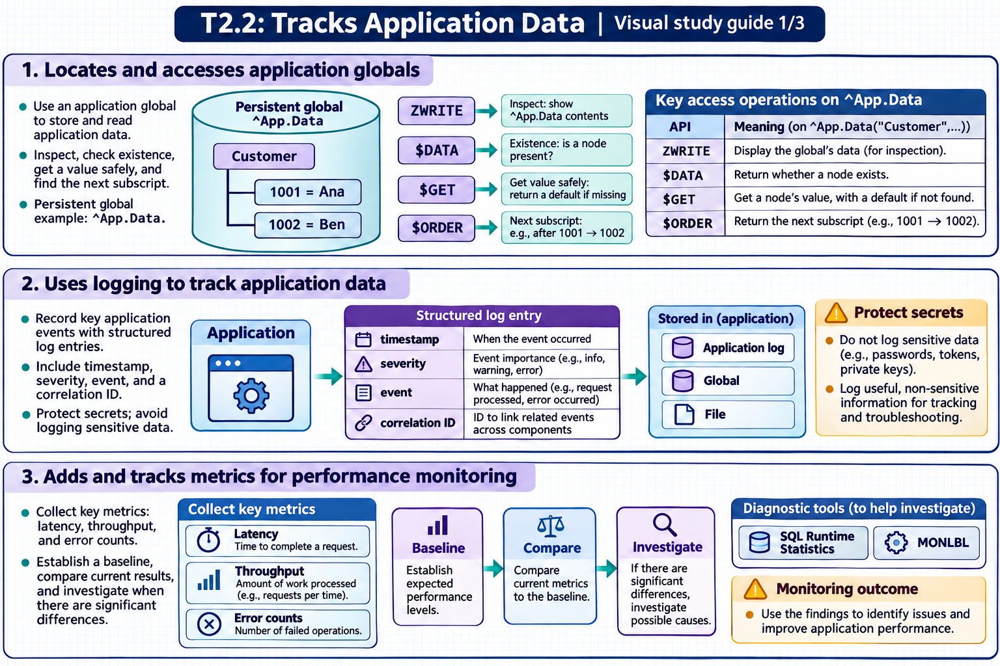
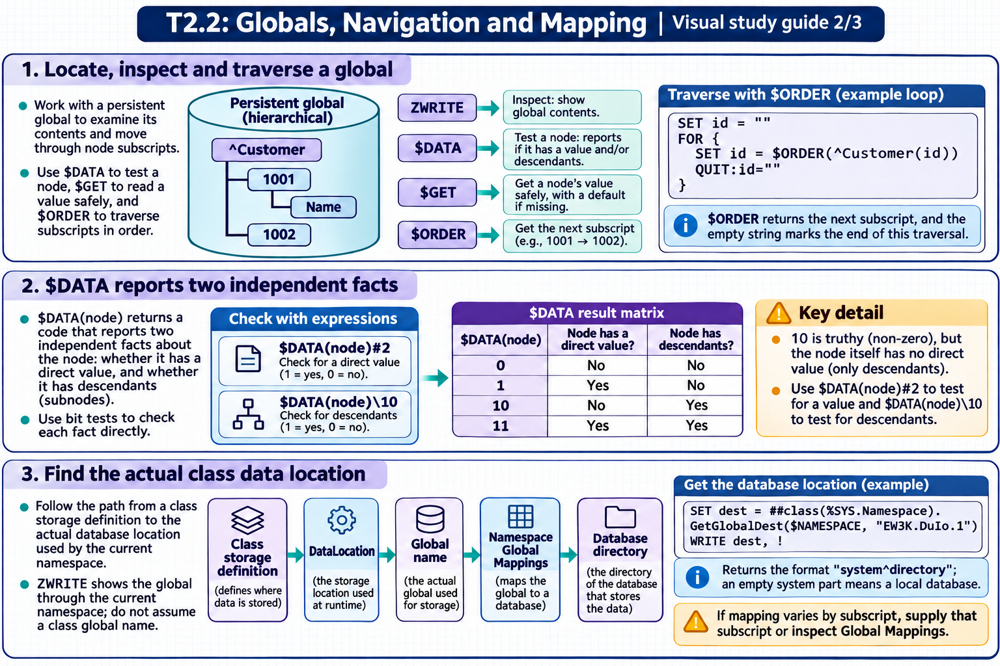
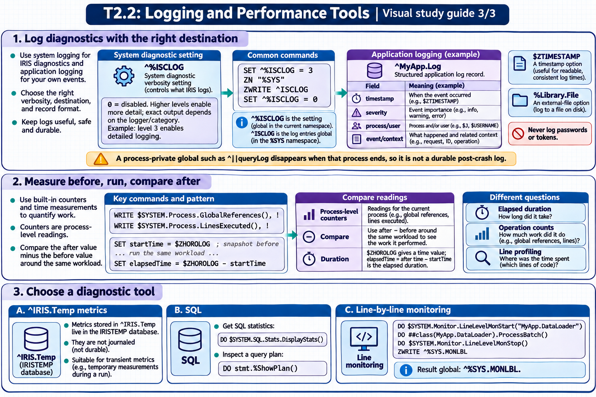

# T2.2: Tracks Application Data — visual study guides

[Approfondimenti dagli esercizi](<Approfondimenti esercizi/README.md>)

[Chapter contents](index.md) · [Full guide](study.md) · [Practice questions](quiz.md)

Generated learning summaries. Read the full notes for detailed explanations and exact code. [Technical review notes](../../visual-technical-notes.md).

## Visual guide — overview of sections 1–3

Covers:

- 1. Locates and accesses application globals
- 2. Uses logging to track application data
- 3. Adds and tracks metrics for performance monitoring

## Visual guide — globals, navigation and mapping

Covers:

- `ZWRITE`, `$DATA`, `$GET`, and `$ORDER`
- The distinction between a node's direct value and its descendants
- `DataLocation`, namespace global mappings, and `GetGlobalDest`

## Visual guide — logging and performance tools

Covers:

- Built-in diagnostics versus application logs and their storage locations
- `$SYSTEM.Process` counters and before/after measurements with `$ZHOROLOG`
- `^IRIS.Temp`, SQL statistics and query plans, and `^%SYS.MONLBL`
