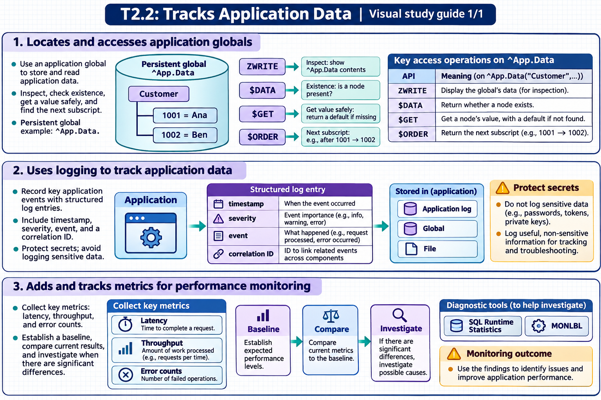

# T2.2: Tracks Application Data — visual study guides

[Approfondimenti dagli esercizi](<Approfondimenti esercizi/README.md>)

[Chapter contents](index.md) · [Full guide](study.md) · [Practice questions](quiz.md)

Generated learning summaries. Read the full notes for detailed explanations and exact code. [Technical review notes](../../visual-technical-notes.md).

## Visual guide — sections 1–3

Covers:

- 1. Locates and accesses application globals
- 2. Uses logging to track application data
- 3. Adds and tracks metrics for performance monitoring
