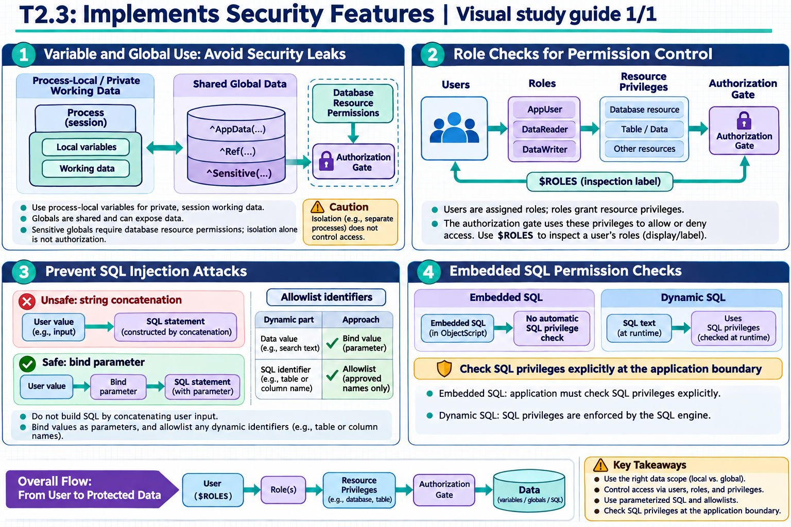

[Topic contents](../index.md) · [Full topic guide](../study.md) · [All topics](../../../index.md)

# T2.3: Implements Security Features

Saved 2 November 2026 from [exam-prep.es](https://exam-prep.es/exams/objectscript/knowledge/T2.3.html). Reference links require internet access.

## 2. Checks roles for permission control



*This diagram covers sections 1–4; use the matching numbered panel for this page.* [Chapter diagrams](../visuals.md) · [Technical review notes](../../../visual-technical-notes.md)

### Key Points

- **$ROLES**: Special variable containing a comma-delimited list of roles held by the current process
- **$SYSTEM.Security.Check()**: Programmatically checks if the current user holds a specific privilege on a resource
- **Requires keyword**: Method-level annotation that restricts execution to users with specific resources/privileges
- **%Admin_Manage, %DB_\*, %Development**: Common system resources used in permission checks
- **Application roles**: Custom roles that group privileges for application-specific access control

### Detailed Notes

#### Checking Roles with $ROLES

$ROLES contains all roles assigned to the current user, including assigned roles and their cascading sub-roles:

```objectscript
 // Display current user's roles
 WRITE "$ROLES = ", $ROLES, !
 // Output example: %All,%Developer,MyApp.Admin,MyApp.User

 // Check for a specific role
 IF $LISTFIND($LISTFROMSTRING($ROLES), "MyApp.Admin") {
     WRITE "User is an administrator", !
 }

 // Alternative: simple string check (less precise due to substring matching)
 IF $ROLES [ "MyApp.Admin" {
     WRITE "User has admin role", !
 }
```

#### Using $SYSTEM.Security.Check()

$SYSTEM.Security.Check() verifies whether the current user has a specific permission on a named resource. This is the recommended approach for programmatic authorization checks:

```objectscript
 // Check if user has WRITE permission on a resource
 IF $SYSTEM.Security.Check("MyApp.PatientData", "WRITE") {
     // User is authorized to modify patient data
     SET ^Patient(id, "Name") = newName
 }
 ELSE {
     SET sc = $$$ERROR($$$AccessDenied)
     QUIT sc
 }

 // Check READ permission
 IF '$SYSTEM.Security.Check("MyApp.Reports", "READ") {
     WRITE "Access denied: insufficient privileges", !
     QUIT
 }
```

The permission argument can be: "READ", "WRITE", or "USE".

#### Method-Level Security with Requires

The Requires keyword on class methods restricts execution to users who hold the specified resource privilege:

```objectscript
/// Delete a patient record (admin only)
ClassMethod DeletePatient(id As %Integer) As %Status [ Requires = "MyApp.Admin:WRITE" ]
{
    SET sc = ##class(MyApp.Patient).%DeleteId(id)
    RETURN sc
}

/// View audit log (requires USE on the audit resource)
ClassMethod ViewAuditLog() As %Status [ Requires = "%Admin_Manage:USE" ]
{
    // Only users with %Admin_Manage:USE can execute this method
    // A <PROTECT> error is thrown if the user lacks the required privilege
    DO ..DisplayLog()
    RETURN $$$OK
}
```

If a user without the required privilege calls a method with Requires, a  error is generated.

#### Practical Authorization Pattern

```objectscript
ClassMethod ProcessOrder(orderId As %Integer) As %Status
{
    // Verify user has appropriate role
    IF '$SYSTEM.Security.Check("MyApp.Orders", "WRITE") {
        $$$ThrowStatus($$$ERROR($$$AccessDenied))
    }

    // Additional business-level role check
    IF $ROLES '[ "MyApp.OrderProcessor" {
        RETURN $$$ERROR($$$GeneralError, "Role MyApp.OrderProcessor required")
    }

    // Proceed with order processing
    TSTART
    TRY {
        // ... processing logic ...
        TCOMMIT
    }
    CATCH ex {
        TROLLBACK
        RETURN ex.AsStatus()
    }
    RETURN $$$OK
}
```

### Documentation References

- [$ROLES Special Variable](https://docs.intersystems.com/irislatest/csp/docbook/DocBook.UI.Page.cls?KEY=RCOS_vroles)
- [$SYSTEM.Security.Check](https://docs.intersystems.com/irislatest/csp/docbook/DocBook.UI.Page.cls?KEY=RCOS_vsystem_security)
- [Method Keywords - Requires](https://docs.intersystems.com/irislatest/csp/docbook/DocBook.UI.Page.cls?KEY=ROBJ_method_requires)
