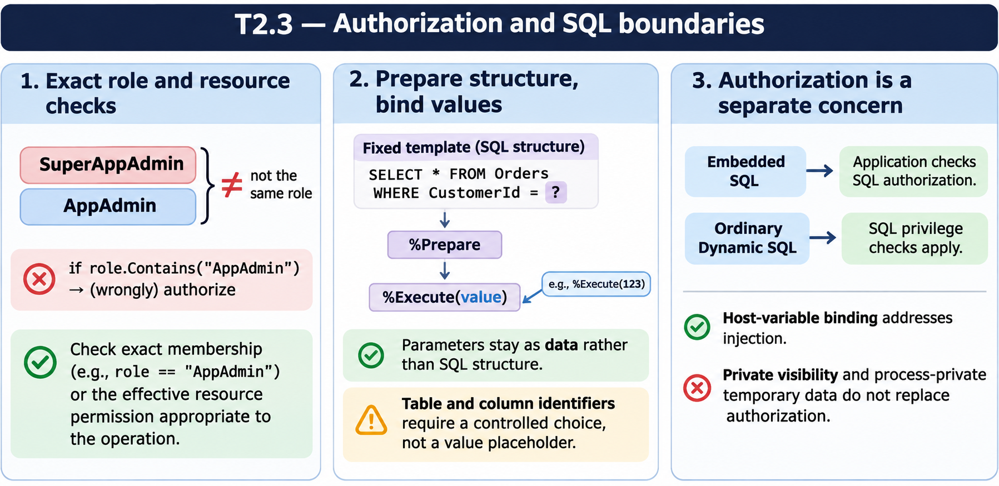

# T2.3 · 01 — Autorizzare un’operazione richiede una risorsa

[Indice degli approfondimenti](README.md) · [Quiz originale](../quiz.md) · [Teoria](../study.md)

**Esercizi di partenza:** [Q1](../quiz.md#question-1-single) · [Q2](../quiz.md#question-2-single) · [Q3](../quiz.md#question-3-single) · [Q4](../quiz.md#question-4-single) · [Q8](../quiz.md#question-8-single) · [Q9](../quiz.md#question-9-multiple). L’approfondimento rielabora il concetto e aggiunge una variante; non riproduce soltanto la risposta del quiz.

## Il caso concreto

AppAdmin cercato come sottostringa corrisponde anche a SuperAppAdmin. Il controllo non prova l’appartenenza esatta al ruolo né il privilegio richiesto.

```objectscript
ClassMethod Manage() As %Status [ Requires = "%App_Manage:RW" ]
{
  ; corpo del metodo protetto dalla risorsa
  return $$$OK
}
```

## Ragionamento passo per passo

Requires esprime il requisito di risorsa e viene controllato prima del corpo. Un controllo programmatico delle autorizzazioni permette invece di decidere come rappresentare il fallimento. Se cerchi un ruolo, usa un confronto esatto degli elementi e non una ricerca di sottostringa.

## Perché il distrattore è plausibile

Equivalere il nome di un ruolo al permesso effettivo, oppure ignorare la differenza fra eccezione e status restituito.

## Lo spunto da portare oltre l’esercizio

Definisci prima la capacità richiesta dall’operazione; poi scegli il punto e il modo in cui negarla.



*Leggi il pannello 1; gli altri due collegano il caso agli altri approfondimenti del capitolo.*

## Variante: prova prima di leggere la soluzione

“SuperAppAdmin” contiene “AppAdmin”: è una prova valida del ruolo AppAdmin?

<details>
<summary>Soluzione ragionata</summary>

No. È solo una corrispondenza testuale parziale.

</details>

## Riferimenti e precisazioni

- [Privilegi SQL](https://docs.intersystems.com/irislatest/csp/docbook/DocBook.UI.Page.cls?KEY=GSQL_privileges)
- [Dynamic SQL](https://docs.intersystems.com/irislatest/csp/docbook/DocBook.UI.Page.cls?KEY=GSQL_dynsql)
- [Requires](https://docs.intersystems.com/irislatest/csp/docbook/DocBook.UI.Page.cls?KEY=ROBJ_method_requires)

[Note specifiche del capitolo](README.md#precisazioni-rispetto-al-quiz) · [Metodo e limiti della revisione](../../../approfondimenti-esercizi.md#metodo-e-limiti)
