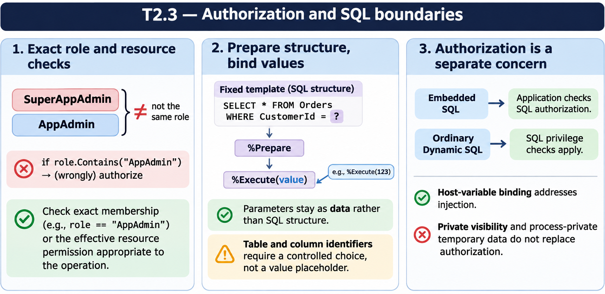

# T2.3 · 02 — Preparare SQL non corregge una concatenazione pericolosa

[Indice degli approfondimenti](README.md) · [Quiz originale](../quiz.md) · [Teoria](../study.md)

**Esercizi di partenza:** [Q5](../quiz.md#question-5-single) · [Q6](../quiz.md#question-6-single) · [Q14](../quiz.md#question-14-single) · [Q15](../quiz.md#question-15-multiple). L’approfondimento rielabora il concetto e aggiunge una variante; non riproduce soltanto la risposta del quiz.

## Il caso concreto

Il nome fornito dall’utente viene incollato nel testo SQL prima della preparazione. %Prepare riceve già una nuova struttura sintattica.

```objectscript
set sql = "SELECT Name FROM Patient WHERE Name = ?"
set stmt = ##class(%SQL.Statement).%New()
set sc = stmt.%Prepare(sql)
; controllare sc prima di eseguire
set rs = stmt.%Execute(userInput)
```

## Ragionamento passo per passo

Con il placeholder, lo schema SQL rimane fisso e userInput viene passato come valore. Una sequenza di apici e operatori resta un dato. Se è dinamico anche il nome della colonna, il binding dei valori non basta: la scelta dell’identificatore deve provenire da un insieme consentito.

## Perché il distrattore è plausibile

Dire che l’uso di %SQL.Statement rende sicura qualunque stringa oppure tentare di parametrizzare un identificatore come se fosse un valore.

## Lo spunto da portare oltre l’esercizio

Separa il codice della query dai dati; controlla indipendentemente le parti strutturali che restano dinamiche.



*Leggi il pannello 2; gli altri due collegano il caso agli altri approfondimenti del capitolo.*

## Variante: prova prima di leggere la soluzione

Hai WHERE Name=? ma concateni ORDER BY con testo libero. Il binding di Name protegge anche ORDER BY?

<details>
<summary>Soluzione ragionata</summary>

No: l’identificatore o la direzione vanno selezionati da valori consentiti.

</details>

## Riferimenti e precisazioni

- [Privilegi SQL](https://docs.intersystems.com/irislatest/csp/docbook/DocBook.UI.Page.cls?KEY=GSQL_privileges)
- [Dynamic SQL](https://docs.intersystems.com/irislatest/csp/docbook/DocBook.UI.Page.cls?KEY=GSQL_dynsql)
- [Requires](https://docs.intersystems.com/irislatest/csp/docbook/DocBook.UI.Page.cls?KEY=ROBJ_method_requires)

[Note specifiche del capitolo](README.md#precisazioni-rispetto-al-quiz) · [Metodo e limiti della revisione](../../../approfondimenti-esercizi.md#metodo-e-limiti)
