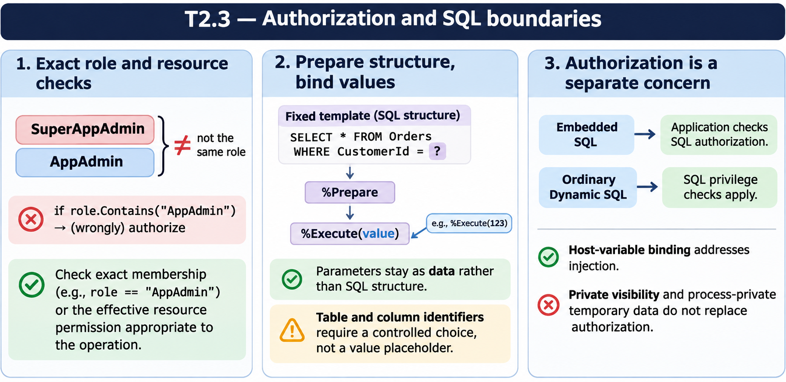

# T2.3 · 03 — SQL privilege e contesto di esecuzione

[Indice degli approfondimenti](README.md) · [Quiz originale](../quiz.md) · [Teoria](../study.md)

**Esercizi di partenza:** [Q7](../quiz.md#question-7-single) · [Q10](../quiz.md#question-10-single) · [Q11](../quiz.md#question-11-multiple) · [Q12](../quiz.md#question-12-single) · [Q13](../quiz.md#question-13-single). L’approfondimento rielabora il concetto e aggiunge una variante; non riproduce soltanto la risposta del quiz.

## Il caso concreto

L’utente ha SELECT ma non UPDATE. Il quiz propone un UPDATE Embedded SQL: i privilegi SQL non vengono verificati automaticamente in questo percorso.

## Ragionamento passo per passo

La documentazione attribuisce all’applicazione il controllo dei privilegi per Embedded SQL. L’assenza del controllo automatico SQL non annulla le altre autorizzazioni del sistema. Per Dynamic SQL ordinario i privilegi SQL sono invece applicati. Un REVOKE parziale da ALL non dimostra che resti soltanto SELECT.

## Perché il distrattore è plausibile

Generalizzare “l’utente non ha UPDATE” a ogni percorso di esecuzione o credere che ALL meno tre privilegi equivalga sempre a sola lettura.

## Lo spunto da portare oltre l’esercizio

L’autorizzazione dipende anche dal percorso; verifica i privilegi effettivi e il punto in cui sono applicati.

*Leggi il pannello 3; gli altri due collegano il caso agli altri approfondimenti del capitolo.*

## Variante: prova prima di leggere la soluzione

Una host variable :status rende un UPDATE Embedded SQL immune da ogni problema di autorizzazione?

Soluzione ragionata

No: binding dei valori e controllo dei privilegi risolvono problemi separati.

## Riferimenti e precisazioni

- [Privilegi SQL](https://docs.intersystems.com/irislatest/csp/docbook/DocBook.UI.Page.cls?KEY=GSQL_privileges)
- [Dynamic SQL](https://docs.intersystems.com/irislatest/csp/docbook/DocBook.UI.Page.cls?KEY=GSQL_dynsql)
- [Requires](https://docs.intersystems.com/irislatest/csp/docbook/DocBook.UI.Page.cls?KEY=ROBJ_method_requires)

[Note specifiche del capitolo](README.md#precisazioni-rispetto-al-quiz) · [Metodo e limiti della revisione](../../../approfondimenti-esercizi.md#metodo-e-limiti)
