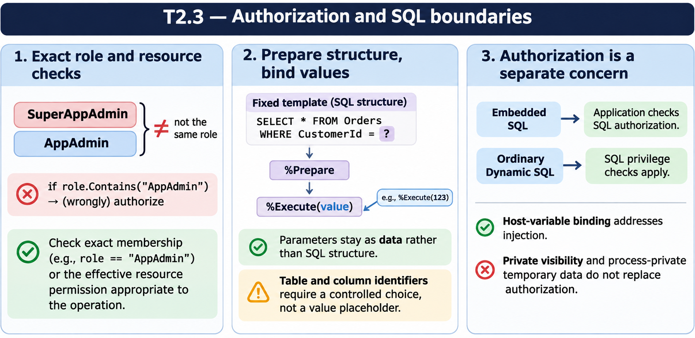
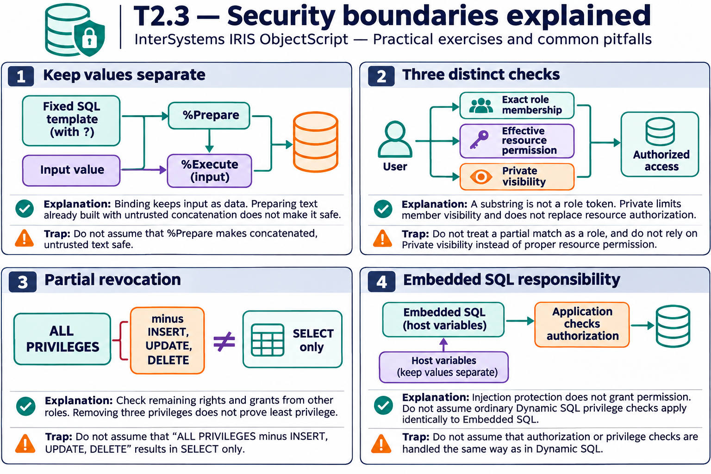

# T2.3 — Approfondimenti dagli esercizi

## Tutte le 15 domande approfondite

[Apri le schede domanda per domanda](<Domanda per domanda/README.md>) · [Tavole spiegate in inglese](tavole-esercizi.md)

Ogni domanda dispone ora di un commento specifico, un concetto ulteriore e una variante con soluzione. I tre casi seguenti sono percorsi tematici aggiuntivi. Le immagini sono in inglese.

[Teoria](../study.md) · [Quiz](../quiz.md) · [Tutti gli approfondimenti](../../../approfondimenti-esercizi.md)

Tre percorsi trasversali, da affiancare alle schede individuali, per capire il meccanismo dietro le risposte: scenario, ragionamento, distrattore, regola riutilizzabile e variante con soluzione. I riferimenti Q rimandano al quiz scaricato; la numerazione è locale al capitolo.

[Leggi esempi e spiegazioni dei pannelli](tavole-esercizi.md).

## Percorso consigliato

1. [Autorizzare un’operazione richiede una risorsa](<01 - Autorizzare un’operazione richiede una risorsa.md>) — Q1, Q2, Q3, Q4, Q8, Q9
2. [Preparare SQL non corregge una concatenazione pericolosa](<02 - Preparare SQL non corregge una concatenazione pericolosa.md>) — Q5, Q6, Q14, Q15
3. [SQL privilege e contesto di esecuzione](<03 - SQL privilege e contesto di esecuzione.md>) — Q7, Q10, Q11, Q12, Q13

[Indice di tutte le 15 domande del capitolo](mappa-domande.md). I percorsi sono tematici; ogni domanda ha inoltre una scheda individuale nella sottocartella dedicata.

## Precisazioni rispetto al quiz

Private limita l’accesso al metodo e non sostituisce l’autorizzazione a risorse. I PPG isolano processi ma non sono un confine universale contro amministratori o un sostituto della gestione dei segreti. La parametrizzazione protegge i valori, non nomi di tabella/colonna concatenati.

Queste precisazioni si applicano agli approfondimenti nuovi. Il testo delle risposte scaricate rimane una testimonianza della fonte e non viene riscritto silenziosamente.

## Documentazione

- [Privilegi SQL](https://docs.intersystems.com/irislatest/csp/docbook/DocBook.UI.Page.cls?KEY=GSQL_privileges)
- [Dynamic SQL](https://docs.intersystems.com/irislatest/csp/docbook/DocBook.UI.Page.cls?KEY=GSQL_dynsql)
- [Requires](https://docs.intersystems.com/irislatest/csp/docbook/DocBook.UI.Page.cls?KEY=ROBJ_method_requires)

Gli snippet sono frammenti didattici: quando usano classi di esempio o macro, presuppongono le relative definizioni e include. Non costituiscono implementazioni complete né sono stati eseguiti in IRIS.
