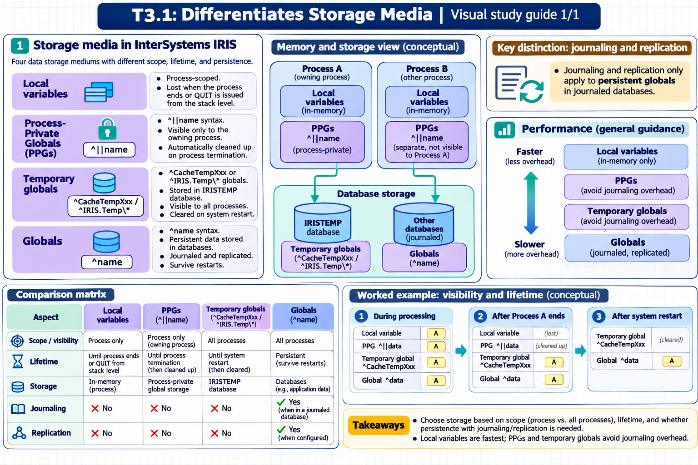

[Topic contents](../index.md) · [Full topic guide](../study.md) · [All topics](../../../index.md)

# T3.1: Differentiates Storage Media

Saved 2 November 2026 from [exam-prep.es](https://exam-prep.es/exams/objectscript/knowledge/T3.1.html). Reference links require internet access.

## 1. Differentiates between PPGs, variables, temporary globals, and globals



*This diagram covers section 1; use the matching numbered panel for this page.* [Chapter diagrams](../visuals.md) · [Technical review notes](../../../visual-technical-notes.md)

### Key Points

- **Local variables**: Process-scoped, lost when the process ends or QUIT is issued from the stack level
- **Process-Private Globals (PPGs)**: `^||name` syntax, visible only to the owning process, automatically cleaned up on process termination
- **Temporary globals**: `^CacheTempXxx` or `^IRIS.Temp\*` globals stored in IRISTEMP database, visible to all processes, cleared on system restart
- **Globals**: `^name` syntax, persistent data stored in databases, journaled, replicated, survive restarts
- **Key distinction**: Journaling and replication only apply to persistent globals in journaled databases
- **Performance**: PPGs and temporary globals avoid journaling overhead; local variables are fastest (in-memory only)

### Detailed Notes

#### Overview

InterSystems IRIS provides four distinct categories of data storage, each with different scope, lifetime, and visibility characteristics. Choosing the right storage medium is critical for application performance, correctness, and data integrity. The exam expects you to know when to use each type and understand their behavioral differences.

#### Local Variables

Local variables exist only within the current process memory (symbol table). They are the fastest form of storage because they never touch disk. Variables created with `SET` in a routine or method are local by default. They persist for the lifetime of the process unless explicitly killed or scoped with the `NEW` command. When `NEW` is used, the variable is stacked and restored when the execution level returns. Local variables are ideal for intermediate calculations, loop counters, and temporary data that does not need to survive beyond the current execution context.

```objectscript
SET name = "John"
SET count = 42
// These exist only in this process's symbol table
KILL name  // explicitly remove
```

#### Process-Private Globals (PPGs)

Process-Private Globals use the `^||` prefix (two pipes) and behave like globals in terms of subscript structure, but are visible only to the process that created them. They are stored in a process-private area and are automatically cleaned up when the process terminates. PPGs are **not journaled**, **not replicated**, and **not visible** to other processes. They are ideal for storing large intermediate result sets that exceed what local variables can comfortably hold, particularly when you need subscripted array structures.

```objectscript
// Process-Private Global - only this process can see it
SET ^||tempResults(1) = "First result"
SET ^||tempResults(2) = "Second result"
// Automatically cleaned up when process ends

// Can also use extended syntax with a database reference
SET ^|"^"|myPPG(1) = "value"
```

PPGs are particularly useful in SQL query processing, custom sort operations, and any scenario requiring large temporary data structures that should not interfere with other processes or persist beyond the current session.

#### Temporary Globals

Temporary globals are stored in the IRISTEMP database and use naming conventions like `^CacheTempXxxxx` or `^IRIS.Temp.*`. Unlike PPGs, temporary globals are **visible to all processes**, making them suitable for inter-process communication of transient data. They are **not journaled** and are **cleared when the system restarts**. The IRISTEMP database is specifically optimized for temporary storage with no journaling overhead.

```objectscript
// Temporary global - visible to all processes, cleared on restart
SET ^CacheTempMyApp($JOB, "key") = "shared temp value"

// Common pattern: use $JOB to partition by process
SET ^IRIS.Temp.MyApp($JOB, 1) = "process-specific temp data"

// Clean up when done (good practice even though restart clears them)
KILL ^CacheTempMyApp($JOB)
```

Because temporary globals are visible to all processes, the common practice is to include `$JOB` (process ID) as a top-level subscript to prevent collisions between processes.

#### Persistent Globals

Persistent globals (regular globals with `^` prefix) are the fundamental storage mechanism in InterSystems IRIS. They are stored in databases on disk, survive system restarts, and can be journaled and replicated. When stored in a journaled database, all changes are recorded in the journal for recovery purposes. In mirrored environments, journaled global changes are replicated to mirror members.

```objectscript
// Persistent global - survives restarts, journaled, replicated
SET ^Patient(12345, "Name") = "Smith, John"
SET ^Patient(12345, "DOB") = "1985-03-15"
// This data persists until explicitly removed
```

#### Comparison Summary

| Feature | Local Variables | PPGs (^||) | Temp Globals (^CacheTemp\*) | Globals (^name) |
| --- | --- | --- | --- | --- |
| Scope | Process only | Process only | All processes | All processes |
| Lifetime | Process/stack level | Process | Until restart | Permanent |
| Journaled | No | No | No | Yes (if DB is journaled) |
| Replicated | No | No | No | Yes (if mirrored) |
| Storage | Memory (symbol table) | Memory/IRISTEMP | IRISTEMP database | Named database |
| Performance | Fastest | Fast | Fast | Standard |

### Documentation References

- [Global Structure](https://docs.intersystems.com/irislatest/csp/docbook/DocBook.UI.Page.cls?KEY=GGBL_structure)
- [Process-Private Globals](https://docs.intersystems.com/irislatest/csp/docbook/DocBook.UI.Page.cls?KEY=GGBL_structure)
- [Variables in ObjectScript](https://docs.intersystems.com/irislatest/csp/docbook/DocBook.UI.Page.cls?KEY=GCOS_variables)
- [Temporary Globals and IRISTEMP](https://docs.intersystems.com/irislatest/csp/docbook/DocBook.UI.Page.cls?KEY=GGBL_structure)
