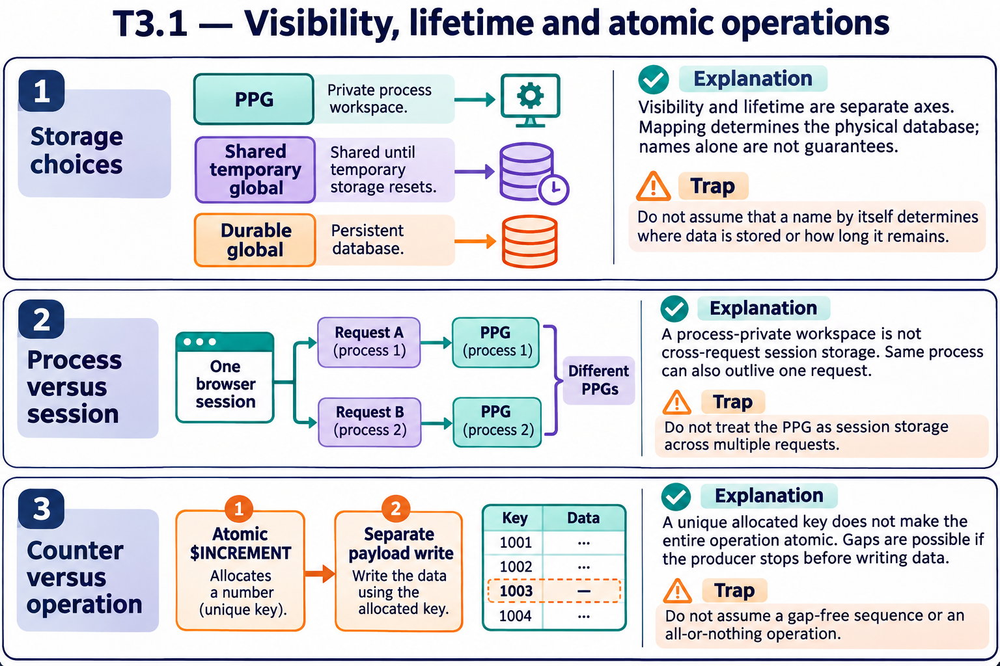

# T3.1 · 01 — Tre domande prima di scegliere lo storage

[Indice degli approfondimenti](README.md) · [Quiz originale](../quiz.md) · [Teoria](../study.md)

**Esercizi di partenza:** [Q1](../quiz.md#question-1-single) · [Q2](../quiz.md#question-2-single) · [Q5](../quiz.md#question-5-single) · [Q6](../quiz.md#question-6-single) · [Q8](../quiz.md#question-8-single) · [Q13](../quiz.md#question-13-single) · [Q15](../quiz.md#question-15-multiple). L’approfondimento rielabora il concetto e aggiunge una variante; non riproduce soltanto la risposta del quiz.

## Il caso concreto

Un parsing produce molti dati temporanei; una coda deve sopravvivere al processo. La dimensione non è l’unico criterio.

## Ragionamento passo per passo

Per ogni struttura specifica visibilità, durata e necessità di recupero. Un PPG permette dati di lavoro privati e viene eliminato a fine processo. Un global in database temporaneo può essere condiviso ma non offre durata attraverso il riavvio. Un global in database durevole è un candidato per una coda da conservare, con journaling e configurazione appropriati.

## Perché il distrattore è plausibile

Confondere condiviso con durevole o assumere che ogni nome con ^ significhi lo stesso tipo di persistenza.

## Lo spunto da portare oltre l’esercizio

Lo storage è una scelta di contratto: chi legge, quando viene eliminato, come si recupera.

*Leggi il pannello 1; gli altri due collegano il caso agli altri approfondimenti del capitolo.*

## Variante: prova prima di leggere la soluzione

Due processi devono condividere una cache ricostruibile. PPG è la scelta corretta?

Soluzione ragionata

No: è privato. Serve uno spazio condiviso con una durata compatibile con la cache.

## Riferimenti e precisazioni

- [Global e dati di processo](https://docs.intersystems.com/irislatest/csp/docbook/DocBook.UI.Page.cls?KEY=GCOS_globals)
- [Variabili e scope](https://docs.intersystems.com/irislatest/csp/docbook/DocBook.UI.Page.cls?KEY=GCOS_variables)

[Note specifiche del capitolo](README.md#precisazioni-rispetto-al-quiz) · [Metodo e limiti della revisione](../../../approfondimenti-esercizi.md#metodo-e-limiti)
