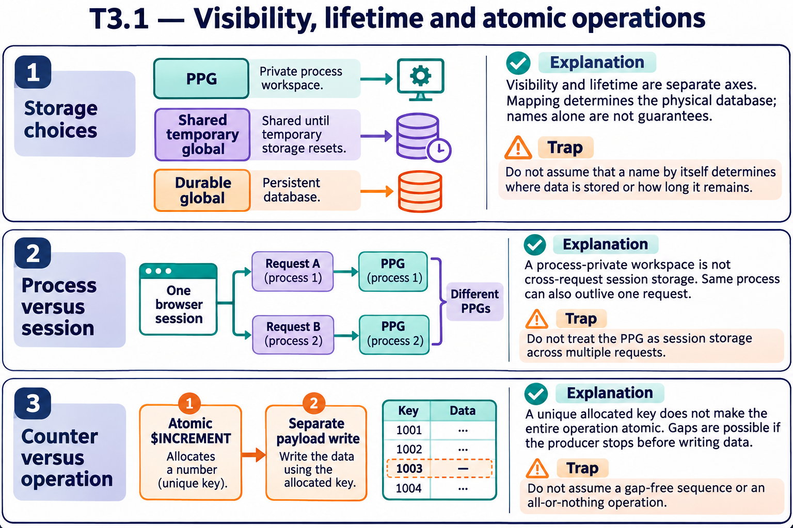

# T3.1 · 02 — Un processo non coincide con una sessione utente

[Indice degli approfondimenti](README.md) · [Quiz originale](../quiz.md) · [Teoria](../study.md)

**Esercizi di partenza:** [Q3](../quiz.md#question-3-single) · [Q4](../quiz.md#question-4-single) · [Q10](../quiz.md#question-10-single) · [Q12](../quiz.md#question-12-single) · [Q14](../quiz.md#question-14-single). L’approfondimento rielabora il concetto e aggiunge una variante; non riproduce soltanto la risposta del quiz.

## Il caso concreto

Due richieste web dello stesso utente possono essere servite da processi diversi. ^||sessionState non garantisce quindi continuità fra richieste.

## Ragionamento passo per passo

Il prefisso ^|| seleziona il contesto privato del processo corrente. Nel processo B, ^||counter è una struttura diversa da quella del processo A. Anche se i nomi sono identici, non sono lo stesso dato. Per lo stato di sessione usa un meccanismo legato all’identità della sessione e alla sua durata.

## Perché il distrattore è plausibile

Dedurre che due richieste dello stesso utente vedano lo stesso PPG oppure usare un contatore privato come totale di tutti i worker.

## Lo spunto da portare oltre l’esercizio

La chiave di isolamento va allineata all’entità logica: processo, sessione, utente o lavoro.

*Leggi il pannello 2; gli altri due collegano il caso agli altri approfondimenti del capitolo.*

## Variante: prova prima di leggere la soluzione

A incrementa ^||counter a 10. B legge il proprio ^||counter mai impostato: riceve 10?

Soluzione ragionata

No: nel contesto B quel nodo non è definito.

## Riferimenti e precisazioni

- [Global e dati di processo](https://docs.intersystems.com/irislatest/csp/docbook/DocBook.UI.Page.cls?KEY=GCOS_globals)
- [Variabili e scope](https://docs.intersystems.com/irislatest/csp/docbook/DocBook.UI.Page.cls?KEY=GCOS_variables)

[Note specifiche del capitolo](README.md#precisazioni-rispetto-al-quiz) · [Metodo e limiti della revisione](../../../approfondimenti-esercizi.md#metodo-e-limiti)
