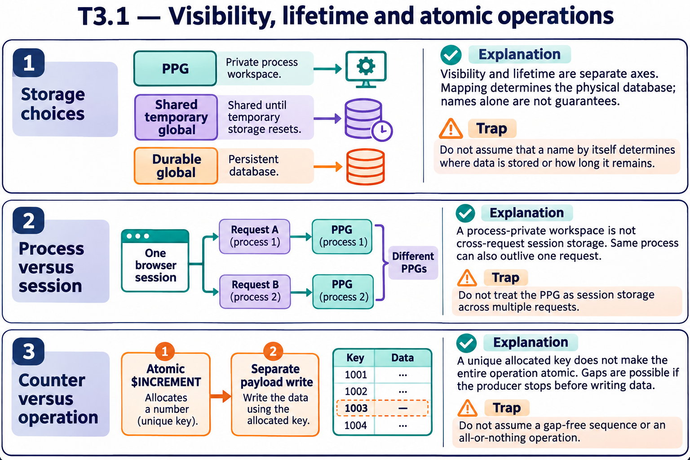

# T3.1 · 03 — Un contatore condiviso non rende atomico l’intero lavoro

[Indice degli approfondimenti](README.md) · [Quiz originale](../quiz.md) · [Teoria](../study.md)

**Esercizi di partenza:** [Q7](../quiz.md#question-7-single) · [Q9](../quiz.md#question-9-single) · [Q11](../quiz.md#question-11-single). L’approfondimento rielabora il concetto e aggiunge una variante; non riproduce soltanto la risposta del quiz.

## Il caso concreto

Più worker vogliono assegnare un identificativo a ogni elemento della coda.

```objectscript
set id = $INCREMENT(^QueueCounter)
set ^Queue(id) = payload
```

## Ragionamento passo per passo

$INCREMENT coordina l’allocazione sullo stesso nodo; il successivo SET è un’altra operazione. Un crash fra le due righe può lasciare un ID allocato senza elemento. La sopravvivenza di coda e contatore dipende dal database, dal journaling e dalla strategia di recupero, non dal solo incremento.

## Perché il distrattore è plausibile

Scambiare l’atomicità di una singola allocazione con una transazione completa o con una sequenza senza buchi.

## Lo spunto da portare oltre l’esercizio

Definisci separatamente identità, atomicità del payload e durata.



*Leggi il pannello 3; gli altri due collegano il caso agli altri approfondimenti del capitolo.*

## Variante: prova prima di leggere la soluzione

Un worker alloca 8 e termina prima del SET. Il prossimo ID deve per forza essere 8?

<details>
<summary>Soluzione ragionata</summary>

No: l’allocazione può lasciare un buco; non costruire il conteggio dei lavori dal massimo ID.

</details>

## Riferimenti e precisazioni

- [Global e dati di processo](https://docs.intersystems.com/irislatest/csp/docbook/DocBook.UI.Page.cls?KEY=GCOS_globals)
- [Variabili e scope](https://docs.intersystems.com/irislatest/csp/docbook/DocBook.UI.Page.cls?KEY=GCOS_variables)

[Note specifiche del capitolo](README.md#precisazioni-rispetto-al-quiz) · [Metodo e limiti della revisione](../../../approfondimenti-esercizi.md#metodo-e-limiti)
