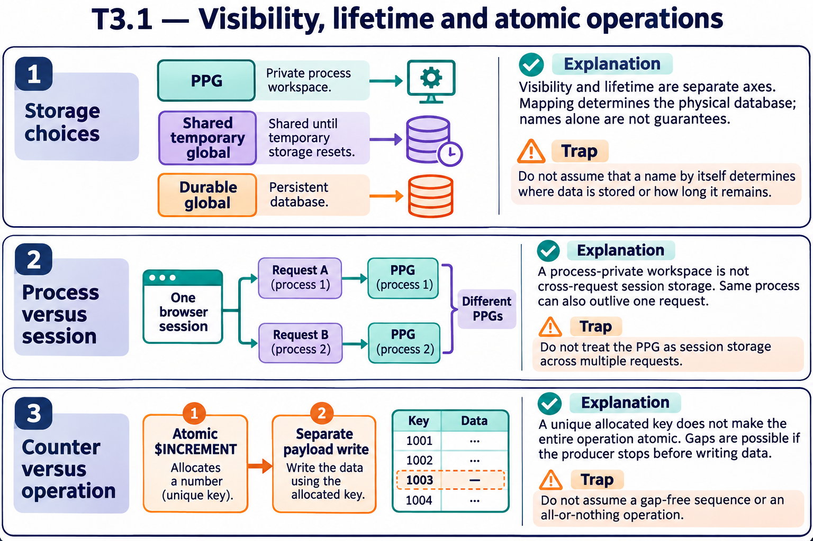
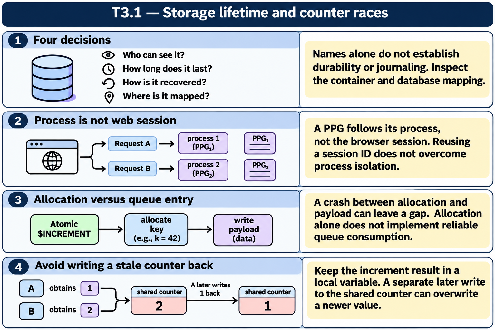

# T3.1 — Approfondimenti dagli esercizi

## Tutte le 15 domande approfondite

[Apri le schede domanda per domanda](<Domanda per domanda/README.md>) · [Tavole spiegate in inglese](tavole-esercizi.md)

Ogni domanda dispone ora di un commento specifico, un concetto ulteriore e una variante con soluzione. I tre casi seguenti sono percorsi tematici aggiuntivi. Le immagini sono in inglese.

[Teoria](../study.md) · [Quiz](../quiz.md) · [Tutti gli approfondimenti](../../../approfondimenti-esercizi.md)

Tre percorsi trasversali, da affiancare alle schede individuali, per capire il meccanismo dietro le risposte: scenario, ragionamento, distrattore, regola riutilizzabile e variante con soluzione. I riferimenti Q rimandano al quiz scaricato; la numerazione è locale al capitolo.

[Leggi esempi e spiegazioni dei pannelli](tavole-esercizi.md).

## Percorso consigliato

1. [Tre domande prima di scegliere lo storage](<01 - Tre domande prima di scegliere lo storage.md>) — Q1, Q2, Q5, Q6, Q8, Q13, Q15
2. [Un processo non coincide con una sessione utente](<02 - Un processo non coincide con una sessione utente.md>) — Q3, Q4, Q10, Q12, Q14
3. [Un contatore condiviso non rende atomico l’intero lavoro](<03 - Un contatore condiviso non rende atomico l’intero lavoro.md>) — Q7, Q9, Q11

[Indice di tutte le 15 domande del capitolo](mappa-domande.md). I percorsi sono tematici; ogni domanda ha inoltre una scheda individuale nella sottocartella dedicata.

## Precisazioni rispetto al quiz

I mapping dei global temporanei dipendono dalla configurazione: un prefisso da solo non prova la destinazione fisica. Un locale non scompare a ogni QUIT: la durata dipende da scope/procedure/NEW. I PPG durano quanto il processo, non quanto una sessione web logica.

Queste precisazioni si applicano agli approfondimenti nuovi. Il testo delle risposte scaricate rimane una testimonianza della fonte e non viene riscritto silenziosamente.

## Documentazione

- [Global e dati di processo](https://docs.intersystems.com/irislatest/csp/docbook/DocBook.UI.Page.cls?KEY=GCOS_globals)
- [Variabili e scope](https://docs.intersystems.com/irislatest/csp/docbook/DocBook.UI.Page.cls?KEY=GCOS_variables)

Gli snippet sono frammenti didattici: quando usano classi di esempio o macro, presuppongono le relative definizioni e include. Non costituiscono implementazioni complete né sono stati eseguiti in IRIS.
