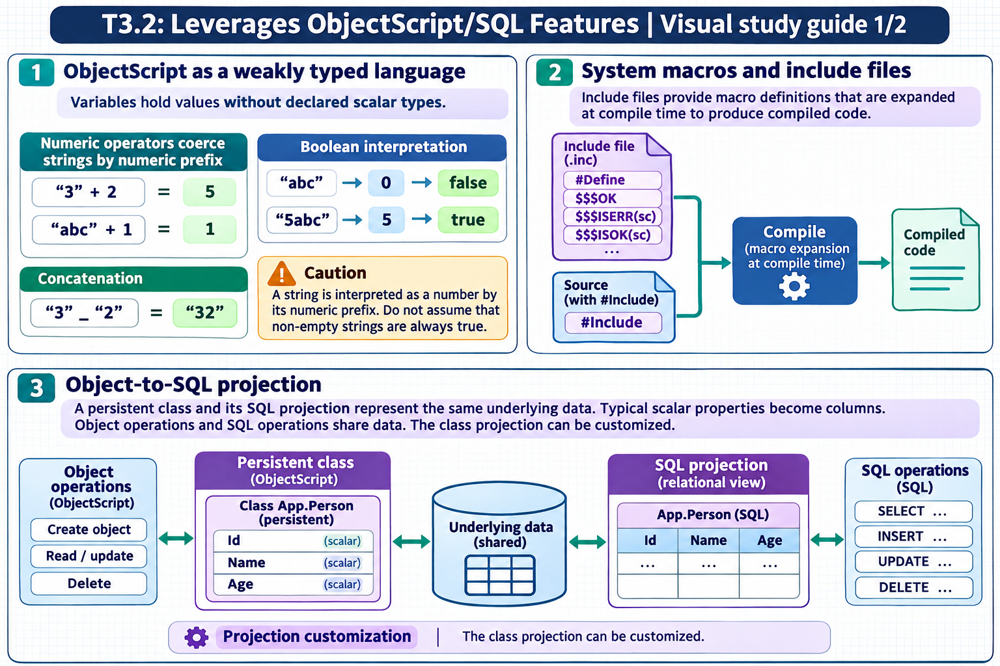

[Topic contents](../index.md) · [Full topic guide](../study.md) · [All topics](../../../index.md)

# T3.2: Leverages ObjectScript/SQL Features

Saved 2 November 2026 from [exam-prep.es](https://exam-prep.es/exams/objectscript/knowledge/T3.2.html). Reference links require internet access.

## 1. ObjectScript as a weakly typed language



*This diagram covers sections 1–3; use the matching numbered panel for this page.* [Chapter diagrams](../visuals.md) · [Technical review notes](../../../visual-technical-notes.md)

### Key Points

- **Weakly typed**: Variables have no declared type; the same variable can hold a string, number, or object reference
- **Automatic coercion**: ObjectScript converts between strings and numbers based on the operator used
- **String-to-number rule**: Leading numeric portion is extracted; non-numeric strings evaluate to 0
- **Arithmetic coercion**: `"3" + 2` evaluates to `5`; `"abc" + 1` evaluates to `1`; `"7dwarfs" + 3` evaluates to `10`
- **String concatenation**: Use `_` operator to concatenate; `3 _ 2` yields `"32"`
- **Boolean evaluation**: Empty string `""` and `0` are false; any non-zero numeric or non-empty string with leading non-zero numeric is true

### Detailed Notes

#### Overview

ObjectScript is a weakly (or loosely) typed language, meaning variables do not have fixed types. A variable that holds a number can later hold a string or an object reference without any declaration or casting. Type coercion happens automatically based on the context in which a value is used, particularly the operator being applied.

#### Numeric Coercion Rules

When ObjectScript encounters an arithmetic operator (`+`, `-`, `*`, `/`, `\`, `#`, `**`), it attempts to interpret operands as numbers. The conversion rule extracts the leading numeric portion of a string:

```objectscript
WRITE "3" + 2        // 5 (string "3" coerced to number 3)
WRITE "abc" + 1      // 1 ("abc" has no leading number, coerced to 0)
WRITE "7dwarfs" + 3  // 10 ("7dwarfs" leading numeric = 7)
WRITE "3.14xyz" + 0  // 3.14 (leading numeric portion extracted)
WRITE "" + 5         // 5 (empty string coerced to 0)
WRITE "  42" + 0     // 0 (leading space is NOT a digit, so numeric value is 0)
WRITE "1E2" + 0      // 100 (scientific notation is recognized)
WRITE "--5" + 0      // 0 (double negative not valid leading numeric)
```

#### String Concatenation

The concatenation operator `_` forces string context. Numbers are converted to their string representation:

```objectscript
WRITE 3 _ 2          // "32"
WRITE "Hello" _ " " _ "World"  // "Hello World"
WRITE 3.14 _ " pi"   // "3.14 pi"
```

#### Comparison Operators

ObjectScript provides separate operators for string and numeric comparison:

- **Numeric comparison**: `=`, `<`, `>`, `'=`, `'<`, `'>`. The `=` operator performs a NUMERIC comparison only when **both** operands are **canonical numbers** (i.e. their string forms already look like a number: no leading zeros, no leading `+`, no trailing `.0`, etc.). Otherwise it performs a STRING comparison.
- **String operators**: `[` (contains), `]` (follows/sorts after), `]]` (sorts after in collation)
- A string with a leading zero, a sign, or any non-digit prefix is NOT canonical, so comparing it to a number does a string compare: `"03" = 3` is FALSE because the strings "03" and "3" are not equal. To force numeric comparison, coerce with `+`: `+"03" = 3` is TRUE.

```objectscript
WRITE ("3"   = 3)    // 1 (true — both canonical numbers, numeric comparison)
WRITE ("03"  = 3)    // 0 (false — "03" is not canonical, string compare: "03" ≠ "3")
WRITE (+"03" = 3)    // 1 (true — + forces numeric interpretation, 3 = 3)
WRITE ("abc" = 0)    // 0 (false — "abc" is not canonical, string compare: "abc" ≠ "0")
WRITE ("abc" = "")   // 0 (false — string compare, "abc" ≠ "")
WRITE (0    = "")    // 0 (false — "" is not canonical, string compare: "0" ≠ "")
```

#### Boolean Context

In boolean context (IF, WHILE, etc.), ObjectScript evaluates values as: `0` and `""` are false; everything else that evaluates to non-zero is true:

```objectscript
IF "abc" { WRITE "truthy" }  // "abc" coerced to 0, so this is FALSE
IF "1abc" { WRITE "truthy" } // "1abc" coerced to 1, so this is TRUE
IF " " { WRITE "truthy" }   // " " coerced to 0, so this is FALSE
```

### Documentation References

- [Variables in ObjectScript](https://docs.intersystems.com/irislatest/csp/docbook/DocBook.UI.Page.cls?KEY=GCOS_variables)
- [Operators and Expressions](https://docs.intersystems.com/irislatest/csp/docbook/DocBook.UI.Page.cls?KEY=GCOS_operators)
- [String Relational Operators](https://docs.intersystems.com/irislatest/csp/docbook/DocBook.UI.Page.cls?KEY=GCOS_operators#GCOS_operators_string_relational)
