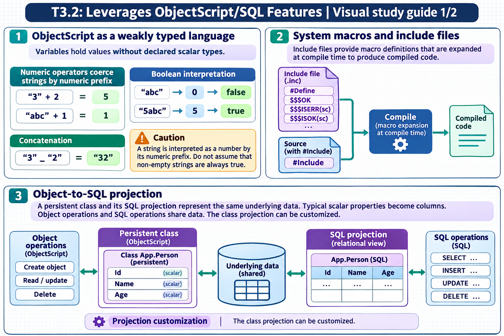

[Topic contents](../index.md) · [Full topic guide](../study.md) · [All topics](../../../index.md)

# T3.2: Leverages ObjectScript/SQL Features

Saved 2 November 2026 from [exam-prep.es](https://exam-prep.es/exams/objectscript/knowledge/T3.2.html). Reference links require internet access.

## 2. System macros and include files



*This diagram covers sections 1–3; use the matching numbered panel for this page.* [Chapter diagrams](../visuals.md) · [Technical review notes](../../../visual-technical-notes.md)

### Key Points

- **#Include directive**: Includes macro definitions from `.inc` files at compile time
- **Macro syntax**: `$$$macroName` for expression macros, `$$$macroName(args)` for parameterized macros
- **Common macros**: `$$$OK`, `$$$ISERR(sc)`, `$$$ThrowOnError(sc)`, `$$$ThrowStatus(sc)`, `$$$ISOK(sc)`
- **%Status pattern**: Methods return `%Status` values; check with `$$$ISERR` / `$$$ISOK` macros
- **#Define directive**: Creates custom macros within classes or include files
- **Include files location**: Stored as routines with `.inc` extension, typically in `%occStatus.inc`, `%occErrors.inc`

### Detailed Notes

#### Overview

ObjectScript uses a C-style preprocessor that processes directives at compile time. Macros provide reusable code fragments, constants, and standardized patterns. The include file mechanism allows sharing macro definitions across multiple classes and routines.

#### Include Files and #Include Directive

Include files have the `.inc` extension and contain macro definitions. They are included at compile time using the `#Include` directive, which must appear before the class definition or at the top of a routine:

```objectscript
#Include %occStatus
#Include %occErrors

Class MyApp.Service Extends %RegisteredObject
{
    // $$$OK, $$$ISERR, etc. are now available
}
```

Multiple include files can be included, and include files can themselves include other files. The `#IncludeGenerator` directive is used for macros needed in method generators.

#### Defining Macros

Use `#Define` to create macros. Expression macros return values; code macros expand to statements:

```objectscript
#Define AppName "MyApplication"
#Define MaxRetries 3
#Define Log(%msg) DO ##class(%SYS.System).WriteToConsoleLog(%msg)
#Define ThrowIfError(%sc) IF $$$ISERR(%sc) { THROW ##class(%Exception.StatusException).CreateFromStatus(%sc) }
```

#### Essential %Status Macros

The `%Status` system is central to InterSystems IRIS error handling. Most system methods return a `%Status` value:

```objectscript
#Include %occStatus

// Check status values
SET sc = obj.%Save()

// Using $$$ISOK / $$$ISERR
IF $$$ISERR(sc) {
    // Handle error
    SET errorText = $SYSTEM.Status.GetErrorText(sc)
    WRITE "Error: ", errorText, !
}

// $$$ThrowOnError - throws exception if status is error
SET sc = obj.%Save()
$$$ThrowOnError(sc)

// $$$OK - represents a successful status
RETURN $$$OK

// Creating error status
SET sc = $$$ERROR($$$GeneralError, "Something went wrong")

// Combining statuses
SET combinedSc = $SYSTEM.Status.AppendStatus(sc1, sc2)
```

#### Common Macro Reference

| Macro | Source | Purpose |
| --- | --- | --- |
| `$$$OK` | %occStatus.inc | Successful %Status value (literal `1`) |
| `$$$ISOK(sc)` | %occStatus.inc | Returns true if status is success |
| `$$$ISERR(sc)` | %occStatus.inc | Returns true if status is error |
| `$$$ThrowOnError(sc)` | %occStatus.inc | Throws exception if status is error |
| `$$$ThrowStatus(sc)` | %occStatus.inc | Throws a %Status as an exception unconditionally |
| `$$$ERROR(code,args...)` | %occErrors.inc | Creates an error %Status |
| `$$$GeneralError` | %occErrors.inc | Generic error code constant |
| `$$$NULLOREF` | %occStatus.inc | Empty object reference (`""`) |

#### Preprocessor Conditionals

The preprocessor also supports conditional compilation:

```objectscript
#IfDef DEBUG
    WRITE "Debug mode: variable = ", var, !
#Else
    // Production code - no debug output
#EndIf
```

### Documentation References

- [ObjectScript Macros and the Preprocessor](https://docs.intersystems.com/irislatest/csp/docbook/DocBook.UI.Page.cls?KEY=GCOS_macros)
- [#Include Directive](https://docs.intersystems.com/irislatest/csp/docbook/DocBook.UI.Page.cls?KEY=RCOS_pinclude)
- [#Define Directive](https://docs.intersystems.com/irislatest/csp/docbook/DocBook.UI.Page.cls?KEY=RCOS_pdefine)
- [%Status Values](https://docs.intersystems.com/irislatest/csp/docbook/DocBook.UI.Page.cls?KEY=GCOS_errors#GCOS_errors_status)
