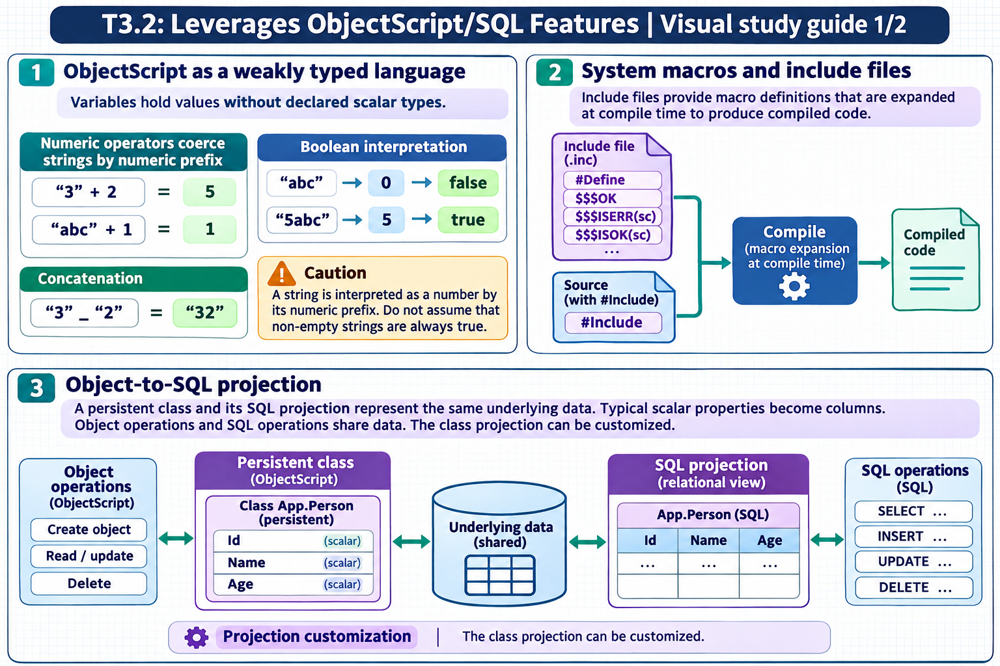

[Topic contents](../index.md) · [Full topic guide](../study.md) · [All topics](../../../index.md)

# T3.2: Leverages ObjectScript/SQL Features

Saved 2 November 2026 from [exam-prep.es](https://exam-prep.es/exams/objectscript/knowledge/T3.2.html). Reference links require internet access.

## 3. Object-to-SQL projection



*This diagram covers sections 1–3; use the matching numbered panel for this page.* [Chapter diagrams](../visuals.md) · [Technical review notes](../../../visual-technical-notes.md)

### Key Points

- **Class maps to table**: A `%Persistent` class automatically projects as a SQL table
- **Property maps to column**: Each property becomes a column in the projected table
- **Package maps to schema**: The package name becomes the SQL schema name (`.` replaced with `_`)
- **%Persistent required**: Only classes extending `%Persistent` get SQL table projection
- **ID column**: Every table has an implicit `ID` column from the object's `%ID()` (OID)
- **Naming**: `Package.ClassName` projects as `Package.ClassName` in SQL (with `_` for subpackages)

### Detailed Notes

#### Overview

InterSystems IRIS implements a unified data architecture where the same data is simultaneously accessible through object and relational (SQL) interfaces. When you define a persistent class, the system automatically generates a SQL table projection without any additional configuration. This dual access model is a fundamental differentiator of InterSystems IRIS.

#### Class-to-Table Mapping

Every class that extends `%Persistent` (directly or indirectly) is projected as a SQL table. The class definition serves as the single source of truth for both the object model and the relational schema:

```objectscript
Class MyApp.Data.Patient Extends %Persistent
{
    Property Name As %String(MAXLEN = 100);
    Property DOB As %Date;
    Property SSN As %String(MAXLEN = 11);
    Property Active As %Boolean;

    Index SSNIdx On SSN [ Unique ];
}
```

This class automatically projects as:

- **SQL Table**: `MyApp_Data.Patient`
- **Columns**: `ID`, `Name`, `DOB`, `SSN`, `Active`
- **Unique Index**: `SSNIdx` on `SSN` column

#### Naming Convention Mapping

| Object Concept | SQL Concept | Example |
| --- | --- | --- |
| Package | Schema | `MyApp.Data` → `MyApp_Data` |
| Class | Table | `Patient` → `Patient` |
| Property | Column | `Name` → `Name` |
| %Persistent class | Table with storage | Full projection |
| %RegisteredObject class | No table | Not projected |
| Relationship | Foreign key | Auto-generated |
| Index | SQL Index | Same name |
| Class method (SqlProc) | Stored Procedure | Callable from SQL |

#### Object vs SQL Access to Same Data

```objectscript
// Object access - create and save
SET patient = ##class(MyApp.Data.Patient).%New()
SET patient.Name = "Smith, John"
SET patient.DOB = $HOROLOG
SET patient.Active = 1
SET sc = patient.%Save()

// The saved data is immediately accessible via SQL
&sql(SELECT Name, DOB INTO :name, :dob
     FROM MyApp_Data.Patient
     WHERE ID = 1)

// SQL access - same underlying data
&sql(INSERT INTO MyApp_Data.Patient (Name, DOB, Active)
     VALUES ('Jones, Mary', CURRENT_DATE, 1))
// The inserted row is accessible as an object
SET patient2 = ##class(MyApp.Data.Patient).%OpenId(2)
WRITE patient2.Name  // "Jones, Mary"
```

#### The ID Column

Every projected table has an implicit `ID` column that corresponds to the object's internal ID. This is the value returned by `%Id()` and used by `%OpenId()`. By default, the system assigns auto-incrementing integer IDs, but this can be customized with `IdKey` index definitions.

### Documentation References

- [Object and SQL Unified Data Model](https://docs.intersystems.com/irislatest/csp/docbook/DocBook.UI.Page.cls?KEY=GOBJ_intro#GOBJ_intro_unified)
- [Tables and Classes](https://docs.intersystems.com/irislatest/csp/docbook/DocBook.UI.Page.cls?KEY=GSQL_tables)
- [Class Definitions and SQL Projections](https://docs.intersystems.com/irislatest/csp/docbook/DocBook.UI.Page.cls?KEY=GSQL_tables)
