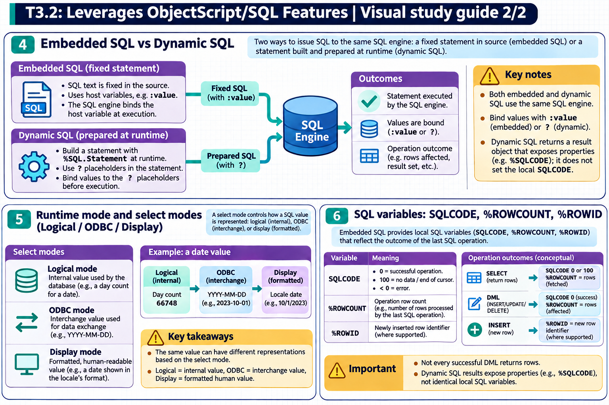

[Topic contents](../index.md) · [Full topic guide](../study.md) · [All topics](../../../index.md)

# T3.2: Leverages ObjectScript/SQL Features

Saved 2 November 2026 from [exam-prep.es](https://exam-prep.es/exams/objectscript/knowledge/T3.2.html). Reference links require internet access.

## 4. Embedded SQL vs Dynamic SQL



*This diagram covers sections 4–6; use the matching numbered panel for this page.* [Chapter diagrams](../visuals.md) · [Technical review notes](../../../visual-technical-notes.md)

### Key Points

- **Embedded SQL**: `&sql()` syntax, **deferred compilation** (compiled on first execution, not at class compile time), fixed query structure
- **Dynamic SQL**: `%SQL.Statement` class, prepared and executed at **runtime**, flexible query building
- **Host variables**: Embedded SQL uses `:variable` for input/output; Dynamic SQL uses `?` parameters
- **Performance**: Both use deferred/runtime compilation; Embedded SQL has simpler invocation syntax
- **Flexibility**: Dynamic SQL allows building queries from user input or configuration at runtime
- **SQLCODE**: Both set SQLCODE; Embedded SQL sets it directly, Dynamic SQL via result set methods

### Detailed Notes

#### Overview

InterSystems IRIS supports two primary methods of executing SQL from within ObjectScript: Embedded SQL and Dynamic SQL. Both use deferred compilation (SQL is compiled on first execution, not at class compile time). Understanding their differences, advantages, and appropriate use cases is essential for the exam.

#### Embedded SQL (&sql)

Embedded SQL is written directly in ObjectScript code using the `&sql()` syntax. The SQL statement uses **deferred compilation**: it is not compiled when the class/routine is compiled. Instead, the SQL is compiled upon its first execution at runtime. This means SQL syntax errors are only discovered at runtime, not during class compilation.

```objectscript
// Simple SELECT with host variables
SET patientId = 12345
&sql(SELECT Name, DOB INTO :name, :dob
     FROM MyApp_Data.Patient
     WHERE ID = :patientId)

IF SQLCODE = 0 {
    WRITE "Name: ", name, !
    WRITE "DOB: ", dob, !
} ELSEIF SQLCODE = 100 {
    WRITE "Patient not found", !
} ELSE {
    WRITE "SQL Error: ", SQLCODE, " - ", %msg, !
}

// Cursor-based query for multiple rows
&sql(DECLARE PatCursor CURSOR FOR
     SELECT Name, DOB FROM MyApp_Data.Patient
     WHERE Active = 1)
&sql(OPEN PatCursor)
FOR {
    &sql(FETCH PatCursor INTO :name, :dob)
    QUIT:SQLCODE'=0
    WRITE name, " - ", dob, !
}
&sql(CLOSE PatCursor)
```

**Advantages of Embedded SQL:**

- Simpler, more concise syntax for straightforward queries
- Query structure is fixed and clear in the code
- Host variables (`:var`) provide direct access to ObjectScript variables

**Limitations of Embedded SQL:**

- Query structure must be known at compile time
- Cannot dynamically change table names, column lists, or WHERE conditions
- Changes require recompilation

#### Dynamic SQL (%SQL.Statement)

Dynamic SQL uses the `%SQL.Statement` class to prepare and execute SQL statements at runtime. This provides maximum flexibility for building queries dynamically.

```objectscript
// Basic Dynamic SQL
SET stmt = ##class(%SQL.Statement).%New()
SET sc = stmt.%Prepare("SELECT Name, DOB FROM MyApp_Data.Patient WHERE ID = ?")
IF $$$ISERR(sc) {
    WRITE "Prepare error: ", $SYSTEM.Status.GetErrorText(sc), !
    QUIT
}

SET rs = stmt.%Execute(12345)
WHILE rs.%Next() {
    WRITE "Name: ", rs.%Get("Name"), !
    WRITE "DOB: ", rs.%Get("DOB"), !
}
IF rs.%SQLCODE < 0 {
    WRITE "SQL Error: ", rs.%SQLCODE, " - ", rs.%Message, !
}

// Dynamic query building
SET sql = "SELECT Name, DOB FROM MyApp_Data.Patient WHERE 1=1"
SET params = 0
IF activeOnly {
    SET sql = sql _ " AND Active = ?"
    SET params = params + 1
    SET params(params) = 1
}
IF nameFilter '= "" {
    SET sql = sql _ " AND Name LIKE ?"
    SET params = params + 1
    SET params(params) = nameFilter _ "%"
}

SET sc = stmt.%Prepare(sql)
// Execute with variable number of parameters
SET rs = stmt.%Execute(params...)
```

**Advantages of Dynamic SQL:**

- Query structure determined at runtime
- Can build queries dynamically based on user input
- No recompilation needed when query logic changes
- Better for ad-hoc reporting and search interfaces

**Limitations of Dynamic SQL:**

- Runtime preparation adds overhead
- SQL errors only discovered at runtime
- More verbose syntax

#### Comparison Table

| Feature | Embedded SQL | Dynamic SQL |
| --- | --- | --- |
| Syntax | `&sql(...)` | `%SQL.Statement` |
| Validation | Runtime (first execution) | Runtime (%Prepare) |
| Compilation | Deferred (first execution) | Runtime (%Prepare, cached) |
| Host variables | `:varName` | `?` placeholders |
| Flexibility | Fixed structure | Dynamic structure |
| Performance | Slightly faster | Preparation overhead |
| Error detection | Early (compile) | Late (runtime) |

### Documentation References

- [Embedded SQL](https://docs.intersystems.com/irislatest/csp/docbook/DocBook.UI.Page.cls?KEY=GSQL_esql)
- [Dynamic SQL with %SQL.Statement](https://docs.intersystems.com/irislatest/csp/docbook/DocBook.UI.Page.cls?KEY=GSQL_dynsql)
- [Using Host Variables](https://docs.intersystems.com/irislatest/csp/docbook/DocBook.UI.Page.cls?KEY=GSQL_esql#GSQL_esql_hostvars)
