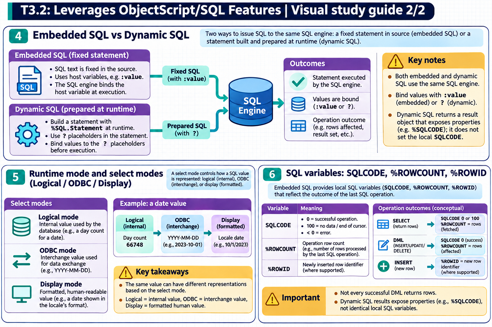

[Topic contents](../index.md) · [Full topic guide](../study.md) · [All topics](../../../index.md)

# T3.2: Leverages ObjectScript/SQL Features

Saved 2 November 2026 from [exam-prep.es](https://exam-prep.es/exams/objectscript/knowledge/T3.2.html). Reference links require internet access.

## 5. Runtime mode and select modes (Logical/ODBC/Display)



*This diagram covers sections 4–6; use the matching numbered panel for this page.* [Chapter diagrams](../visuals.md) · [Technical review notes](../../../visual-technical-notes.md)

### Key Points

- **Three modes**: Logical (internal storage), ODBC (standard interchange), Display (human-readable)
- **Logical mode**: Default for Embedded SQL and for Dynamic SQL (`%SQL.Statement`); values as stored internally (e.g., `%Date` as `$HOROLOG` integer)
- **ODBC mode**: Converts to standard formats (e.g., dates as `YYYY-MM-DD`); default for ODBC/JDBC connections
- **Display mode**: Converts to locale-specific display format (e.g., `MM/DD/YYYY`)
- **%SQL.Statement.%New(selectMode)**: Set mode at creation: 0=Logical, 1=ODBC, 2=Display
- **Conversion functions**: `%EXTERNAL()` (Display), `%ODBCOUT()` (ODBC), `%INTERNAL()` (Logical) for inline conversion

### Detailed Notes

#### Overview

InterSystems IRIS stores data internally in **logical** format for efficiency and processes it in one of three select modes depending on the consumer of the data. Understanding these modes is critical because returning data in the wrong mode can cause display errors, data misinterpretation, or application failures.

#### The Three Modes

**Logical Mode (Mode 0)**: Data as stored internally. Dates are `$HOROLOG` integers, booleans are `0`/`1`, and custom datatypes use their internal representation. This is the default mode for Embedded SQL and for Dynamic SQL alike: `%SelectMode` is 0 unless the process default has been changed with `$SYSTEM.SQL.Util.SetOption("SelectMode", n)`.

**ODBC Mode (Mode 1)**: Data converted to standard interchange format. Dates become `YYYY-MM-DD`, times become `HH:MM:SS`, and %List values become comma-separated strings. This is the default mode for ODBC/JDBC connections. Note that Dynamic SQL run from ObjectScript (`%SQL.Statement.%New()`) does NOT default to ODBC: you have to ask for it with `%New(1)` or by setting `%SelectMode` to 1.

**Display Mode (Mode 2)**: Data converted to human-readable, locale-specific format. Dates might become `03/05/2026` depending on locale settings.

```objectscript
// Embedded SQL defaults to Logical mode
&sql(SELECT DOB INTO :dob FROM MyApp_Data.Patient WHERE ID = 1)
WRITE dob  // 66841 ($HOROLOG integer)

// Dynamic SQL also defaults to Logical mode (mode 0)
SET stmt = ##class(%SQL.Statement).%New()
SET sc = stmt.%Prepare("SELECT DOB FROM MyApp_Data.Patient WHERE ID = 1")
SET rs = stmt.%Execute()
IF rs.%Next() {
    WRITE rs.%Get("DOB")  // 66841 (Logical format, $HOROLOG integer)
}

// Explicitly set mode to ODBC (1)
SET stmt = ##class(%SQL.Statement).%New(1)
SET sc = stmt.%Prepare("SELECT DOB FROM MyApp_Data.Patient WHERE ID = 1")
SET rs = stmt.%Execute()
IF rs.%Next() {
    WRITE rs.%Get("DOB")  // 2026-03-05 (ODBC format)
}

// Explicitly set mode to Display (2)
SET stmt = ##class(%SQL.Statement).%New(2)
SET sc = stmt.%Prepare("SELECT DOB FROM MyApp_Data.Patient WHERE ID = 1")
SET rs = stmt.%Execute()
IF rs.%Next() {
    WRITE rs.%Get("DOB")  // 03/05/2026 (Display format)
}
```

#### Inline Conversion Functions

You can convert individual columns within a query regardless of the select mode:

```objectscript
// In any mode, force specific conversion for one column
&sql(SELECT Name, %EXTERNAL(DOB), %ODBCOUT(DOB), DOB
     INTO :name, :dobDisplay, :dobODBC, :dobLogical
     FROM MyApp_Data.Patient WHERE ID = 1)

WRITE "Display: ", dobDisplay, !    // 03/05/2026
WRITE "ODBC: ", dobODBC, !          // 2026-03-05
WRITE "Logical: ", dobLogical, !    // 66841
```

| Function | Output Mode | Description |
| --- | --- | --- |
| `%EXTERNAL(col)` | Display | Locale-specific display format |
| `%ODBCOUT(col)` | ODBC | Standard interchange format |
| `%INTERNAL(col)` | Logical | Internal storage format |

#### Common Pitfalls

- Forgetting that Embedded SQL defaults to Logical mode and trying to display raw `$HOROLOG` values to users
- Assuming that Dynamic SQL defaults to ODBC mode: `%SQL.Statement` defaults to Logical (0), so `rs.%Get("DOB")` returns a `$HOROLOG` integer unless you pass 1 (ODBC) or 2 (Display) to `%New()` or set `%SelectMode`
- Using the wrong mode when comparing date values across Embedded and Dynamic SQL results

### Documentation References

- [Select Mode](https://docs.intersystems.com/irislatest/csp/docbook/DocBook.UI.Page.cls?KEY=GSQL_dynsql#GSQL_dynsql_selectmode)
- [%EXTERNAL, %INTERNAL, %ODBCOUT Functions](https://docs.intersystems.com/irislatest/csp/docbook/DocBook.UI.Page.cls?KEY=RSQL_external)
- [Data Display Options](https://docs.intersystems.com/irislatest/csp/docbook/DocBook.UI.Page.cls?KEY=GOBJ_datatypes)
