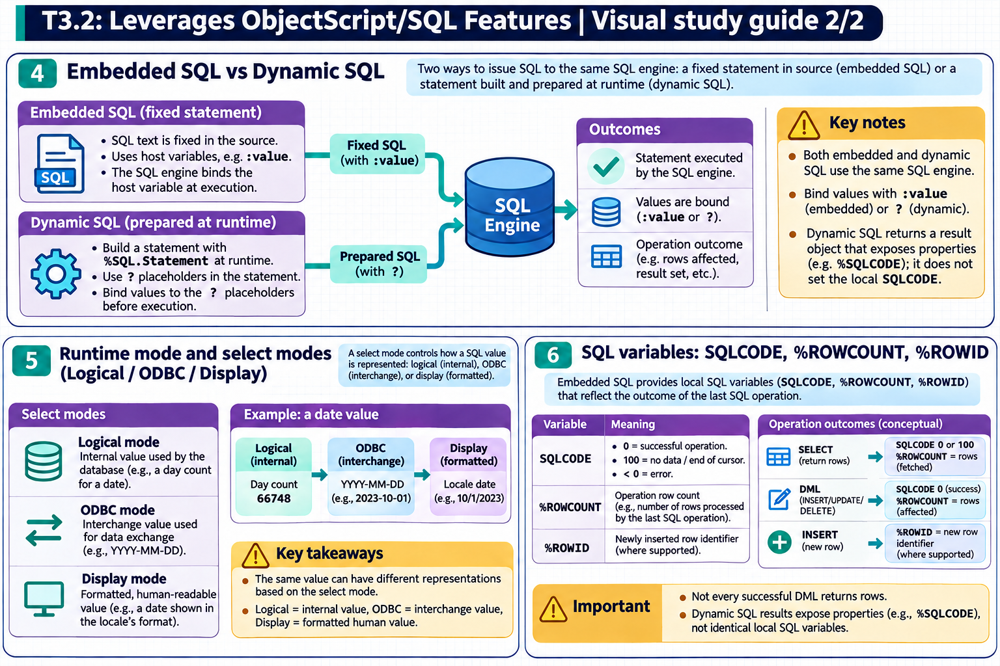

[Topic contents](../index.md) · [Full topic guide](../study.md) · [All topics](../../../index.md)

# T3.2: Leverages ObjectScript/SQL Features

Saved 2 November 2026 from [exam-prep.es](https://exam-prep.es/exams/objectscript/knowledge/T3.2.html). Reference links require internet access.

## 6. SQL variables: SQLCODE, %ROWCOUNT, %ROWID



*This diagram covers sections 4–6; use the matching numbered panel for this page.* [Chapter diagrams](../visuals.md) · [Technical review notes](../../../visual-technical-notes.md)

### Key Points

- **SQLCODE = 0**: Successful execution with data returned
- **SQLCODE = 100**: No more data (end of cursor, no matching row for SELECT INTO, successful INSERT/UPDATE/DELETE)
- **SQLCODE &lt; 0**: Error occurred; check `%msg` or `%Message` for details
- **%ROWCOUNT**: Number of rows affected by the last INSERT, UPDATE, DELETE, or FETCH operations
- **%ROWID**: Row ID of the last row affected by INSERT, UPDATE, or DELETE
- **Embedded vs Dynamic**: Embedded SQL sets `SQLCODE` and `%ROWCOUNT` as local variables; Dynamic SQL uses `rs.%SQLCODE` and `rs.%ROWCOUNT`

### Detailed Notes

#### Overview

After executing any SQL statement in InterSystems IRIS, several status variables are set to indicate the result. Understanding these variables and their values is critical for writing correct SQL-consuming code.

#### SQLCODE Values

```objectscript
// SQLCODE = 0: Success with data
&sql(SELECT Name INTO :name FROM MyApp_Data.Patient WHERE ID = 1)
IF SQLCODE = 0 {
    WRITE "Found: ", name, !
}

// SQLCODE = 100: No data found (SELECT INTO)
&sql(SELECT Name INTO :name FROM MyApp_Data.Patient WHERE ID = 99999)
IF SQLCODE = 100 {
    WRITE "Patient not found", !
}

// SQLCODE = 100 with cursors: No more rows to fetch
&sql(DECLARE C1 CURSOR FOR SELECT Name FROM MyApp_Data.Patient)
&sql(OPEN C1)
FOR {
    &sql(FETCH C1 INTO :name)
    QUIT:SQLCODE'=0    // SQLCODE=100 means no more rows
    WRITE name, !
}
&sql(CLOSE C1)

// SQLCODE < 0: Error
&sql(SELECT BadColumn INTO :x FROM MyApp_Data.Patient)
IF SQLCODE < 0 {
    WRITE "Error ", SQLCODE, ": ", %msg, !
}
```

#### SQLCODE for DML Statements

For INSERT, UPDATE, and DELETE statements:

- **SQLCODE = 0**: Statement executed successfully, rows were affected
- **SQLCODE = 100**: Statement executed successfully, but no rows were affected (e.g., UPDATE with no matching WHERE clause)
- **SQLCODE &lt; 0**: Error occurred

```objectscript
// %ROWCOUNT after DML
&sql(UPDATE MyApp_Data.Patient SET Active = 1 WHERE DOB > 50000)
WRITE "Rows updated: ", %ROWCOUNT, !
WRITE "SQLCODE: ", SQLCODE, !  // 0 if rows updated, 100 if no matches

// %ROWID after INSERT
&sql(INSERT INTO MyApp_Data.Patient (Name, Active) VALUES ('New Patient', 1))
IF SQLCODE = 0 {
    WRITE "New patient ID: ", %ROWID, !
    WRITE "Rows inserted: ", %ROWCOUNT, !  // 1
}
```

#### Dynamic SQL Status Variables

```objectscript
SET stmt = ##class(%SQL.Statement).%New()
SET sc = stmt.%Prepare("SELECT Name FROM MyApp_Data.Patient WHERE Active = ?")
SET rs = stmt.%Execute(1)

WHILE rs.%Next() {
    WRITE rs.%Get("Name"), !
}

// After iteration completes
WRITE "SQLCODE: ", rs.%SQLCODE, !      // 100 (no more rows)
WRITE "Rows: ", rs.%ROWCOUNT, !        // number of rows fetched

// For DML via Dynamic SQL
SET sc = stmt.%Prepare("UPDATE MyApp_Data.Patient SET Active = 0 WHERE ID = ?")
SET rs = stmt.%Execute(12345)
WRITE "SQLCODE: ", rs.%SQLCODE, !
WRITE "Rows affected: ", rs.%ROWCOUNT, !
```

#### Summary Table

| Variable | Context | Values | Purpose |
| --- | --- | --- | --- |
| `SQLCODE` | Embedded SQL | 0=success, 100=no data, &lt;0=error | Execution status |
| `rs.%SQLCODE` | Dynamic SQL | Same as above | Execution status |
| `%ROWCOUNT` | Embedded SQL | Integer &gt;= 0 | Rows affected/fetched |
| `rs.%ROWCOUNT` | Dynamic SQL | Integer &gt;= 0 | Rows affected/fetched |
| `%ROWID` | Embedded SQL | Row ID value | Last affected row ID |
| `%msg` | Embedded SQL | Error text | Error description |
| `rs.%Message` | Dynamic SQL | Error text | Error description |

### Documentation References

- [SQLCODE](https://docs.intersystems.com/irislatest/csp/docbook/DocBook.UI.Page.cls?KEY=RSQL_sqlcode)
- [%ROWCOUNT](https://docs.intersystems.com/irislatest/csp/docbook/DocBook.UI.Page.cls?KEY=RSQL_rowcount)
- [%ROWID](https://docs.intersystems.com/irislatest/csp/docbook/DocBook.UI.Page.cls?KEY=RSQL_rowid)
- [Embedded SQL Error Handling](https://docs.intersystems.com/irislatest/csp/docbook/DocBook.UI.Page.cls?KEY=GSQL_esql#GSQL_esql_errors)
