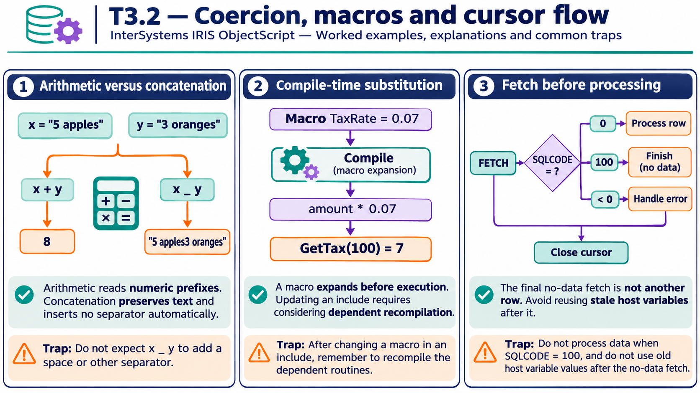

# T3.2 · 01 — L’operatore decide come interpretare il dato

[Indice degli approfondimenti](README.md) · [Quiz originale](../quiz.md) · [Teoria](../study.md)

**Esercizi di partenza:** [Q1](../quiz.md#question-1-single) · [Q4](../quiz.md#question-4-single) · [Q11](../quiz.md#question-11-single) · [Q15](../quiz.md#question-15-single). L’approfondimento rielabora il concetto e aggiunge una variante; non riproduce soltanto la risposta del quiz.

## Il caso concreto

"5 apples" e "3 oranges" sono stringhe, ma + richiede una conversione numerica mentre _ concatena.

```objectscript
set x = "5 apples", y = "3 oranges"
write x + y, !
write x _ y
```

## Ragionamento passo per passo

Con + vengono usati i prefissi numerici 5 e 3: risultato 8. Con _ i testi restano interi: 5 apples3 oranges. "abc3.14" non ha un prefisso numerico utile e in quel contesto vale 0; non viene cercato il numero nel mezzo della stringa.

## Perché il distrattore è plausibile

Interpretare + come concatenazione oppure pensare che qualunque cifra contenuta nel testo venga estratta.

## Lo spunto da portare oltre l’esercizio

Una conversione permissiva è una regola di valutazione, non una validazione dell’input.



*Leggi il pannello 1; gli altri due collegano il caso agli altri approfondimenti del capitolo.*

## Variante: prova prima di leggere la soluzione

Quanto vale "10abc20"+5? E "abc20"+5?

<details>
<summary>Soluzione ragionata</summary>

15 e 5: conta il prefisso, non la cifra nel mezzo.

</details>

## Riferimenti e precisazioni

- [Operatori](https://docs.intersystems.com/irislatest/csp/docbook/DocBook.UI.Page.cls?KEY=GCOS_operators)
- [Macro](https://docs.intersystems.com/irislatest/csp/docbook/DocBook.UI.Page.cls?KEY=GCOS_macros)
- [Variabili di contesto SQL](https://docs.intersystems.com/irislatest/csp/docbook/DocBook.UI.Page.cls?KEY=RSQL_variables)

[Note specifiche del capitolo](README.md#precisazioni-rispetto-al-quiz) · [Metodo e limiti della revisione](../../../approfondimenti-esercizi.md#metodo-e-limiti)
