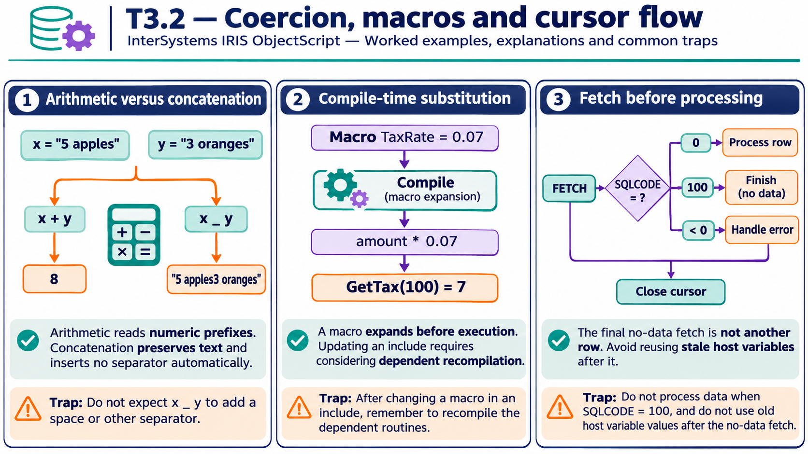

# T3.2 · 02 — Le macro appartengono alla compilazione

[Indice degli approfondimenti](README.md) · [Quiz originale](../quiz.md) · [Teoria](../study.md)

**Esercizi di partenza:** [Q3](../quiz.md#question-3-single) · [Q6](../quiz.md#question-6-single) · [Q12](../quiz.md#question-12-single). L’approfondimento rielabora il concetto e aggiunge una variante; non riproduce soltanto la risposta del quiz.

## Il caso concreto

TaxRate viene definita nell’include e sostituita nel codice prima dell’esecuzione.

```objectscript
Include MyApp.Constants

Class MyApp.Tax
{
ClassMethod GetTax(amount As %Numeric) As %Numeric
{
  return amount * $$$TaxRate
}
}
```

## Ragionamento passo per passo

Con #Define TaxRate 0.07 nel file include, la formula compilata usa 0.07. La chiamata con 100 restituisce 7. Se cambia il testo dell’include, il codice già compilato non diventa automaticamente una lettura dinamica di quel file: va gestita la ricompilazione dei dipendenti.

## Perché il distrattore è plausibile

Cercare una variabile runtime TaxRate oppure mettere un include nel punto sbagliato e credere di aver reso disponibile la macro a tutta la classe.

## Lo spunto da portare oltre l’esercizio

Distingui tempo di compilazione e tempo di esecuzione; gli errori di macro si diagnosticano nel primo.



*Leggi il pannello 2; gli altri due collegano il caso agli altri approfondimenti del capitolo.*

## Variante: prova prima di leggere la soluzione

Modifichi la macro a 0.08 ma non ricompili la classe. Puoi assumere che il prossimo GetTax usi il nuovo valore?

<details>
<summary>Soluzione ragionata</summary>

No: la sostituzione è avvenuta nella compilazione precedente.

</details>

## Riferimenti e precisazioni

- [Operatori](https://docs.intersystems.com/irislatest/csp/docbook/DocBook.UI.Page.cls?KEY=GCOS_operators)
- [Macro](https://docs.intersystems.com/irislatest/csp/docbook/DocBook.UI.Page.cls?KEY=GCOS_macros)
- [Variabili di contesto SQL](https://docs.intersystems.com/irislatest/csp/docbook/DocBook.UI.Page.cls?KEY=RSQL_variables)

[Note specifiche del capitolo](README.md#precisazioni-rispetto-al-quiz) · [Metodo e limiti della revisione](../../../approfondimenti-esercizi.md#metodo-e-limiti)
