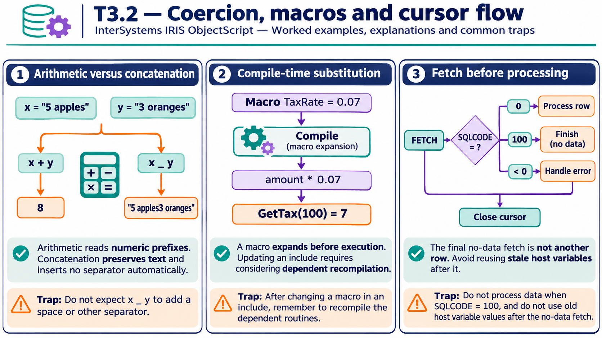

# T3.2 · 03 — Un cursore richiede stato, controllo e chiusura

[Indice degli approfondimenti](README.md) · [Quiz originale](../quiz.md) · [Teoria](../study.md)

**Esercizi di partenza:** [Q7](../quiz.md#question-7-single) · [Q10](../quiz.md#question-10-single) · [Q14](../quiz.md#question-14-single) · [Q16](../quiz.md#question-16-single). L’approfondimento rielabora il concetto e aggiunge una variante; non riproduce soltanto la risposta del quiz.

## Il caso concreto

Cinque FETCH riusciti vengono seguiti da un FETCH con SQLCODE=100. Il codice non deve elaborare una sesta riga inesistente.

## Ragionamento passo per passo

Per ogni FETCH controlla SQLCODE prima di usare gli host variable. 0 indica successo, 100 fine dati, un valore negativo un errore SQL. Nel caso del quiz il conteggio delle righe recuperate è 5. Gestisci OPEN e CLOSE anche nel percorso di errore; in Dynamic SQL osserva il risultato dell’oggetto, non assumere che tutti gli indicatori siano variabili locali Embedded SQL.

## Perché il distrattore è plausibile

Leggere i valori dopo il FETCH fallito o interpretare SQLCODE=100 come la stessa cosa di un errore negativo.

## Lo spunto da portare oltre l’esercizio

La condizione di terminazione deve precedere l’elaborazione del valore corrente.

*Leggi il pannello 3; gli altri due collegano il caso agli altri approfondimenti del capitolo.*

## Variante: prova prima di leggere la soluzione

Il primo FETCH restituisce 100. Quante righe elabori?

Soluzione ragionata

Zero. Non usare i precedenti valori delle variabili come se fossero una riga valida.

## Riferimenti e precisazioni

- [Operatori](https://docs.intersystems.com/irislatest/csp/docbook/DocBook.UI.Page.cls?KEY=GCOS_operators)
- [Macro](https://docs.intersystems.com/irislatest/csp/docbook/DocBook.UI.Page.cls?KEY=GCOS_macros)
- [Variabili di contesto SQL](https://docs.intersystems.com/irislatest/csp/docbook/DocBook.UI.Page.cls?KEY=RSQL_variables)

[Note specifiche del capitolo](README.md#precisazioni-rispetto-al-quiz) · [Metodo e limiti della revisione](../../../approfondimenti-esercizi.md#metodo-e-limiti)
