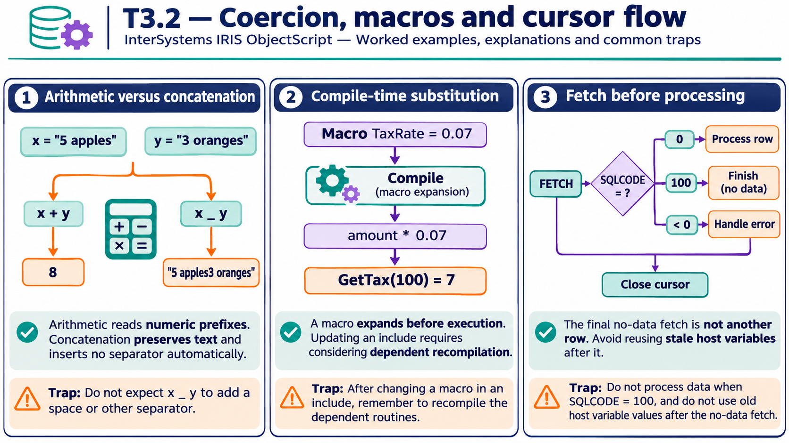
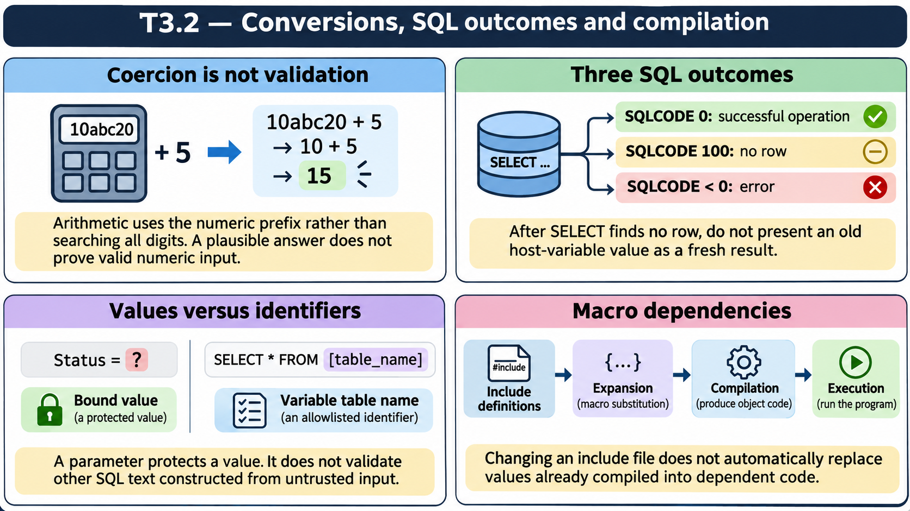

# T3.2 — Approfondimenti dagli esercizi

## Tutte le 17 domande approfondite

[Apri le schede domanda per domanda](<Domanda per domanda/README.md>) · [Tavole spiegate in inglese](tavole-esercizi.md)

Ogni domanda dispone ora di un commento specifico, un concetto ulteriore e una variante con soluzione. I tre casi seguenti sono percorsi tematici aggiuntivi. Le immagini sono in inglese.

[Teoria](../study.md) · [Quiz](../quiz.md) · [Tutti gli approfondimenti](../../../approfondimenti-esercizi.md)

Tre percorsi trasversali, da affiancare alle schede individuali, per capire il meccanismo dietro le risposte: scenario, ragionamento, distrattore, regola riutilizzabile e variante con soluzione. I riferimenti Q rimandano al quiz scaricato; la numerazione è locale al capitolo.

[Leggi esempi e spiegazioni dei pannelli](tavole-esercizi.md).

## Percorso consigliato

1. [L’operatore decide come interpretare il dato](<01 - L’operatore decide come interpretare il dato.md>) — Q1, Q4, Q11, Q15
2. [Le macro appartengono alla compilazione](<02 - Le macro appartengono alla compilazione.md>) — Q3, Q6, Q12
3. [Un cursore richiede stato, controllo e chiusura](<03 - Un cursore richiede stato, controllo e chiusura.md>) — Q7, Q10, Q14, Q16

[Indice di tutte le 17 domande del capitolo](mappa-domande.md). I percorsi sono tematici; ogni domanda ha inoltre una scheda individuale nella sottocartella dedicata.

## Precisazioni rispetto al quiz

Non dedurre il formato di tutti i risultati SQL dal solo esempio di host variable. Output logico/ODBC/display va verificato per interfaccia e modalità. Proiezione SQL e nomi dei campi possono essere personalizzati: non imporre una regola universale sulle classi.

Queste precisazioni si applicano agli approfondimenti nuovi. Il testo delle risposte scaricate rimane una testimonianza della fonte e non viene riscritto silenziosamente.

## Documentazione

- [Operatori](https://docs.intersystems.com/irislatest/csp/docbook/DocBook.UI.Page.cls?KEY=GCOS_operators)
- [Macro](https://docs.intersystems.com/irislatest/csp/docbook/DocBook.UI.Page.cls?KEY=GCOS_macros)
- [Variabili di contesto SQL](https://docs.intersystems.com/irislatest/csp/docbook/DocBook.UI.Page.cls?KEY=RSQL_variables)

Gli snippet sono frammenti didattici: quando usano classi di esempio o macro, presuppongono le relative definizioni e include. Non costituiscono implementazioni complete né sono stati eseguiti in IRIS.
