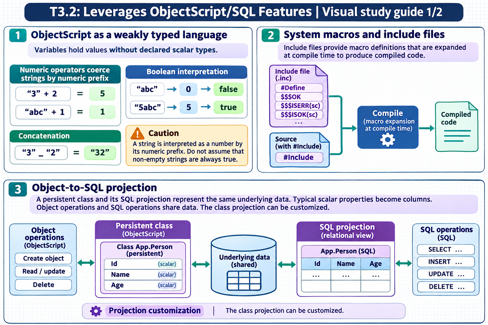
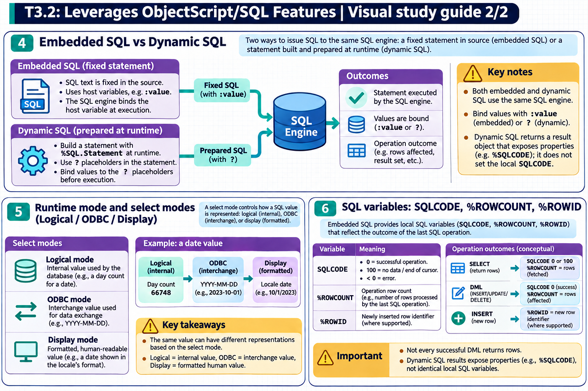

# T3.2: Leverages ObjectScript/SQL Features — visual study guides

[Approfondimenti dagli esercizi](<Approfondimenti esercizi/README.md>)

[Chapter contents](index.md) · [Full guide](study.md) · [Practice questions](quiz.md)

Generated learning summaries. Read the full notes for detailed explanations and exact code. [Technical review notes](../../visual-technical-notes.md).

## Visual guide — sections 1–3

Covers:

- 1. ObjectScript as a weakly typed language
- 2. System macros and include files
- 3. Object-to-SQL projection

## Visual guide — sections 4–6

Covers:

- 4. Embedded SQL vs Dynamic SQL
- 5. Runtime mode and select modes (Logical/ODBC/Display)
- 6. SQL variables: SQLCODE, %ROWCOUNT, %ROWID
