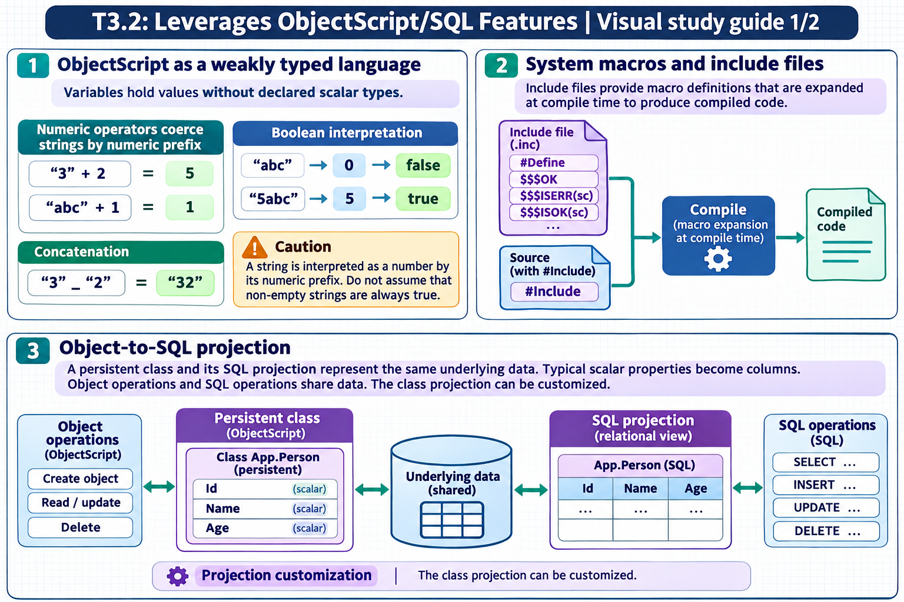
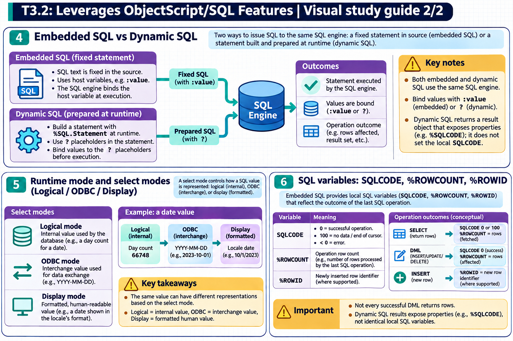

[All topics](../../index.md) · [Practice quiz](quiz.md)

# T3.2: Leverages ObjectScript/SQL Features

[Approfondimenti dagli esercizi](<Approfondimenti esercizi/README.md>)

Saved 2 November 2026 from [exam-prep.es](https://exam-prep.es/exams/objectscript/knowledge/T3.2.html). Reference links require internet access.

### Contents

1. [ObjectScript as a weakly typed language](#1-objectscript-as-a-weakly-typed-language)
2. [System macros and include files](#2-system-macros-and-include-files)
3. [Object-to-SQL projection](#3-object-to-sql-projection)
4. [Embedded SQL vs Dynamic SQL](#4-embedded-sql-vs-dynamic-sql)
5. [Runtime mode and select modes (Logical/ODBC/Display)](#5-runtime-mode-and-select-modes-logicalodbcdisplay)
6. [SQL variables: SQLCODE, %ROWCOUNT, %ROWID](#6-sql-variables-sqlcode-rowcount-rowid)

### Visual study guide — sections 1–3



[View all chapter diagrams](visuals.md) · [Technical review notes](../../visual-technical-notes.md)

## 1. ObjectScript as a weakly typed language

### Key Points

- **Weakly typed**: Variables have no declared type; the same variable can hold a string, number, or object reference
- **Automatic coercion**: ObjectScript converts between strings and numbers based on the operator used
- **String-to-number rule**: Leading numeric portion is extracted; non-numeric strings evaluate to 0
- **Arithmetic coercion**: `"3" + 2` evaluates to `5`; `"abc" + 1` evaluates to `1`; `"7dwarfs" + 3` evaluates to `10`
- **String concatenation**: Use `_` operator to concatenate; `3 _ 2` yields `"32"`
- **Boolean evaluation**: Empty string `""` and `0` are false; any non-zero numeric or non-empty string with leading non-zero numeric is true

### Detailed Notes

#### Overview

ObjectScript is a weakly (or loosely) typed language, meaning variables do not have fixed types. A variable that holds a number can later hold a string or an object reference without any declaration or casting. Type coercion happens automatically based on the context in which a value is used, particularly the operator being applied.

#### Numeric Coercion Rules

When ObjectScript encounters an arithmetic operator (`+`, `-`, `*`, `/`, `\`, `#`, `**`), it attempts to interpret operands as numbers. The conversion rule extracts the leading numeric portion of a string:

```objectscript
WRITE "3" + 2        // 5 (string "3" coerced to number 3)
WRITE "abc" + 1      // 1 ("abc" has no leading number, coerced to 0)
WRITE "7dwarfs" + 3  // 10 ("7dwarfs" leading numeric = 7)
WRITE "3.14xyz" + 0  // 3.14 (leading numeric portion extracted)
WRITE "" + 5         // 5 (empty string coerced to 0)
WRITE "  42" + 0     // 0 (leading space is NOT a digit, so numeric value is 0)
WRITE "1E2" + 0      // 100 (scientific notation is recognized)
WRITE "--5" + 0      // 0 (double negative not valid leading numeric)
```

#### String Concatenation

The concatenation operator `_` forces string context. Numbers are converted to their string representation:

```objectscript
WRITE 3 _ 2          // "32"
WRITE "Hello" _ " " _ "World"  // "Hello World"
WRITE 3.14 _ " pi"   // "3.14 pi"
```

#### Comparison Operators

ObjectScript provides separate operators for string and numeric comparison:

- **Numeric comparison**: `=`, `<`, `>`, `'=`, `'<`, `'>`. The `=` operator performs a NUMERIC comparison only when **both** operands are **canonical numbers** (i.e. their string forms already look like a number: no leading zeros, no leading `+`, no trailing `.0`, etc.). Otherwise it performs a STRING comparison.
- **String operators**: `[` (contains), `]` (follows/sorts after), `]]` (sorts after in collation)
- A string with a leading zero, a sign, or any non-digit prefix is NOT canonical, so comparing it to a number does a string compare: `"03" = 3` is FALSE because the strings "03" and "3" are not equal. To force numeric comparison, coerce with `+`: `+"03" = 3` is TRUE.

```objectscript
WRITE ("3"   = 3)    // 1 (true — both canonical numbers, numeric comparison)
WRITE ("03"  = 3)    // 0 (false — "03" is not canonical, string compare: "03" ≠ "3")
WRITE (+"03" = 3)    // 1 (true — + forces numeric interpretation, 3 = 3)
WRITE ("abc" = 0)    // 0 (false — "abc" is not canonical, string compare: "abc" ≠ "0")
WRITE ("abc" = "")   // 0 (false — string compare, "abc" ≠ "")
WRITE (0    = "")    // 0 (false — "" is not canonical, string compare: "0" ≠ "")
```

#### Boolean Context

In boolean context (IF, WHILE, etc.), ObjectScript evaluates values as: `0` and `""` are false; everything else that evaluates to non-zero is true:

```objectscript
IF "abc" { WRITE "truthy" }  // "abc" coerced to 0, so this is FALSE
IF "1abc" { WRITE "truthy" } // "1abc" coerced to 1, so this is TRUE
IF " " { WRITE "truthy" }   // " " coerced to 0, so this is FALSE
```

### Documentation References

- [Variables in ObjectScript](https://docs.intersystems.com/irislatest/csp/docbook/DocBook.UI.Page.cls?KEY=GCOS_variables)
- [Operators and Expressions](https://docs.intersystems.com/irislatest/csp/docbook/DocBook.UI.Page.cls?KEY=GCOS_operators)
- [String Relational Operators](https://docs.intersystems.com/irislatest/csp/docbook/DocBook.UI.Page.cls?KEY=GCOS_operators#GCOS_operators_string_relational)

## 2. System macros and include files

### Key Points

- **#Include directive**: Includes macro definitions from `.inc` files at compile time
- **Macro syntax**: `$$$macroName` for expression macros, `$$$macroName(args)` for parameterized macros
- **Common macros**: `$$$OK`, `$$$ISERR(sc)`, `$$$ThrowOnError(sc)`, `$$$ThrowStatus(sc)`, `$$$ISOK(sc)`
- **%Status pattern**: Methods return `%Status` values; check with `$$$ISERR` / `$$$ISOK` macros
- **#Define directive**: Creates custom macros within classes or include files
- **Include files location**: Stored as routines with `.inc` extension, typically in `%occStatus.inc`, `%occErrors.inc`

### Detailed Notes

#### Overview

ObjectScript uses a C-style preprocessor that processes directives at compile time. Macros provide reusable code fragments, constants, and standardized patterns. The include file mechanism allows sharing macro definitions across multiple classes and routines.

#### Include Files and #Include Directive

Include files have the `.inc` extension and contain macro definitions. They are included at compile time using the `#Include` directive, which must appear before the class definition or at the top of a routine:

```objectscript
#Include %occStatus
#Include %occErrors

Class MyApp.Service Extends %RegisteredObject
{
    // $$$OK, $$$ISERR, etc. are now available
}
```

Multiple include files can be included, and include files can themselves include other files. The `#IncludeGenerator` directive is used for macros needed in method generators.

#### Defining Macros

Use `#Define` to create macros. Expression macros return values; code macros expand to statements:

```objectscript
#Define AppName "MyApplication"
#Define MaxRetries 3
#Define Log(%msg) DO ##class(%SYS.System).WriteToConsoleLog(%msg)
#Define ThrowIfError(%sc) IF $$$ISERR(%sc) { THROW ##class(%Exception.StatusException).CreateFromStatus(%sc) }
```

#### Essential %Status Macros

The `%Status` system is central to InterSystems IRIS error handling. Most system methods return a `%Status` value:

```objectscript
#Include %occStatus

// Check status values
SET sc = obj.%Save()

// Using $$$ISOK / $$$ISERR
IF $$$ISERR(sc) {
    // Handle error
    SET errorText = $SYSTEM.Status.GetErrorText(sc)
    WRITE "Error: ", errorText, !
}

// $$$ThrowOnError - throws exception if status is error
SET sc = obj.%Save()
$$$ThrowOnError(sc)

// $$$OK - represents a successful status
RETURN $$$OK

// Creating error status
SET sc = $$$ERROR($$$GeneralError, "Something went wrong")

// Combining statuses
SET combinedSc = $SYSTEM.Status.AppendStatus(sc1, sc2)
```

#### Common Macro Reference

| Macro | Source | Purpose |
| --- | --- | --- |
| `$$$OK` | %occStatus.inc | Successful %Status value (literal `1`) |
| `$$$ISOK(sc)` | %occStatus.inc | Returns true if status is success |
| `$$$ISERR(sc)` | %occStatus.inc | Returns true if status is error |
| `$$$ThrowOnError(sc)` | %occStatus.inc | Throws exception if status is error |
| `$$$ThrowStatus(sc)` | %occStatus.inc | Throws a %Status as an exception unconditionally |
| `$$$ERROR(code,args...)` | %occErrors.inc | Creates an error %Status |
| `$$$GeneralError` | %occErrors.inc | Generic error code constant |
| `$$$NULLOREF` | %occStatus.inc | Empty object reference (`""`) |

#### Preprocessor Conditionals

The preprocessor also supports conditional compilation:

```objectscript
#IfDef DEBUG
    WRITE "Debug mode: variable = ", var, !
#Else
    // Production code - no debug output
#EndIf
```

### Documentation References

- [ObjectScript Macros and the Preprocessor](https://docs.intersystems.com/irislatest/csp/docbook/DocBook.UI.Page.cls?KEY=GCOS_macros)
- [#Include Directive](https://docs.intersystems.com/irislatest/csp/docbook/DocBook.UI.Page.cls?KEY=RCOS_pinclude)
- [#Define Directive](https://docs.intersystems.com/irislatest/csp/docbook/DocBook.UI.Page.cls?KEY=RCOS_pdefine)
- [%Status Values](https://docs.intersystems.com/irislatest/csp/docbook/DocBook.UI.Page.cls?KEY=GCOS_errors#GCOS_errors_status)

## 3. Object-to-SQL projection

### Key Points

- **Class maps to table**: A `%Persistent` class automatically projects as a SQL table
- **Property maps to column**: Each property becomes a column in the projected table
- **Package maps to schema**: The package name becomes the SQL schema name (`.` replaced with `_`)
- **%Persistent required**: Only classes extending `%Persistent` get SQL table projection
- **ID column**: Every table has an implicit `ID` column from the object's `%ID()` (OID)
- **Naming**: `Package.ClassName` projects as `Package.ClassName` in SQL (with `_` for subpackages)

### Detailed Notes

#### Overview

InterSystems IRIS implements a unified data architecture where the same data is simultaneously accessible through object and relational (SQL) interfaces. When you define a persistent class, the system automatically generates a SQL table projection without any additional configuration. This dual access model is a fundamental differentiator of InterSystems IRIS.

#### Class-to-Table Mapping

Every class that extends `%Persistent` (directly or indirectly) is projected as a SQL table. The class definition serves as the single source of truth for both the object model and the relational schema:

```objectscript
Class MyApp.Data.Patient Extends %Persistent
{
    Property Name As %String(MAXLEN = 100);
    Property DOB As %Date;
    Property SSN As %String(MAXLEN = 11);
    Property Active As %Boolean;

    Index SSNIdx On SSN [ Unique ];
}
```

This class automatically projects as:

- **SQL Table**: `MyApp_Data.Patient`
- **Columns**: `ID`, `Name`, `DOB`, `SSN`, `Active`
- **Unique Index**: `SSNIdx` on `SSN` column

#### Naming Convention Mapping

| Object Concept | SQL Concept | Example |
| --- | --- | --- |
| Package | Schema | `MyApp.Data` → `MyApp_Data` |
| Class | Table | `Patient` → `Patient` |
| Property | Column | `Name` → `Name` |
| %Persistent class | Table with storage | Full projection |
| %RegisteredObject class | No table | Not projected |
| Relationship | Foreign key | Auto-generated |
| Index | SQL Index | Same name |
| Class method (SqlProc) | Stored Procedure | Callable from SQL |

#### Object vs SQL Access to Same Data

```objectscript
// Object access - create and save
SET patient = ##class(MyApp.Data.Patient).%New()
SET patient.Name = "Smith, John"
SET patient.DOB = $HOROLOG
SET patient.Active = 1
SET sc = patient.%Save()

// The saved data is immediately accessible via SQL
&sql(SELECT Name, DOB INTO :name, :dob
     FROM MyApp_Data.Patient
     WHERE ID = 1)

// SQL access - same underlying data
&sql(INSERT INTO MyApp_Data.Patient (Name, DOB, Active)
     VALUES ('Jones, Mary', CURRENT_DATE, 1))
// The inserted row is accessible as an object
SET patient2 = ##class(MyApp.Data.Patient).%OpenId(2)
WRITE patient2.Name  // "Jones, Mary"
```

#### The ID Column

Every projected table has an implicit `ID` column that corresponds to the object's internal ID. This is the value returned by `%Id()` and used by `%OpenId()`. By default, the system assigns auto-incrementing integer IDs, but this can be customized with `IdKey` index definitions.

### Documentation References

- [Object and SQL Unified Data Model](https://docs.intersystems.com/irislatest/csp/docbook/DocBook.UI.Page.cls?KEY=GOBJ_intro#GOBJ_intro_unified)
- [Tables and Classes](https://docs.intersystems.com/irislatest/csp/docbook/DocBook.UI.Page.cls?KEY=GSQL_tables)
- [Class Definitions and SQL Projections](https://docs.intersystems.com/irislatest/csp/docbook/DocBook.UI.Page.cls?KEY=GSQL_tables)

### Visual study guide — sections 4–6



[View all chapter diagrams](visuals.md) · [Technical review notes](../../visual-technical-notes.md)

## 4. Embedded SQL vs Dynamic SQL

### Key Points

- **Embedded SQL**: `&sql()` syntax, **deferred compilation** (compiled on first execution, not at class compile time), fixed query structure
- **Dynamic SQL**: `%SQL.Statement` class, prepared and executed at **runtime**, flexible query building
- **Host variables**: Embedded SQL uses `:variable` for input/output; Dynamic SQL uses `?` parameters
- **Performance**: Both use deferred/runtime compilation; Embedded SQL has simpler invocation syntax
- **Flexibility**: Dynamic SQL allows building queries from user input or configuration at runtime
- **SQLCODE**: Both set SQLCODE; Embedded SQL sets it directly, Dynamic SQL via result set methods

### Detailed Notes

#### Overview

InterSystems IRIS supports two primary methods of executing SQL from within ObjectScript: Embedded SQL and Dynamic SQL. Both use deferred compilation (SQL is compiled on first execution, not at class compile time). Understanding their differences, advantages, and appropriate use cases is essential for the exam.

#### Embedded SQL (&sql)

Embedded SQL is written directly in ObjectScript code using the `&sql()` syntax. The SQL statement uses **deferred compilation**: it is not compiled when the class/routine is compiled. Instead, the SQL is compiled upon its first execution at runtime. This means SQL syntax errors are only discovered at runtime, not during class compilation.

```objectscript
// Simple SELECT with host variables
SET patientId = 12345
&sql(SELECT Name, DOB INTO :name, :dob
     FROM MyApp_Data.Patient
     WHERE ID = :patientId)

IF SQLCODE = 0 {
    WRITE "Name: ", name, !
    WRITE "DOB: ", dob, !
} ELSEIF SQLCODE = 100 {
    WRITE "Patient not found", !
} ELSE {
    WRITE "SQL Error: ", SQLCODE, " - ", %msg, !
}

// Cursor-based query for multiple rows
&sql(DECLARE PatCursor CURSOR FOR
     SELECT Name, DOB FROM MyApp_Data.Patient
     WHERE Active = 1)
&sql(OPEN PatCursor)
FOR {
    &sql(FETCH PatCursor INTO :name, :dob)
    QUIT:SQLCODE'=0
    WRITE name, " - ", dob, !
}
&sql(CLOSE PatCursor)
```

**Advantages of Embedded SQL:**

- Simpler, more concise syntax for straightforward queries
- Query structure is fixed and clear in the code
- Host variables (`:var`) provide direct access to ObjectScript variables

**Limitations of Embedded SQL:**

- Query structure must be known at compile time
- Cannot dynamically change table names, column lists, or WHERE conditions
- Changes require recompilation

#### Dynamic SQL (%SQL.Statement)

Dynamic SQL uses the `%SQL.Statement` class to prepare and execute SQL statements at runtime. This provides maximum flexibility for building queries dynamically.

```objectscript
// Basic Dynamic SQL
SET stmt = ##class(%SQL.Statement).%New()
SET sc = stmt.%Prepare("SELECT Name, DOB FROM MyApp_Data.Patient WHERE ID = ?")
IF $$$ISERR(sc) {
    WRITE "Prepare error: ", $SYSTEM.Status.GetErrorText(sc), !
    QUIT
}

SET rs = stmt.%Execute(12345)
WHILE rs.%Next() {
    WRITE "Name: ", rs.%Get("Name"), !
    WRITE "DOB: ", rs.%Get("DOB"), !
}
IF rs.%SQLCODE < 0 {
    WRITE "SQL Error: ", rs.%SQLCODE, " - ", rs.%Message, !
}

// Dynamic query building
SET sql = "SELECT Name, DOB FROM MyApp_Data.Patient WHERE 1=1"
SET params = 0
IF activeOnly {
    SET sql = sql _ " AND Active = ?"
    SET params = params + 1
    SET params(params) = 1
}
IF nameFilter '= "" {
    SET sql = sql _ " AND Name LIKE ?"
    SET params = params + 1
    SET params(params) = nameFilter _ "%"
}

SET sc = stmt.%Prepare(sql)
// Execute with variable number of parameters
SET rs = stmt.%Execute(params...)
```

**Advantages of Dynamic SQL:**

- Query structure determined at runtime
- Can build queries dynamically based on user input
- No recompilation needed when query logic changes
- Better for ad-hoc reporting and search interfaces

**Limitations of Dynamic SQL:**

- Runtime preparation adds overhead
- SQL errors only discovered at runtime
- More verbose syntax

#### Comparison Table

| Feature | Embedded SQL | Dynamic SQL |
| --- | --- | --- |
| Syntax | `&sql(...)` | `%SQL.Statement` |
| Validation | Runtime (first execution) | Runtime (%Prepare) |
| Compilation | Deferred (first execution) | Runtime (%Prepare, cached) |
| Host variables | `:varName` | `?` placeholders |
| Flexibility | Fixed structure | Dynamic structure |
| Performance | Slightly faster | Preparation overhead |
| Error detection | Early (compile) | Late (runtime) |

### Documentation References

- [Embedded SQL](https://docs.intersystems.com/irislatest/csp/docbook/DocBook.UI.Page.cls?KEY=GSQL_esql)
- [Dynamic SQL with %SQL.Statement](https://docs.intersystems.com/irislatest/csp/docbook/DocBook.UI.Page.cls?KEY=GSQL_dynsql)
- [Using Host Variables](https://docs.intersystems.com/irislatest/csp/docbook/DocBook.UI.Page.cls?KEY=GSQL_esql#GSQL_esql_hostvars)

## 5. Runtime mode and select modes (Logical/ODBC/Display)

### Key Points

- **Three modes**: Logical (internal storage), ODBC (standard interchange), Display (human-readable)
- **Logical mode**: Default for Embedded SQL and for Dynamic SQL (`%SQL.Statement`); values as stored internally (e.g., `%Date` as `$HOROLOG` integer)
- **ODBC mode**: Converts to standard formats (e.g., dates as `YYYY-MM-DD`); default for ODBC/JDBC connections
- **Display mode**: Converts to locale-specific display format (e.g., `MM/DD/YYYY`)
- **%SQL.Statement.%New(selectMode)**: Set mode at creation: 0=Logical, 1=ODBC, 2=Display
- **Conversion functions**: `%EXTERNAL()` (Display), `%ODBCOUT()` (ODBC), `%INTERNAL()` (Logical) for inline conversion

### Detailed Notes

#### Overview

InterSystems IRIS stores data internally in **logical** format for efficiency and processes it in one of three select modes depending on the consumer of the data. Understanding these modes is critical because returning data in the wrong mode can cause display errors, data misinterpretation, or application failures.

#### The Three Modes

**Logical Mode (Mode 0)**: Data as stored internally. Dates are `$HOROLOG` integers, booleans are `0`/`1`, and custom datatypes use their internal representation. This is the default mode for Embedded SQL and for Dynamic SQL alike: `%SelectMode` is 0 unless the process default has been changed with `$SYSTEM.SQL.Util.SetOption("SelectMode", n)`.

**ODBC Mode (Mode 1)**: Data converted to standard interchange format. Dates become `YYYY-MM-DD`, times become `HH:MM:SS`, and %List values become comma-separated strings. This is the default mode for ODBC/JDBC connections. Note that Dynamic SQL run from ObjectScript (`%SQL.Statement.%New()`) does NOT default to ODBC: you have to ask for it with `%New(1)` or by setting `%SelectMode` to 1.

**Display Mode (Mode 2)**: Data converted to human-readable, locale-specific format. Dates might become `03/05/2026` depending on locale settings.

```objectscript
// Embedded SQL defaults to Logical mode
&sql(SELECT DOB INTO :dob FROM MyApp_Data.Patient WHERE ID = 1)
WRITE dob  // 66841 ($HOROLOG integer)

// Dynamic SQL also defaults to Logical mode (mode 0)
SET stmt = ##class(%SQL.Statement).%New()
SET sc = stmt.%Prepare("SELECT DOB FROM MyApp_Data.Patient WHERE ID = 1")
SET rs = stmt.%Execute()
IF rs.%Next() {
    WRITE rs.%Get("DOB")  // 66841 (Logical format, $HOROLOG integer)
}

// Explicitly set mode to ODBC (1)
SET stmt = ##class(%SQL.Statement).%New(1)
SET sc = stmt.%Prepare("SELECT DOB FROM MyApp_Data.Patient WHERE ID = 1")
SET rs = stmt.%Execute()
IF rs.%Next() {
    WRITE rs.%Get("DOB")  // 2026-03-05 (ODBC format)
}

// Explicitly set mode to Display (2)
SET stmt = ##class(%SQL.Statement).%New(2)
SET sc = stmt.%Prepare("SELECT DOB FROM MyApp_Data.Patient WHERE ID = 1")
SET rs = stmt.%Execute()
IF rs.%Next() {
    WRITE rs.%Get("DOB")  // 03/05/2026 (Display format)
}
```

#### Inline Conversion Functions

You can convert individual columns within a query regardless of the select mode:

```objectscript
// In any mode, force specific conversion for one column
&sql(SELECT Name, %EXTERNAL(DOB), %ODBCOUT(DOB), DOB
     INTO :name, :dobDisplay, :dobODBC, :dobLogical
     FROM MyApp_Data.Patient WHERE ID = 1)

WRITE "Display: ", dobDisplay, !    // 03/05/2026
WRITE "ODBC: ", dobODBC, !          // 2026-03-05
WRITE "Logical: ", dobLogical, !    // 66841
```

| Function | Output Mode | Description |
| --- | --- | --- |
| `%EXTERNAL(col)` | Display | Locale-specific display format |
| `%ODBCOUT(col)` | ODBC | Standard interchange format |
| `%INTERNAL(col)` | Logical | Internal storage format |

#### Common Pitfalls

- Forgetting that Embedded SQL defaults to Logical mode and trying to display raw `$HOROLOG` values to users
- Assuming that Dynamic SQL defaults to ODBC mode: `%SQL.Statement` defaults to Logical (0), so `rs.%Get("DOB")` returns a `$HOROLOG` integer unless you pass 1 (ODBC) or 2 (Display) to `%New()` or set `%SelectMode`
- Using the wrong mode when comparing date values across Embedded and Dynamic SQL results

### Documentation References

- [Select Mode](https://docs.intersystems.com/irislatest/csp/docbook/DocBook.UI.Page.cls?KEY=GSQL_dynsql#GSQL_dynsql_selectmode)
- [%EXTERNAL, %INTERNAL, %ODBCOUT Functions](https://docs.intersystems.com/irislatest/csp/docbook/DocBook.UI.Page.cls?KEY=RSQL_external)
- [Data Display Options](https://docs.intersystems.com/irislatest/csp/docbook/DocBook.UI.Page.cls?KEY=GOBJ_datatypes)

## 6. SQL variables: SQLCODE, %ROWCOUNT, %ROWID

### Key Points

- **SQLCODE = 0**: Successful execution with data returned
- **SQLCODE = 100**: No more data (end of cursor, no matching row for SELECT INTO, successful INSERT/UPDATE/DELETE)
- **SQLCODE &lt; 0**: Error occurred; check `%msg` or `%Message` for details
- **%ROWCOUNT**: Number of rows affected by the last INSERT, UPDATE, DELETE, or FETCH operations
- **%ROWID**: Row ID of the last row affected by INSERT, UPDATE, or DELETE
- **Embedded vs Dynamic**: Embedded SQL sets `SQLCODE` and `%ROWCOUNT` as local variables; Dynamic SQL uses `rs.%SQLCODE` and `rs.%ROWCOUNT`

### Detailed Notes

#### Overview

After executing any SQL statement in InterSystems IRIS, several status variables are set to indicate the result. Understanding these variables and their values is critical for writing correct SQL-consuming code.

#### SQLCODE Values

```objectscript
// SQLCODE = 0: Success with data
&sql(SELECT Name INTO :name FROM MyApp_Data.Patient WHERE ID = 1)
IF SQLCODE = 0 {
    WRITE "Found: ", name, !
}

// SQLCODE = 100: No data found (SELECT INTO)
&sql(SELECT Name INTO :name FROM MyApp_Data.Patient WHERE ID = 99999)
IF SQLCODE = 100 {
    WRITE "Patient not found", !
}

// SQLCODE = 100 with cursors: No more rows to fetch
&sql(DECLARE C1 CURSOR FOR SELECT Name FROM MyApp_Data.Patient)
&sql(OPEN C1)
FOR {
    &sql(FETCH C1 INTO :name)
    QUIT:SQLCODE'=0    // SQLCODE=100 means no more rows
    WRITE name, !
}
&sql(CLOSE C1)

// SQLCODE < 0: Error
&sql(SELECT BadColumn INTO :x FROM MyApp_Data.Patient)
IF SQLCODE < 0 {
    WRITE "Error ", SQLCODE, ": ", %msg, !
}
```

#### SQLCODE for DML Statements

For INSERT, UPDATE, and DELETE statements:

- **SQLCODE = 0**: Statement executed successfully, rows were affected
- **SQLCODE = 100**: Statement executed successfully, but no rows were affected (e.g., UPDATE with no matching WHERE clause)
- **SQLCODE &lt; 0**: Error occurred

```objectscript
// %ROWCOUNT after DML
&sql(UPDATE MyApp_Data.Patient SET Active = 1 WHERE DOB > 50000)
WRITE "Rows updated: ", %ROWCOUNT, !
WRITE "SQLCODE: ", SQLCODE, !  // 0 if rows updated, 100 if no matches

// %ROWID after INSERT
&sql(INSERT INTO MyApp_Data.Patient (Name, Active) VALUES ('New Patient', 1))
IF SQLCODE = 0 {
    WRITE "New patient ID: ", %ROWID, !
    WRITE "Rows inserted: ", %ROWCOUNT, !  // 1
}
```

#### Dynamic SQL Status Variables

```objectscript
SET stmt = ##class(%SQL.Statement).%New()
SET sc = stmt.%Prepare("SELECT Name FROM MyApp_Data.Patient WHERE Active = ?")
SET rs = stmt.%Execute(1)

WHILE rs.%Next() {
    WRITE rs.%Get("Name"), !
}

// After iteration completes
WRITE "SQLCODE: ", rs.%SQLCODE, !      // 100 (no more rows)
WRITE "Rows: ", rs.%ROWCOUNT, !        // number of rows fetched

// For DML via Dynamic SQL
SET sc = stmt.%Prepare("UPDATE MyApp_Data.Patient SET Active = 0 WHERE ID = ?")
SET rs = stmt.%Execute(12345)
WRITE "SQLCODE: ", rs.%SQLCODE, !
WRITE "Rows affected: ", rs.%ROWCOUNT, !
```

#### Summary Table

| Variable | Context | Values | Purpose |
| --- | --- | --- | --- |
| `SQLCODE` | Embedded SQL | 0=success, 100=no data, &lt;0=error | Execution status |
| `rs.%SQLCODE` | Dynamic SQL | Same as above | Execution status |
| `%ROWCOUNT` | Embedded SQL | Integer &gt;= 0 | Rows affected/fetched |
| `rs.%ROWCOUNT` | Dynamic SQL | Integer &gt;= 0 | Rows affected/fetched |
| `%ROWID` | Embedded SQL | Row ID value | Last affected row ID |
| `%msg` | Embedded SQL | Error text | Error description |
| `rs.%Message` | Dynamic SQL | Error text | Error description |

### Documentation References

- [SQLCODE](https://docs.intersystems.com/irislatest/csp/docbook/DocBook.UI.Page.cls?KEY=RSQL_sqlcode)
- [%ROWCOUNT](https://docs.intersystems.com/irislatest/csp/docbook/DocBook.UI.Page.cls?KEY=RSQL_rowcount)
- [%ROWID](https://docs.intersystems.com/irislatest/csp/docbook/DocBook.UI.Page.cls?KEY=RSQL_rowid)
- [Embedded SQL Error Handling](https://docs.intersystems.com/irislatest/csp/docbook/DocBook.UI.Page.cls?KEY=GSQL_esql#GSQL_esql_errors)

## Exam Preparation Summary

### Critical Concepts to Master:

1. **Weak typing coercion rules**: Know exactly what `"7abc" + 3` evaluates to (10) and why
2. **Macro essentials**: `$$$OK`, `$$$ISERR`, `$$$ThrowOnError`, `$$$ERROR` - know each one's purpose and syntax
3. **Object-SQL mapping**: Package→Schema, Class→Table, Property→Column, `%Persistent`→SQL table
4. **Embedded vs Dynamic SQL**: Compile-time vs runtime, `:var` vs `?`, performance vs flexibility trade-offs
5. **Select modes**: Logical (0), ODBC (1), Display (2); Embedded and Dynamic SQL both default to Logical; ODBC is the default only for ODBC/JDBC connections
6. **SQLCODE values**: 0=success, 100=no data, negative=error - this appears on almost every exam
7. **%ROWCOUNT and %ROWID**: Know when each is set and what it contains

### Common Exam Scenarios:

- Predicting the output of arithmetic operations involving string-to-number coercion
- Choosing between Embedded and Dynamic SQL for a given use case
- Identifying the correct select mode for a particular consumer (UI, ODBC client, internal logic)
- Interpreting SQLCODE values after SELECT, INSERT, UPDATE, DELETE operations
- Using macros correctly for %Status error handling patterns
- Mapping class/property definitions to their SQL table/column projections

### Hands-On Practice Recommendations:

- Experiment with type coercion: try various string+number combinations in the Terminal
- Write classes extending %Persistent and verify the SQL projection in the Management Portal SQL tab
- Execute the same query using both Embedded and Dynamic SQL and compare results
- Test all three select modes with date and boolean properties to see format differences
- Practice SQLCODE checking patterns for both single-row and cursor-based queries
- Create and use custom macros in include files
- Write code using `$$$ThrowOnError` and `$$$ISERR` patterns with %Status returns
