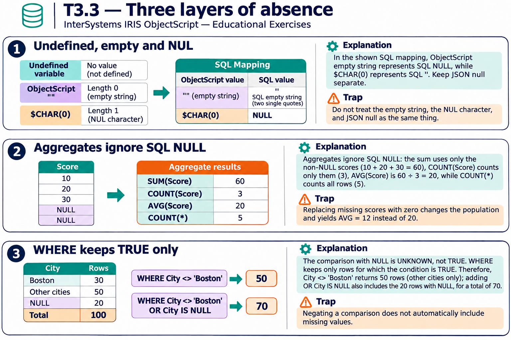

# T3.3 · 01 — Assente, vuoto e NUL non sono sinonimi

[Indice degli approfondimenti](README.md) · [Quiz originale](../quiz.md) · [Teoria](../study.md)

**Esercizi di partenza:** [Q1](../quiz.md#question-1-single) · [Q2](../quiz.md#question-2-single) · [Q3](../quiz.md#question-3-single) · [Q6](../quiz.md#question-6-single) · [Q9](../quiz.md#question-9-single) · [Q10](../quiz.md#question-10-single) · [Q12](../quiz.md#question-12-single) · [Q14](../quiz.md#question-14-single). L’approfondimento rielabora il concetto e aggiunge una variante; non riproduce soltanto la risposta del quiz.

## Il caso concreto

ObjectScript "" ha lunghezza zero; $CHAR(0) ha lunghezza uno. La loro proiezione SQL è diversa.

```objectscript
write $LENGTH(""), !
write $LENGTH($CHAR(0)), !
write $CHAR(0) = ""
```

## Ragionamento passo per passo

I risultati sono 0,1,0. Nel mapping IRIS fra un valore SQL e ObjectScript, SQL NULL corrisponde a "", mentre SQL zero-length string corrisponde a $CHAR(0). Una variabile mai definita non ha neppure quel valore: leggerla direttamente può produrre UNDEFINED.

## Perché il distrattore è plausibile

Rendere equivalenti il byte NUL, una stringa senza caratteri e un identificatore mai assegnato.

## Lo spunto da portare oltre l’esercizio

Disegna il valore a livello applicativo e la sua rappresentazione; il nome “null” da solo è ambiguo.



*Leggi il pannello 1; gli altri due collegano il caso agli altri approfondimenti del capitolo.*

## Variante: prova prima di leggere la soluzione

SQL INSERT di due stringhe vuote e un NULL: quante righe soddisfano IS NULL?

<details>
<summary>Soluzione ragionata</summary>

Una. Le due stringhe SQL vuote restano valori non NULL.

</details>

## Riferimenti e precisazioni

- [Elementi del linguaggio SQL e NULL](https://docs.intersystems.com/irislatest/csp/docbook/DocBook.UI.Page.cls?KEY=GSQL_langelements)
- [AVG](https://docs.intersystems.com/irislatest/csp/docbook/DocBook.UI.Page.cls?KEY=RSQL_avg)
- [COALESCE](https://docs.intersystems.com/irislatest/csp/docbook/DocBook.UI.Page.cls?KEY=RSQL_coalesce)

[Note specifiche del capitolo](README.md#precisazioni-rispetto-al-quiz) · [Metodo e limiti della revisione](../../../approfondimenti-esercizi.md#metodo-e-limiti)
