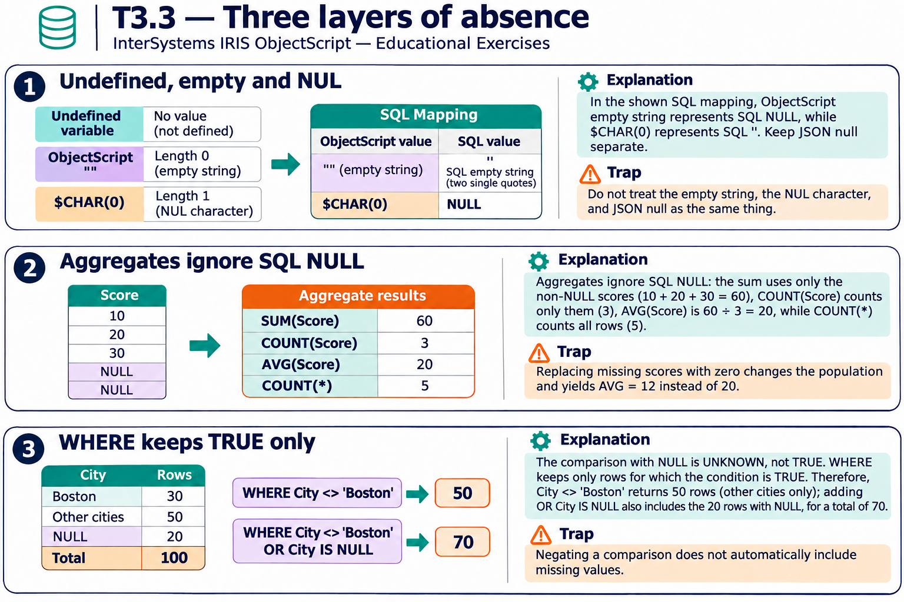

# T3.3 · 02 — Le aggregazioni contano cose diverse

[Indice degli approfondimenti](README.md) · [Quiz originale](../quiz.md) · [Teoria](../study.md)

**Esercizi di partenza:** [Q4](../quiz.md#question-4-single) · [Q7](../quiz.md#question-7-single). L’approfondimento rielabora il concetto e aggiunge una variante; non riproduce soltanto la risposta del quiz.

## Il caso concreto

Le righe Score sono 10,NULL,20,NULL,30.

## Ragionamento passo per passo

COUNT(*) conta le cinque righe; COUNT(Score) soltanto tre valori non NULL. SUM vale 60 e AVG usa 60/3=20. Sostituire NULL con zero prima di AVG cambia la domanda: la media su cinque valori diventa 12. Non è una semplice modifica cosmetica del risultato.

## Perché il distrattore è plausibile

Usare il totale delle righe come denominatore di AVG(Score) o trattare NULL come zero senza una decisione di dominio.

## Lo spunto da portare oltre l’esercizio

Prima della formula definisci la popolazione: righe esistenti oppure misure disponibili.

*Leggi il pannello 2; gli altri due collegano il caso agli altri approfondimenti del capitolo.*

## Variante: prova prima di leggere la soluzione

Aggiungi una sesta riga Score=0. Nuovi COUNT(Score), COUNT(*) e AVG?

Soluzione ragionata

4, 6 e 15: lo zero è una misura presente e partecipa alla media.

## Riferimenti e precisazioni

- [Elementi del linguaggio SQL e NULL](https://docs.intersystems.com/irislatest/csp/docbook/DocBook.UI.Page.cls?KEY=GSQL_langelements)
- [AVG](https://docs.intersystems.com/irislatest/csp/docbook/DocBook.UI.Page.cls?KEY=RSQL_avg)
- [COALESCE](https://docs.intersystems.com/irislatest/csp/docbook/DocBook.UI.Page.cls?KEY=RSQL_coalesce)

[Note specifiche del capitolo](README.md#precisazioni-rispetto-al-quiz) · [Metodo e limiti della revisione](../../../approfondimenti-esercizi.md#metodo-e-limiti)
