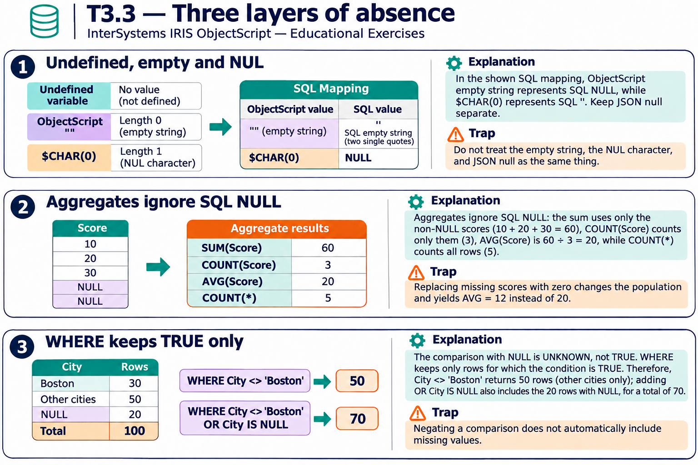

# T3.3 · 03 — UNKNOWN non passa un filtro WHERE

[Indice degli approfondimenti](README.md) · [Quiz originale](../quiz.md) · [Teoria](../study.md)

**Esercizi di partenza:** [Q5](../quiz.md#question-5-single) · [Q8](../quiz.md#question-8-single) · [Q11](../quiz.md#question-11-single) · [Q13](../quiz.md#question-13-single) · [Q15](../quiz.md#question-15-single). L’approfondimento rielabora il concetto e aggiunge una variante; non riproduce soltanto la risposta del quiz.

## Il caso concreto

Su 100 persone, 30 hanno Boston, 20 City NULL e 50 una città diversa. City<>Boston seleziona solo 50 righe.

## Ragionamento passo per passo

Una comparazione con NULL produce UNKNOWN, non TRUE. WHERE conserva solo TRUE. Per includere chi non ha la città, scrivi la condizione esplicita City<>'Boston' OR City IS NULL. Per un calcolo Total-Discount, COALESCE(Discount,0) sceglie un default solo se semanticamente corretto.

## Perché il distrattore è plausibile

Interpretare “non Boston” come complemento automatico di Boston includendo NULL, oppure aspettarsi che NOT trasformi UNKNOWN in TRUE.

## Lo spunto da portare oltre l’esercizio

Un dato sconosciuto richiede una regola esplicita: escluderlo, includerlo o sostituirlo con un valore giustificato.

*Leggi il pannello 3; gli altri due collegano il caso agli altri approfondimenti del capitolo.*

## Variante: prova prima di leggere la soluzione

Con 30 Boston,20 NULL,50 altre città, quante righe produce City<>Boston OR City IS NULL?

Soluzione ragionata

70: 50 città diverse più 20 valori mancanti.

## Riferimenti e precisazioni

- [Elementi del linguaggio SQL e NULL](https://docs.intersystems.com/irislatest/csp/docbook/DocBook.UI.Page.cls?KEY=GSQL_langelements)
- [AVG](https://docs.intersystems.com/irislatest/csp/docbook/DocBook.UI.Page.cls?KEY=RSQL_avg)
- [COALESCE](https://docs.intersystems.com/irislatest/csp/docbook/DocBook.UI.Page.cls?KEY=RSQL_coalesce)

[Note specifiche del capitolo](README.md#precisazioni-rispetto-al-quiz) · [Metodo e limiti della revisione](../../../approfondimenti-esercizi.md#metodo-e-limiti)
