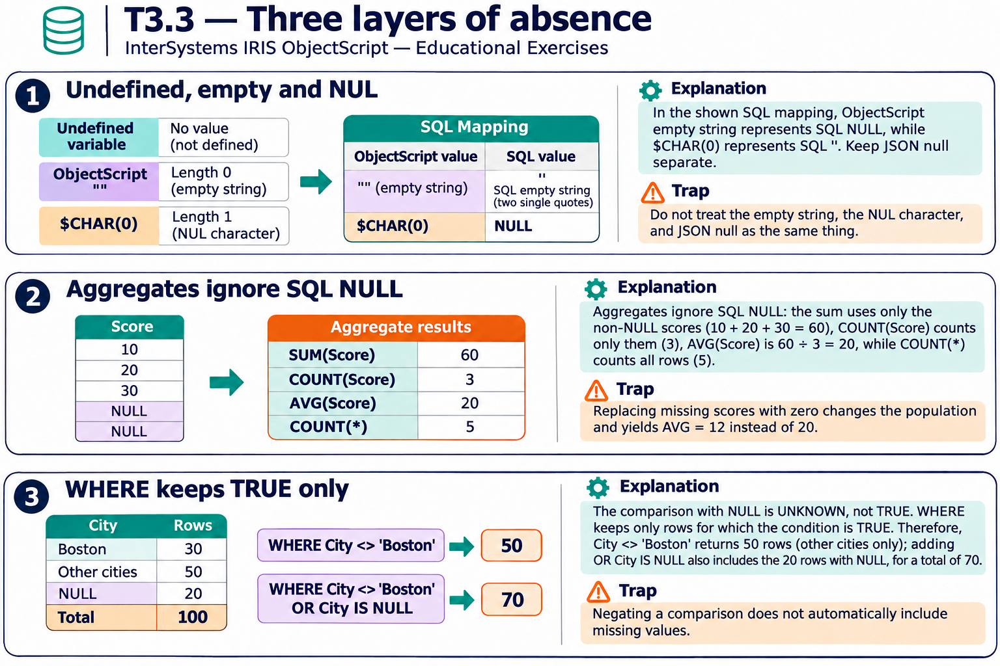
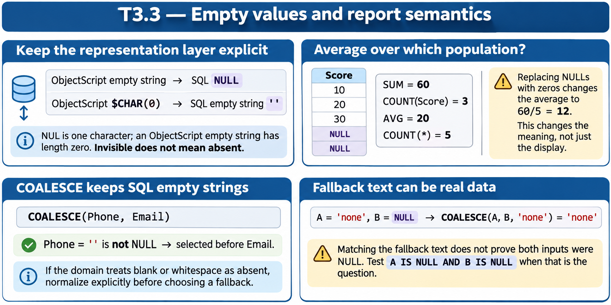

# T3.3 — Approfondimenti dagli esercizi

## Tutte le 15 domande approfondite

[Apri le schede domanda per domanda](<Domanda per domanda/README.md>) · [Tavole spiegate in inglese](tavole-esercizi.md)

Ogni domanda dispone ora di un commento specifico, un concetto ulteriore e una variante con soluzione. I tre casi seguenti sono percorsi tematici aggiuntivi. Le immagini sono in inglese.

[Teoria](../study.md) · [Quiz](../quiz.md) · [Tutti gli approfondimenti](../../../approfondimenti-esercizi.md)

Tre percorsi trasversali, da affiancare alle schede individuali, per capire il meccanismo dietro le risposte: scenario, ragionamento, distrattore, regola riutilizzabile e variante con soluzione. I riferimenti Q rimandano al quiz scaricato; la numerazione è locale al capitolo.

[Leggi esempi e spiegazioni dei pannelli](tavole-esercizi.md).

## Percorso consigliato

1. [Assente, vuoto e NUL non sono sinonimi](<01 - Assente, vuoto e NUL non sono sinonimi.md>) — Q1, Q2, Q3, Q6, Q9, Q10, Q12, Q14
2. [Le aggregazioni contano cose diverse](<02 - Le aggregazioni contano cose diverse.md>) — Q4, Q7
3. [UNKNOWN non passa un filtro WHERE](<03 - UNKNOWN non passa un filtro WHERE.md>) — Q5, Q8, Q11, Q13, Q15

[Indice di tutte le 15 domande del capitolo](mappa-domande.md). I percorsi sono tematici; ogni domanda ha inoltre una scheda individuale nella sottocartella dedicata.

## Precisazioni rispetto al quiz

La mappatura tra SQL e ObjectScript non identifica SQL NULL con una variabile ObjectScript mai definita. JSON null costituisce ancora un altro contesto. Gli esempi qui distinguono valore assente, stringa vuota e carattere NUL.

Queste precisazioni si applicano agli approfondimenti nuovi. Il testo delle risposte scaricate rimane una testimonianza della fonte e non viene riscritto silenziosamente.

## Documentazione

- [Elementi del linguaggio SQL e NULL](https://docs.intersystems.com/irislatest/csp/docbook/DocBook.UI.Page.cls?KEY=GSQL_langelements)
- [AVG](https://docs.intersystems.com/irislatest/csp/docbook/DocBook.UI.Page.cls?KEY=RSQL_avg)
- [COALESCE](https://docs.intersystems.com/irislatest/csp/docbook/DocBook.UI.Page.cls?KEY=RSQL_coalesce)

Gli snippet sono frammenti didattici: quando usano classi di esempio o macro, presuppongono le relative definizioni e include. Non costituiscono implementazioni complete né sono stati eseguiti in IRIS.
