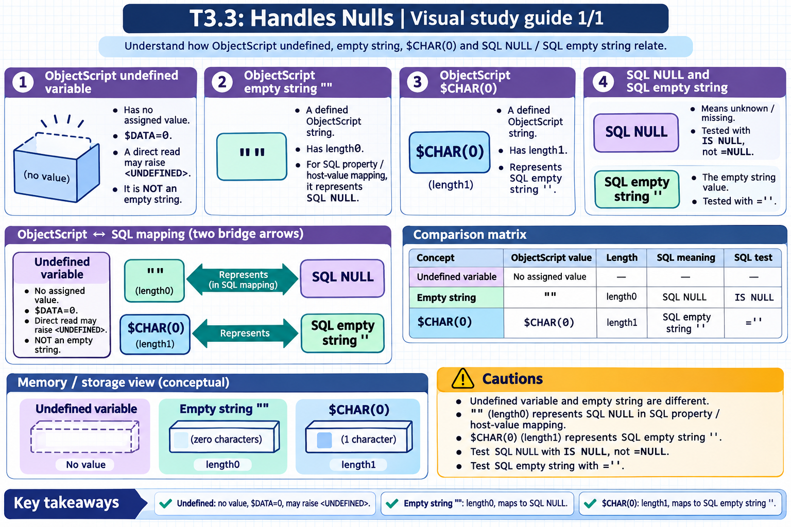

[All topics](../../index.md) · [Practice quiz](quiz.md)

# T3.3: Handles Nulls

[Approfondimenti dagli esercizi](<Approfondimenti esercizi/README.md>)

Saved 2 November 2026 from [exam-prep.es](https://exam-prep.es/exams/objectscript/knowledge/T3.3.html). Reference links require internet access.

### Contents

1. [Understands $CHAR(0) vs empty string vs SQL NULL](#1-understands-char0-vs-empty-string-vs-sql-null)

### Visual study guide — section 1



[View all chapter diagrams](visuals.md) · [Technical review notes](../../visual-technical-notes.md)

## 1. Understands $CHAR(0) vs empty string vs SQL NULL

### Key Points

- **Empty string `""`**: The default "undefined" value in ObjectScript; `$LENGTH = 0`; **this is the ObjectScript representation of SQL NULL**
- **`$CHAR(0)`** (or `$C(0)`): A single-character string containing ASCII 0; `$LENGTH = 1`; **this is the ObjectScript representation of the SQL zero-length string `''`**
- **SQL NULL**: Means "unknown/missing"; different from the SQL zero-length string `''`
- **IS NULL vs = ''**: `WHERE col IS NULL` matches values stored as `""` in ObjectScript; `WHERE col = ''` matches values stored as `$CHAR(0)`
- **Object-SQL bridge**: When a property has no value (default `""` in ObjectScript), it projects as **SQL NULL**, not as empty string
- **Explicit zero-length string**: To store a SQL `''` (non-NULL zero-length string) from ObjectScript, set the property to `$CHAR(0)`

### Detailed Notes

#### Overview

One of the most frequently tested and commonly misunderstood topics in InterSystems IRIS is the relationship between the ObjectScript empty string, `$CHAR(0)`, and SQL NULL. The three-way distinction is unique to InterSystems IRIS because of its unified object-SQL data model, and getting it backwards leads to subtle bugs in queries and data handling.

The two rules to remember (from the official InterSystems SQL reference):

1. **ObjectScript `""` ↔ SQL NULL** — "Use NULL to represent the absence of a data value, which corresponds to the ObjectScript empty string (`""`)." 2. **ObjectScript `$CHAR(0)` ↔ SQL `''`** — "The SQL zero-length string (empty string) is specified by two single quote characters. In ObjectScript, this corresponds to a string of length one that contains the `$CHAR(0)` character."

#### Empty String in ObjectScript is SQL NULL

In ObjectScript, the empty string `""` is the default initial value of any unset variable or property. It is a zero-length string. When you access a property that has never been set, you get `""`:

```objectscript
SET obj = ##class(MyApp.Patient).%New()
WRITE obj.MiddleName            // "" (empty string - the default)
WRITE $LENGTH(obj.MiddleName)   // 0
WRITE (obj.MiddleName = "")     // 1 (true)
```

In SQL, when this object is saved, the `MiddleName` column is **NULL**, not a zero-length string:

```text
-- After saving the object above:
SELECT ID, MiddleName FROM MyApp.Patient WHERE ID = 1
-- Returns: MiddleName = NULL

SELECT ID FROM MyApp.Patient WHERE MiddleName IS NULL
-- DOES return this row

SELECT ID FROM MyApp.Patient WHERE MiddleName = ''
-- Does NOT return this row (= '' tests for the SQL zero-length string, not NULL)
```

#### $CHAR(0) is the SQL Zero-Length String

`$CHAR(0)` (abbreviated `$C(0)`) is a single character with ASCII code 0. It is a **distinct, non-NULL value of length 1**. InterSystems IRIS uses `$CHAR(0)` as the ObjectScript representation of the SQL zero-length string `''`. When a property is set to `$C(0)`, it projects as `''` (empty string, non-NULL) in SQL — never as NULL:

```objectscript
// Storing a SQL zero-length string via ObjectScript
SET obj.MiddleName = $CHAR(0)
SET sc = obj.%Save()

// Now in SQL:
// SELECT MiddleName FROM MyApp.Patient WHERE ID = 1
// Returns: '' (zero-length string), NOT NULL

// SELECT ID FROM MyApp.Patient WHERE MiddleName IS NULL
// Does NOT return this row

// SELECT ID FROM MyApp.Patient WHERE MiddleName = ''
// DOES return this row
```

#### Testing in ObjectScript

```objectscript
SET obj = ##class(MyApp.Patient).%OpenId(1)

// Test whether the value is SQL NULL
IF obj.MiddleName = "" {
    WRITE "Value is SQL NULL (empty string in ObjectScript)", !
}

// Test whether the value is the SQL zero-length string
IF obj.MiddleName = $C(0) {
    // True only if the column stores '' (a non-NULL zero-length string)
    // This is FALSE for the empty string "" — they are different strings
    WRITE "Value is the SQL zero-length string ''", !
}

// Distinguishing the three cases:
IF obj.MiddleName = "" {
    WRITE "SQL NULL", !
} ELSEIF obj.MiddleName = $C(0) {
    WRITE "SQL '' (zero-length, non-NULL)", !
} ELSE {
    WRITE "Real value: ", obj.MiddleName, !
}
```

#### SQL NULL Behavior in Queries

SQL NULL follows standard SQL three-valued logic (TRUE, FALSE, UNKNOWN):

```text
-- NULL comparisons
SELECT * FROM MyApp.Patient WHERE MiddleName = NULL   -- WRONG! Always returns no rows
SELECT * FROM MyApp.Patient WHERE MiddleName IS NULL  -- Correct way to test for NULL

-- NULL in expressions
SELECT Name, MiddleName || ' ' || LastName FROM MyApp.Patient
-- If MiddleName is NULL, the concatenation result is NULL (NULL propagates)

-- COALESCE / IFNULL to handle NULLs
SELECT Name, COALESCE(MiddleName, 'N/A') AS MiddleName FROM MyApp.Patient
-- Returns 'N/A' if MiddleName is NULL

-- NULL in aggregates
SELECT COUNT(MiddleName) FROM MyApp.Patient
-- COUNT(column) excludes NULL values
-- COUNT(*) counts all rows including those with NULLs
```

#### Comparison Summary

| Concept | ObjectScript Value | `$LENGTH()` | SQL Projection | SQL Test |
| --- | --- | --- | --- | --- |
| SQL NULL | `""` (also the default for unset) | 0 | `NULL` | `IS NULL` |
| SQL zero-length string | `$C(0)` | 1 | `''` | `= ''` |
| Space | `" "` | 1 | `' '` | `= ' '` |
| Unset property | `""` (default) | 0 | `NULL` | `IS NULL` |

#### Inserting via SQL

```text
-- Explicit NULL insertion
INSERT INTO MyApp.Patient (Name, MiddleName) VALUES ('Smith', NULL)
-- MiddleName will be "" (empty string) when accessed via ObjectScript

-- Explicit zero-length string
INSERT INTO MyApp.Patient (Name, MiddleName) VALUES ('Smith', '')
-- MiddleName will be $C(0) (length 1) when accessed via ObjectScript

-- Omitting a column inserts the ObjectScript default (""), which is SQL NULL
INSERT INTO MyApp.Patient (Name) VALUES ('Jones')
-- MiddleName will be NULL in SQL
```

#### Common Gotcha: WHERE Clause Differences

```objectscript
// This query finds rows whose value is the SQL zero-length string '':
&sql(SELECT COUNT(*) INTO :cnt FROM MyApp.Patient WHERE MiddleName = '')
WRITE "Zero-length '': ", cnt, !

// This query finds rows whose value is SQL NULL (ObjectScript ""):
&sql(SELECT COUNT(*) INTO :cnt FROM MyApp.Patient WHERE MiddleName IS NULL)
WRITE "NULLs: ", cnt, !

// These are DIFFERENT result sets.
// The common bug is using = '' when you meant IS NULL, or vice versa.
```

### Documentation References

- [NULL and Empty String (GSQL_langelements)](https://docs.intersystems.com/irislatest/csp/docbook/DocBook.UI.Page.cls?KEY=GSQL_langelements#GSQL_langelements_null)
- [NULL in ObjectScript (GSQL_langelements_nullcos)](https://docs.intersystems.com/irislatest/csp/docbook/DocBook.UI.Page.cls?KEY=GSQL_langelements#GSQL_langelements_nullcos)
- [$CHAR Function](https://docs.intersystems.com/irislatest/csp/docbook/DocBook.UI.Page.cls?KEY=RCOS_fchar)
- [IS NULL Predicate](https://docs.intersystems.com/irislatest/csp/docbook/DocBook.UI.Page.cls?KEY=RSQL_isnull)

## Exam Preparation Summary

### Critical Concepts to Master:

1. **`""` = SQL NULL**: This is the single most important fact. The ObjectScript empty string is how IRIS represents SQL NULL, and it is the default for unset properties.
2. **`$CHAR(0)` = SQL `''`**: The ObjectScript one-character NUL string is how IRIS represents the SQL zero-length (non-NULL) string. It is a valid non-NULL value.
3. **IS NULL vs = ''**: `IS NULL` matches the ObjectScript `""`; `= ''` matches the ObjectScript `$CHAR(0)`. These test for completely different stored values.
4. **NULL propagation**: NULL in any arithmetic or string expression propagates (result is NULL).
5. **COUNT behavior**: `COUNT(\*)` counts all rows; `COUNT(column)` excludes NULLs.
6. **Three-valued logic**: Comparisons involving NULL return UNKNOWN, not TRUE or FALSE.

### Common Exam Scenarios:

- Given an ObjectScript property assignment, predicting whether SQL sees NULL or the zero-length string `''`
- Writing correct WHERE clauses to find NULL (`IS NULL`) vs zero-length (`= ''`) values
- Identifying bugs where `= ''` is used instead of `IS NULL` (or vice versa)
- Understanding what happens when you INSERT without specifying a column (default `""` in ObjectScript → SQL NULL)
- Predicting COUNT results when data contains a mix of NULLs and zero-length strings
- Setting a property to `$C(0)` to create a SQL zero-length string from ObjectScript, or leaving it as `""` to create SQL NULL

### Hands-On Practice Recommendations:

- Create a test class with string properties; save objects with `""`, `$C(0)`, and real values
- Query the table with both `IS NULL` and `= ''` to see which row matches which
- Use `SELECT $LENGTH(col), $ASCII(col) FROM ...` in embedded ObjectScript to inspect stored values
- Practice COALESCE and IFNULL to handle NULLs in queries
- Experiment with NULL propagation in expressions: `NULL + 5`, `NULL || 'text'`
- Test COUNT(\*) vs COUNT(column) with NULL-containing data
- Verify the mapping empirically: `obj.Email = ""` → row matches `IS NULL`; `obj.Email = $C(0)` → row matches `= ''`
