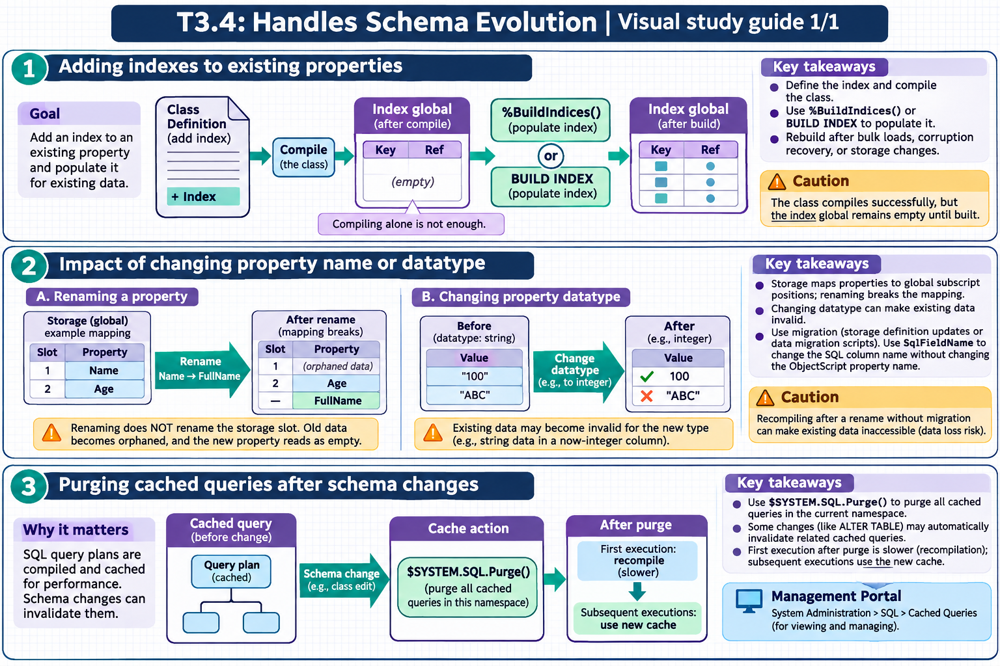

[Topic contents](../index.md) · [Full topic guide](../study.md) · [All topics](../../../index.md)

# T3.4: Handles Schema Evolution

Saved 2 November 2026 from [exam-prep.es](https://exam-prep.es/exams/objectscript/knowledge/T3.4.html). Reference links require internet access.

## 1. Adding indexes to existing properties



*This diagram covers sections 1–3; use the matching numbered panel for this page.* [Chapter diagrams](../visuals.md) · [Technical review notes](../../../visual-technical-notes.md)

### Key Points

- **Adding an index**: Define the index in the class definition and compile the class
- **Building the index**: New indexes on existing data require population via `%BuildIndices()` or `BUILD INDEX` SQL command
- **Compiling alone is not enough**: The class compiles successfully, but the index global remains empty until built
- **%BuildIndices()**: Class method to populate one or more indexes; can run in background
- **CREATE INDEX**: SQL DDL alternative that both defines and optionally builds the index
- **Rebuild scenarios**: Required after bulk data loads, data corruption recovery, or storage changes

### Detailed Notes

#### Overview

When you add an index to a class that already contains data, the index definition is registered at compile time, but the index data structure (the global subscript entries) is not automatically populated. You must explicitly build the index to populate it with existing data. Failing to do so means the optimizer will use the empty index and queries will return no results (or incomplete results if some rows were inserted after the index was defined).

#### Adding an Index via Class Definition

```objectscript
Class MyApp.Patient Extends %Persistent
{
    Property Name As %String(MAXLEN = 100);
    Property SSN As %String(MAXLEN = 11);
    Property City As %String(MAXLEN = 50);

    // Existing index
    Index SSNIdx On SSN [ Unique ];

    // NEW index added to existing class with data
    Index CityIdx On City;
    Index NameIdx On Name;
}
```

After adding the index definition and compiling the class, you must build it:

```objectscript
// Build all indexes for the class
DO ##class(MyApp.Patient).%BuildIndices()

// Build only specific indexes
DO ##class(MyApp.Patient).%BuildIndices($ListBuild("CityIdx", "NameIdx"))

// Build with progress output
DO ##class(MyApp.Patient).%BuildIndices(, 1)  // verbose mode

// Build and purge existing index data first (clean rebuild)
DO ##class(MyApp.Patient).%BuildIndices($ListBuild("CityIdx"), 1, 1)
// Parameters: (indexList, verbose, purgeFirst)
```

#### Adding an Index via SQL DDL

```text
-- CREATE INDEX defines AND builds in one step
CREATE INDEX CityIdx ON TABLE MyApp.Patient (City)

-- Create a unique index
CREATE UNIQUE INDEX SSNIdx ON TABLE MyApp.Patient (SSN)

-- The SQL approach is often simpler for DBA-style operations
```

#### BUILD INDEX Command

```text
-- Rebuild a specific index
BUILD INDEX CityIdx FOR TABLE MyApp.Patient

-- Rebuild all indexes for a table
BUILD INDEX FOR TABLE MyApp.Patient
```

#### When to Rebuild Indexes

- **After adding a new index**: The most common scenario
- **After bulk data import**: If data was loaded via global-level operations bypassing index maintenance
- **After data recovery**: If data was restored from a backup and indexes may be inconsistent
- **After storage definition changes**: If the class storage was modified manually
- **Performance degradation**: If an index becomes fragmented (though this is rare with B-tree+ structures)

```objectscript
// Common pattern: check if rebuild is needed after bulk load
// First, purge and rebuild all indexes
SET sc = ##class(MyApp.Patient).%BuildIndices(, 1, 1)
IF $$$ISERR(sc) {
    WRITE "Index build failed: ", $SYSTEM.Status.GetErrorText(sc), !
}
```

### Documentation References

- [Building Indexes](https://docs.intersystems.com/irislatest/csp/docbook/DocBook.UI.Page.cls?KEY=GSOD_indexes)
- [%BuildIndices Method](https://docs.intersystems.com/irislatest/csp/docbook/DocBook.UI.Page.cls?KEY=GSOD_indexes)
- [CREATE INDEX](https://docs.intersystems.com/irislatest/csp/docbook/DocBook.UI.Page.cls?KEY=RSQL_createindex)
- [BUILD INDEX](https://docs.intersystems.com/irislatest/csp/docbook/DocBook.UI.Page.cls?KEY=RSQL_buildindex)
