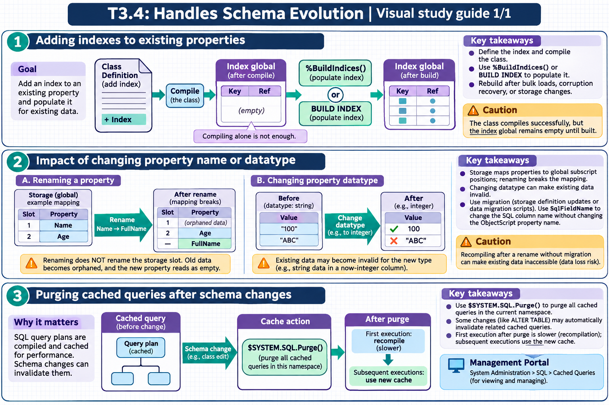

[Topic contents](../index.md) · [Full topic guide](../study.md) · [All topics](../../../index.md)

# T3.4: Handles Schema Evolution

Saved 2 November 2026 from [exam-prep.es](https://exam-prep.es/exams/objectscript/knowledge/T3.4.html). Reference links require internet access.

## 2. Impact of changing property name or datatype



*This diagram covers sections 1–3; use the matching numbered panel for this page.* [Chapter diagrams](../visuals.md) · [Technical review notes](../../../visual-technical-notes.md)

### Key Points

- **Renaming a property**: Does NOT rename the storage slot; old data becomes orphaned, new property reads as empty
- **Storage definition mismatch**: Class storage maps property names to global subscript positions; renaming breaks the mapping
- **Changing datatype**: Existing data may become invalid for the new type (e.g., string data in a now-integer column)
- **Data loss risk**: Recompiling after rename without migration can make existing data inaccessible
- **Migration required**: Rename operations require either storage definition updates or data migration scripts
- **SqlFieldName**: Use to change SQL column name without changing ObjectScript property name

### Detailed Notes

#### Overview

InterSystems IRIS uses a storage definition that maps property names to specific positions in the underlying global structure. When you change a property name or datatype, the storage definition and existing data can become misaligned, leading to data loss or corruption. Understanding these risks is essential for safe schema evolution.

#### How Storage Works

When a class is first compiled, the compiler generates a storage definition that maps each property to a subscript position in the data global. For example:

```text
<!-- Auto-generated storage definition (simplified) -->
<Storage name="Default">
  <Data name="PatientDefaultData">
    <Value name="1"><Value>Name</Value></Value>
    <Value name="2"><Value>SSN</Value></Value>
    <Value name="3"><Value>City</Value></Value>
  </Data>
  <DataLocation>^MyApp.PatientD</DataLocation>
</Storage>
```

The data global might look like:

```text
^MyApp.PatientD(1) = $LB("", "Smith, John", "123-45-6789", "Boston")
^MyApp.PatientD(2) = $LB("", "Jones, Mary", "987-65-4321", "Chicago")
```

#### What Happens When You Rename a Property

If you rename `City` to `Location` and recompile:

1. The compiler sees `Location` as a **new property** and assigns it to position 4 2. Position 3 (where `City` data lives) is now unmapped 3. `Location` reads from position 4, which is empty for all existing rows 4. The old `City` data at position 3 is effectively orphaned

```objectscript
// BEFORE rename: City is at position 3
SET obj = ##class(MyApp.Patient).%OpenId(1)
WRITE obj.City  // "Boston" - reads from position 3

// AFTER renaming City to Location and recompiling:
SET obj = ##class(MyApp.Patient).%OpenId(1)
WRITE obj.Location  // "" - reads from position 4 (empty!)
// The "Boston" data still exists at position 3 but is inaccessible
```

#### Safe Approaches to Renaming

**Option 1: Edit the storage definition** - Manually update the storage XML to map `Location` to position 3 (where `City` data resides). This requires editing the class XML directly.

**Option 2: Data migration** - Write a migration script that copies data from the old property to the new one:

```objectscript
// Migration script for renaming City to Location
SET id = ""
FOR {
    SET id = $ORDER(^MyApp.PatientD(id))
    QUIT:id=""
    SET data = ^MyApp.PatientD(id)
    // Copy position 3 (old City) to position 4 (new Location)
    SET $LIST(data, 4) = $LIST(data, 3)
    SET ^MyApp.PatientD(id) = data
}
```

**Option 3: Use SqlFieldName** - If you only need to change the SQL column name, keep the ObjectScript property name and use the `SqlFieldName` keyword:

```objectscript
Property City As %String(MAXLEN = 50) [ SqlFieldName = Location ];
// ObjectScript uses obj.City, SQL uses Location column
```

#### Changing Datatype Risks

Changing a property's datatype can cause problems with existing data:

```objectscript
// Original: Property Age As %String;
// Data stored: "twenty-five", "30", "unknown"

// Changed to: Property Age As %Integer;
// Now "twenty-five" and "unknown" fail validation
// Existing string data at the global level is still there but invalid
```

When changing datatypes:

- **Widening** (e.g., `%Integer` to `%String`): Data values are compatible, but **index collation may differ** — `%Integer` defaults to `EXACT` collation while `%String` defaults to `SQLUPPER`, so indexed properties may require an index rebuild after the type change
- **Narrowing** (e.g., `%String` to `%Integer`): Risky, existing data may not conform
- **Completely different** (e.g., `%String` to `%Date`): Requires data migration

**Safer approach via SQL DDL**: Using `ALTER TABLE ... ALTER COLUMN` to change a column's datatype is often the safest one-stop solution. SQL DDL operations automatically handle storage updates, trigger cached query invalidation, and surface validation errors — reducing the risk of collation mismatches or orphaned index entries compared to editing the class definition directly.

```text
-- Change column type via SQL (handles storage + cache invalidation)
ALTER TABLE MyApp.Patient ALTER COLUMN Age VARCHAR(10)
```

### Documentation References

- [Storage Definitions](https://docs.intersystems.com/irislatest/csp/docbook/DocBook.UI.Page.cls?KEY=GOBJ_classdef_storage)
- [Modifying Class Definitions](https://docs.intersystems.com/irislatest/csp/docbook/DocBook.UI.Page.cls?KEY=GOBJ_classdef_modifying)
- [SqlFieldName Property Keyword](https://docs.intersystems.com/irislatest/csp/docbook/DocBook.UI.Page.cls?KEY=ROBJ_property_sqlfieldname)
