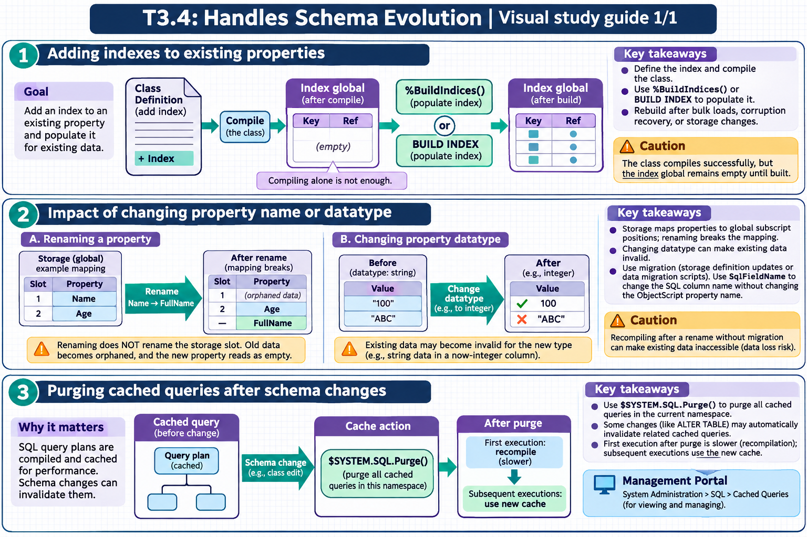

[Topic contents](../index.md) · [Full topic guide](../study.md) · [All topics](../../../index.md)

# T3.4: Handles Schema Evolution

Saved 2 November 2026 from [exam-prep.es](https://exam-prep.es/exams/objectscript/knowledge/T3.4.html). Reference links require internet access.

## 3. Purging cached queries after schema changes



*This diagram covers sections 1–3; use the matching numbered panel for this page.* [Chapter diagrams](../visuals.md) · [Technical review notes](../../../visual-technical-notes.md)

### Key Points

- **Cached queries**: SQL query plans are compiled and cached for performance; schema changes can invalidate them
- **$SYSTEM.SQL.Purge()**: Purges all cached queries in the current namespace
- **Automatic invalidation**: Some changes (like ALTER TABLE) automatically invalidate related cached queries
- **Manual purge needed**: Changes via class definition editing may not trigger automatic invalidation
- **Performance impact**: First execution after purge is slower (recompilation); subsequent executions use new cache
- **Management Portal**: System Administration &gt; SQL &gt; Cached Queries for viewing and managing

### Detailed Notes

#### Overview

When a SQL query is first executed (either via Dynamic SQL or Embedded SQL), InterSystems IRIS compiles a query plan and caches it as an optimized routine. This cached query is reused for subsequent executions, providing significant performance benefits. However, when the underlying schema changes (new indexes, modified columns, changed statistics), the cached plan may be suboptimal or even incorrect. Purging forces recompilation with the updated schema.

#### When to Purge Cached Queries

1. **After adding or removing indexes**: The query optimizer may choose different access strategies 2. **After running TUNE TABLE** (only if values were unchanged): TUNE TABLE automatically recompiles cached queries when statistics change, but if no values changed, cached queries are left as-is 3. **After changing property datatypes**: Column type changes can affect query plan validity 4. **After modifying class storage**: Direct storage definition changes require query plan regeneration 5. **After upgrading InterSystems IRIS**: New optimizer improvements may produce better plans

#### Purging Methods

```objectscript
// Purge ALL cached queries in the current namespace
DO $SYSTEM.SQL.Purge()

// Purge cached queries for a specific table/class
DO $SYSTEM.SQL.PurgeForTable("MyApp.Patient")

// Purge with more control via %SYS.PTools utilities
DO $SYSTEM.SQL.Purge(.count)
WRITE "Purged ", count, " cached queries", !
```

```text
-- SQL approach
PURGE CACHED QUERIES
```

#### Via Management Portal

Navigate to **System Administration &gt; SQL** and use the **Cached Queries** tab to:

- View all cached queries with their SQL text and execution statistics
- Selectively delete individual cached queries
- See when each query was last compiled and executed
- View the query plan for each cached query

#### Automatic vs Manual Invalidation

**Automatic invalidation** occurs when:

- Using `ALTER TABLE` to modify a table structure
- Using `DROP INDEX` or `CREATE INDEX` via SQL DDL
- Running `TUNE TABLE` (automatically recompiles cached queries for the table when statistics change)
- Certain system-level changes that trigger class recompilation

**Manual invalidation needed** when:

- Editing class definitions directly in Studio/VS Code and compiling
- Performing bulk data operations that change data distribution
- Making storage definition changes

```objectscript
// Best practice after schema changes via class editing:
// 1. Compile the class
DO $SYSTEM.OBJ.Compile("MyApp.Patient", "ck")

// 2. Rebuild indexes if new ones were added
DO ##class(MyApp.Patient).%BuildIndices()

// 3. Update table statistics (also recompiles cached queries for this table)
DO $SYSTEM.SQL.TuneTable("MyApp.Patient")

// 4. If class edits did not trigger automatic cache invalidation,
//    manually purge cached queries for this table
DO $SYSTEM.SQL.PurgeForTable("MyApp.Patient")
```

#### Frozen Plans

Frozen plans allow you to lock a query plan so it is retained across compiles, TUNE TABLE, and even system upgrades. A frozen plan is **not recompiled** when schema changes or TUNE TABLE would normally trigger recompilation.

**Why freeze a plan?**

- Protect a well-tuned query plan from being replaced by an untested new plan after schema changes or software upgrades
- Ensure predictable query performance in production

**Two strategies for using frozen plans:**

- **Optimistic**: Assume changes will improve performance. Freeze the current plan as a backup, unfreeze, make the change, compare. If worse, restore the frozen plan from backup.
- **Pessimistic**: Assume changes will not improve performance. Freeze the current plan, make the change, re-run the query with `%NOFPLAN` (ignores the frozen plan) to compare. If no improvement, keep the plan frozen.

**Freezing and unfreezing plans:**

```text
-- Freeze/unfreeze all plans for a table
FREEZE PLANS FOR TABLE Sample.Person
UNFREEZE PLANS FOR TABLE Sample.Person

-- Freeze/unfreeze all plans in a schema or namespace
FREEZE PLANS FOR SCHEMA Sample
FREEZE PLANS

-- Ignore a frozen plan for testing (pessimistic strategy)
SELECT %NOFPLAN * FROM Sample.Person WHERE Name = 'Smith'
```

```objectscript
// Programmatic interface via $SYSTEM.SQL.Statement
DO $SYSTEM.SQL.Statement.FreezeRelation("Sample.Person")
DO $SYSTEM.SQL.Statement.UnfreezeRelation("Sample.Person")

// Per-statement (requires the statement hash from INFORMATION_SCHEMA.STATEMENTS)
DO $SYSTEM.SQL.Statement.FreezeStatement(hash)
```

You can check frozen status by querying `INFORMATION_SCHEMA.STATEMENTS` for the `Frozen` column: Unfrozen (0), Frozen/Explicit (1), Frozen/Upgrade (2), or Unfrozen/Parallel (3). You can also use `EXPLAIN` on a specific query.

**Important**: Frozen plans can become a problem after schema evolution. If you add a new index that would significantly improve a query, the frozen plan will not use it. Review frozen plans after major schema changes.

#### Performance Implications

- **First execution after purge**: Slightly slower as the query is recompiled
- **Subsequent executions**: Use the new optimized plan, potentially much faster if new indexes are available
- **Unnecessary purging**: Avoid purging in production without reason, as it causes a brief performance dip
- **Targeted purging**: `PurgeForTable()` is preferred over `Purge()` in production to minimize impact
- **Frozen plans**: Not affected by purges or TUNE TABLE — must be explicitly unfrozen to benefit from new query optimization

### Documentation References

- [Cached Queries](https://docs.intersystems.com/irislatest/csp/docbook/DocBook.UI.Page.cls?KEY=GSOC_cachedqueries)
- [Purging Cached Queries](https://docs.intersystems.com/irislatest/csp/docbook/DocBook.UI.Page.cls?KEY=GSOC_cachedqueries)
- [Frozen Plans](https://docs.intersystems.com/irislatest/csp/docbook/DocBook.UI.Page.cls?KEY=GSOC_cachedqueries)
- [$SYSTEM.SQL Class](https://docs.intersystems.com/irislatest/csp/docbook/DocBook.UI.Page.cls?KEY=GSQLOPT)
