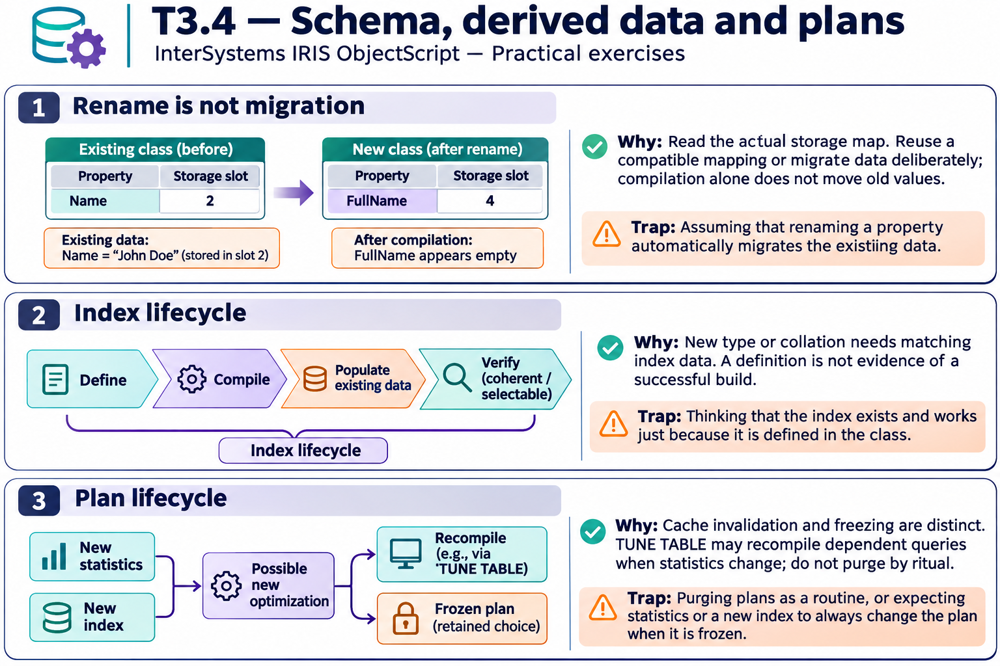

# T3.4 · 01 — Cambiare un nome non sposta il dato

[Indice degli approfondimenti](README.md) · [Quiz originale](../quiz.md) · [Teoria](../study.md)

**Esercizi di partenza:** [Q3](../quiz.md#question-3-single) · [Q4](../quiz.md#question-4-single) · [Q5](../quiz.md#question-5-single) · [Q6](../quiz.md#question-6-single) · [Q10](../quiz.md#question-10-single) · [Q14](../quiz.md#question-14-single). L’approfondimento rielabora il concetto e aggiunge una variante; non riproduce soltanto la risposta del quiz.

## Il caso concreto

Name occupa lo slot 2. La proprietà rinominata FullName viene associata a un nuovo slot vuoto: il dato originale può essere ancora presente nello slot 2.

## Ragionamento passo per passo

Distingui lo schema che descrive una proprietà dai byte già salvati. Una nuova associazione legge una posizione diversa, non converte le righe passate. Prima di correggere lo storage verifica la definizione completa, i sottotipi e i percorsi SQL/oggetto. Un cambio di tipo richiede inoltre una decisione sui valori incompatibili.

## Perché il distrattore è plausibile

Credere che ricompilare migri tutti i valori o che un campo apparentemente vuoto dimostri la perdita fisica del vecchio contenuto.

## Lo spunto da portare oltre l’esercizio

Una modifica di schema deve dichiarare anche il destino dei dati preesistenti.

*Leggi il pannello 1; gli altri due collegano il caso agli altri approfondimenti del capitolo.*

## Variante: prova prima di leggere la soluzione

Aggiungi Phone con InitialExpression="N/A". I vecchi record vengono tutti aggiornati automaticamente?

Soluzione ragionata

No: il default di creazione non equivale a un backfill dei dati esistenti.

## Riferimenti e precisazioni

- [Storage delle classi](https://docs.intersystems.com/irislatest/csp/docbook/DocBook.UI.Page.cls?KEY=GOBJ_storage)
- [CREATE INDEX](https://docs.intersystems.com/irislatest/csp/docbook/DocBook.UI.Page.cls?KEY=RSQL_createindex)
- [TUNE TABLE](https://docs.intersystems.com/irislatest/csp/docbook/DocBook.UI.Page.cls?KEY=RSQL_tunetable)

[Note specifiche del capitolo](README.md#precisazioni-rispetto-al-quiz) · [Metodo e limiti della revisione](../../../approfondimenti-esercizi.md#metodo-e-limiti)
