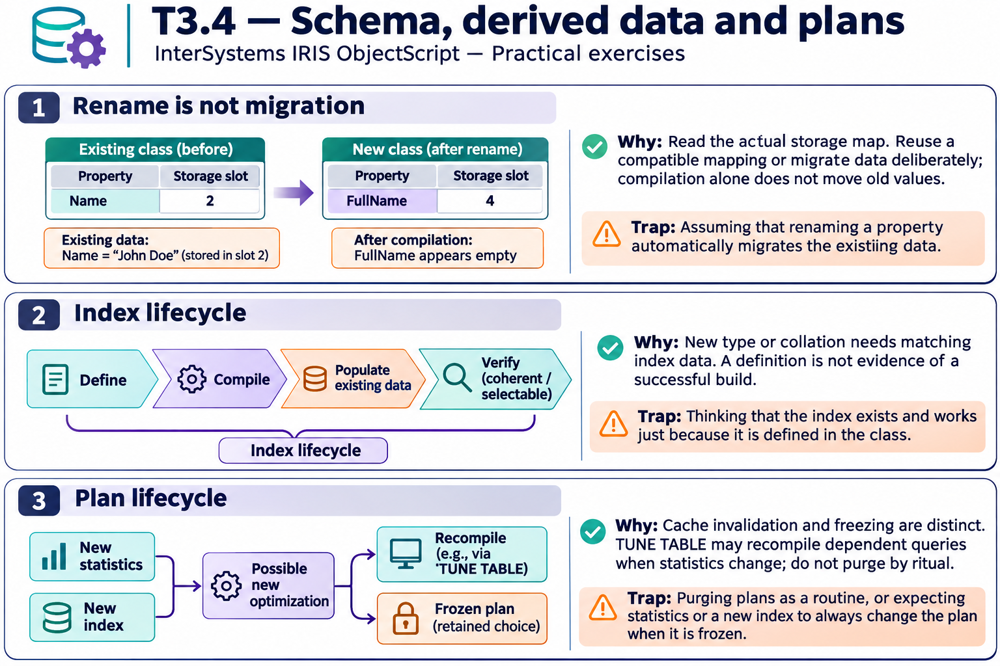

# T3.4 · 02 — Definire un indice non significa averlo popolato

[Indice degli approfondimenti](README.md) · [Quiz originale](../quiz.md) · [Teoria](../study.md)

**Esercizi di partenza:** [Q1](../quiz.md#question-1-single) · [Q2](../quiz.md#question-2-single) · [Q7](../quiz.md#question-7-single) · [Q8](../quiz.md#question-8-single) · [Q11](../quiz.md#question-11-single) · [Q12](../quiz.md#question-12-single) · [Q15](../quiz.md#question-15-multiple). L’approfondimento rielabora il concetto e aggiunge una variante; non riproduce soltanto la risposta del quiz.

## Il caso concreto

Aggiungi StatusIdx a una classe con molte righe esistenti. Il codice di manutenzione futuro non dimostra che le righe passate siano già indicizzate.

## Ragionamento passo per passo

La compilazione della definizione e la costruzione sui dati storici sono due passi. Per cambi di tipo o collation verifica la ricostruzione necessaria e le opzioni di build previste. Il percorso SQL DDL CREATE INDEX gestisce anche il popolamento secondo le sue opzioni; non generalizzare il comportamento del solo compile a ogni interfaccia.

## Perché il distrattore è plausibile

Dichiarare pronto l’indice perché compare nella classe, oppure cambiare bitmap in standard riutilizzando senza verifica i vecchi dati.

## Lo spunto da portare oltre l’esercizio

La struttura derivata deve essere coerente con dati, tipo e regola di confronto.

*Leggi il pannello 2; gli altri due collegano il caso agli altri approfondimenti del capitolo.*

## Variante: prova prima di leggere la soluzione

Cambi la collation ma i dati delle righe restano uguali. È irrilevante per l’indice?

Soluzione ragionata

No: le chiavi indicizzate dipendono dalla regola di confronto e vanno rese coerenti.

## Riferimenti e precisazioni

- [Storage delle classi](https://docs.intersystems.com/irislatest/csp/docbook/DocBook.UI.Page.cls?KEY=GOBJ_storage)
- [CREATE INDEX](https://docs.intersystems.com/irislatest/csp/docbook/DocBook.UI.Page.cls?KEY=RSQL_createindex)
- [TUNE TABLE](https://docs.intersystems.com/irislatest/csp/docbook/DocBook.UI.Page.cls?KEY=RSQL_tunetable)

[Note specifiche del capitolo](README.md#precisazioni-rispetto-al-quiz) · [Metodo e limiti della revisione](../../../approfondimenti-esercizi.md#metodo-e-limiti)
