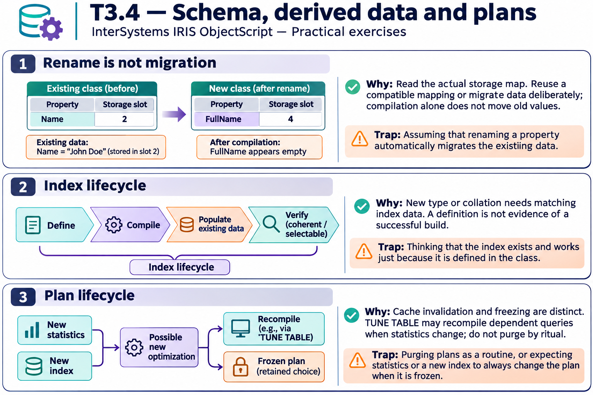

# T3.4 · 03 — Un piano congelato spiega un indice ignorato

[Indice degli approfondimenti](README.md) · [Quiz originale](../quiz.md) · [Teoria](../study.md)

**Esercizi di partenza:** [Q9](../quiz.md#question-9-single) · [Q13](../quiz.md#question-13-single) · [Q16](../quiz.md#question-16-single) · [Q17](../quiz.md#question-17-single). L’approfondimento rielabora il concetto e aggiunge una variante; non riproduce soltanto la risposta del quiz.

## Il caso concreto

Indice costruito e statistiche aggiornate non cambiano il piano della query critica: è congelato.

## Ragionamento passo per passo

Separa disponibilità dell’indice, qualità delle statistiche e libertà di riottimizzare. Un piano congelato conserva una scelta precedente. Confronta la nuova alternativa su carico rappresentativo e decidi se scongelare; non promettere che l’indice nuovo sia comunque più veloce.

## Perché il distrattore è plausibile

Ripetere TUNE TABLE o un purge come ricetta universale senza controllare lo stato del piano.

## Lo spunto da portare oltre l’esercizio

Una modifica della struttura rende possibili nuove scelte; non obbliga ogni query a usarle.

*Leggi il pannello 3; gli altri due collegano il caso agli altri approfondimenti del capitolo.*

## Variante: prova prima di leggere la soluzione

Il piano nuovo usa un indice ma legge più blocchi del vecchio. Quale scegli?

Soluzione ragionata

Quello che soddisfa meglio gli obiettivi misurati sul carico rappresentativo, non quello con il nome più nuovo.

## Riferimenti e precisazioni

- [Storage delle classi](https://docs.intersystems.com/irislatest/csp/docbook/DocBook.UI.Page.cls?KEY=GOBJ_storage)
- [CREATE INDEX](https://docs.intersystems.com/irislatest/csp/docbook/DocBook.UI.Page.cls?KEY=RSQL_createindex)
- [TUNE TABLE](https://docs.intersystems.com/irislatest/csp/docbook/DocBook.UI.Page.cls?KEY=RSQL_tunetable)

[Note specifiche del capitolo](README.md#precisazioni-rispetto-al-quiz) · [Metodo e limiti della revisione](../../../approfondimenti-esercizi.md#metodo-e-limiti)
