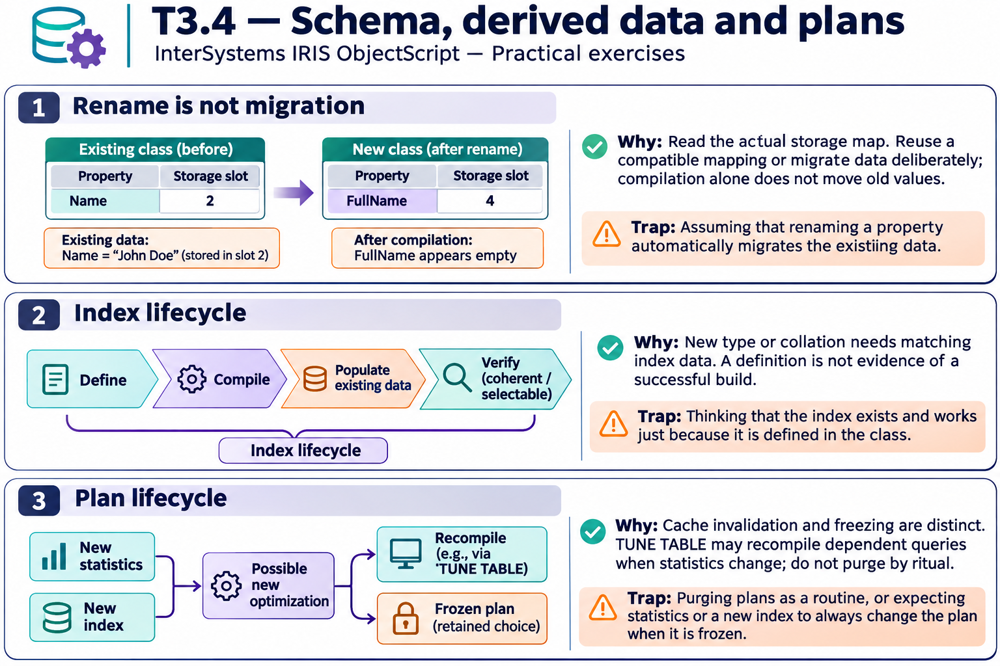
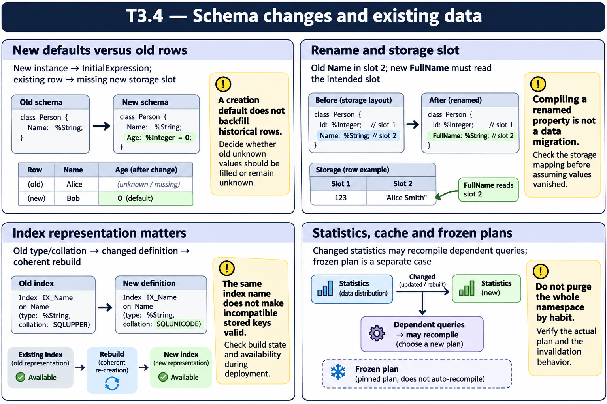

# T3.4 — Approfondimenti dagli esercizi

## Tutte le 17 domande approfondite

[Apri le schede domanda per domanda](<Domanda per domanda/README.md>) · [Tavole spiegate in inglese](tavole-esercizi.md)

Ogni domanda dispone ora di un commento specifico, un concetto ulteriore e una variante con soluzione. I tre casi seguenti sono percorsi tematici aggiuntivi. Le immagini sono in inglese.

[Teoria](../study.md) · [Quiz](../quiz.md) · [Tutti gli approfondimenti](../../../approfondimenti-esercizi.md)

Tre percorsi trasversali, da affiancare alle schede individuali, per capire il meccanismo dietro le risposte: scenario, ragionamento, distrattore, regola riutilizzabile e variante con soluzione. I riferimenti Q rimandano al quiz scaricato; la numerazione è locale al capitolo.

[Leggi esempi e spiegazioni dei pannelli](tavole-esercizi.md).

## Percorso consigliato

1. [Cambiare un nome non sposta il dato](<01 - Cambiare un nome non sposta il dato.md>) — Q3, Q4, Q5, Q6, Q10, Q14
2. [Definire un indice non significa averlo popolato](<02 - Definire un indice non significa averlo popolato.md>) — Q1, Q2, Q7, Q8, Q11, Q12, Q15
3. [Un piano congelato spiega un indice ignorato](<03 - Un piano congelato spiega un indice ignorato.md>) — Q9, Q13, Q16, Q17

[Indice di tutte le 17 domande del capitolo](mappa-domande.md). I percorsi sono tematici; ogni domanda ha inoltre una scheda individuale nella sottocartella dedicata.

## Precisazioni rispetto al quiz

Nuova definizione, popolamento dell’indice e statistiche sono operazioni distinte. TUNE TABLE normalmente aggiorna i piani cache quando cambiano le statistiche: non prescrivere sempre un purge indiscriminato. Piano congelato e modalità di costruzione online vanno verificati per la versione in uso.

Queste precisazioni si applicano agli approfondimenti nuovi. Il testo delle risposte scaricate rimane una testimonianza della fonte e non viene riscritto silenziosamente.

## Documentazione

- [Storage delle classi](https://docs.intersystems.com/irislatest/csp/docbook/DocBook.UI.Page.cls?KEY=GOBJ_storage)
- [CREATE INDEX](https://docs.intersystems.com/irislatest/csp/docbook/DocBook.UI.Page.cls?KEY=RSQL_createindex)
- [TUNE TABLE](https://docs.intersystems.com/irislatest/csp/docbook/DocBook.UI.Page.cls?KEY=RSQL_tunetable)

Gli snippet sono frammenti didattici: quando usano classi di esempio o macro, presuppongono le relative definizioni e include. Non costituiscono implementazioni complete né sono stati eseguiti in IRIS.
