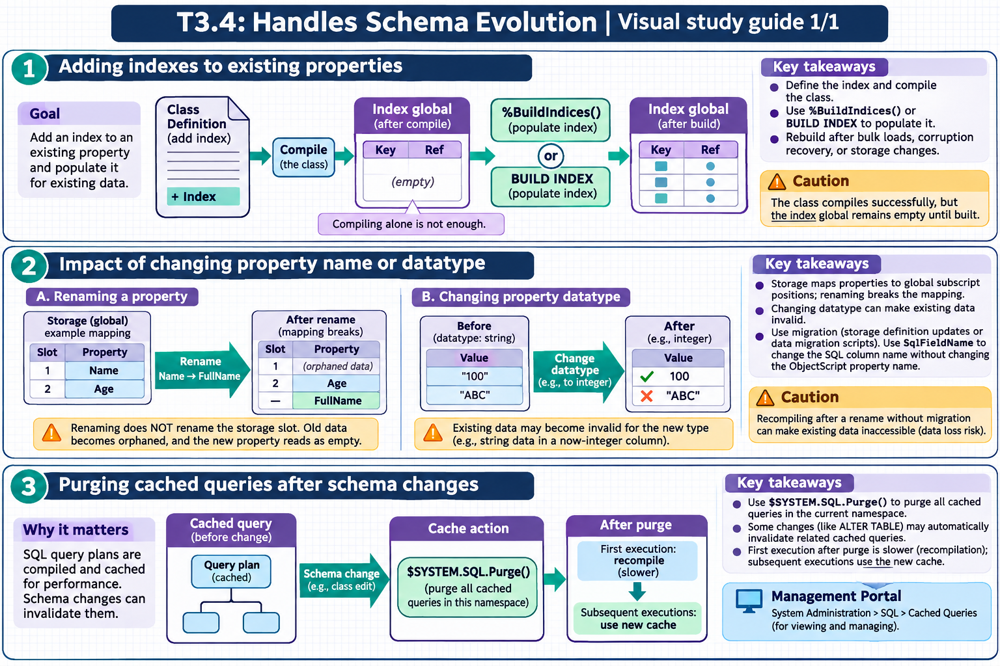

[All topics](../../index.md) · [Practice quiz](quiz.md)

# T3.4: Handles Schema Evolution

[Approfondimenti dagli esercizi](<Approfondimenti esercizi/README.md>)

Saved 2 November 2026 from [exam-prep.es](https://exam-prep.es/exams/objectscript/knowledge/T3.4.html). Reference links require internet access.

### Contents

1. [Adding indexes to existing properties](#1-adding-indexes-to-existing-properties)
2. [Impact of changing property name or datatype](#2-impact-of-changing-property-name-or-datatype)
3. [Purging cached queries after schema changes](#3-purging-cached-queries-after-schema-changes)

### Visual study guide — sections 1–3



[View all chapter diagrams](visuals.md) · [Technical review notes](../../visual-technical-notes.md)

## 1. Adding indexes to existing properties

### Key Points

- **Adding an index**: Define the index in the class definition and compile the class
- **Building the index**: New indexes on existing data require population via `%BuildIndices()` or `BUILD INDEX` SQL command
- **Compiling alone is not enough**: The class compiles successfully, but the index global remains empty until built
- **%BuildIndices()**: Class method to populate one or more indexes; can run in background
- **CREATE INDEX**: SQL DDL alternative that both defines and optionally builds the index
- **Rebuild scenarios**: Required after bulk data loads, data corruption recovery, or storage changes

### Detailed Notes

#### Overview

When you add an index to a class that already contains data, the index definition is registered at compile time, but the index data structure (the global subscript entries) is not automatically populated. You must explicitly build the index to populate it with existing data. Failing to do so means the optimizer will use the empty index and queries will return no results (or incomplete results if some rows were inserted after the index was defined).

#### Adding an Index via Class Definition

```objectscript
Class MyApp.Patient Extends %Persistent
{
    Property Name As %String(MAXLEN = 100);
    Property SSN As %String(MAXLEN = 11);
    Property City As %String(MAXLEN = 50);

    // Existing index
    Index SSNIdx On SSN [ Unique ];

    // NEW index added to existing class with data
    Index CityIdx On City;
    Index NameIdx On Name;
}
```

After adding the index definition and compiling the class, you must build it:

```objectscript
// Build all indexes for the class
DO ##class(MyApp.Patient).%BuildIndices()

// Build only specific indexes
DO ##class(MyApp.Patient).%BuildIndices($ListBuild("CityIdx", "NameIdx"))

// Build with progress output
DO ##class(MyApp.Patient).%BuildIndices(, 1)  // verbose mode

// Build and purge existing index data first (clean rebuild)
DO ##class(MyApp.Patient).%BuildIndices($ListBuild("CityIdx"), 1, 1)
// Parameters: (indexList, verbose, purgeFirst)
```

#### Adding an Index via SQL DDL

```text
-- CREATE INDEX defines AND builds in one step
CREATE INDEX CityIdx ON TABLE MyApp.Patient (City)

-- Create a unique index
CREATE UNIQUE INDEX SSNIdx ON TABLE MyApp.Patient (SSN)

-- The SQL approach is often simpler for DBA-style operations
```

#### BUILD INDEX Command

```text
-- Rebuild a specific index
BUILD INDEX CityIdx FOR TABLE MyApp.Patient

-- Rebuild all indexes for a table
BUILD INDEX FOR TABLE MyApp.Patient
```

#### When to Rebuild Indexes

- **After adding a new index**: The most common scenario
- **After bulk data import**: If data was loaded via global-level operations bypassing index maintenance
- **After data recovery**: If data was restored from a backup and indexes may be inconsistent
- **After storage definition changes**: If the class storage was modified manually
- **Performance degradation**: If an index becomes fragmented (though this is rare with B-tree+ structures)

```objectscript
// Common pattern: check if rebuild is needed after bulk load
// First, purge and rebuild all indexes
SET sc = ##class(MyApp.Patient).%BuildIndices(, 1, 1)
IF $$$ISERR(sc) {
    WRITE "Index build failed: ", $SYSTEM.Status.GetErrorText(sc), !
}
```

### Documentation References

- [Building Indexes](https://docs.intersystems.com/irislatest/csp/docbook/DocBook.UI.Page.cls?KEY=GSOD_indexes)
- [%BuildIndices Method](https://docs.intersystems.com/irislatest/csp/docbook/DocBook.UI.Page.cls?KEY=GSOD_indexes)
- [CREATE INDEX](https://docs.intersystems.com/irislatest/csp/docbook/DocBook.UI.Page.cls?KEY=RSQL_createindex)
- [BUILD INDEX](https://docs.intersystems.com/irislatest/csp/docbook/DocBook.UI.Page.cls?KEY=RSQL_buildindex)

## 2. Impact of changing property name or datatype

### Key Points

- **Renaming a property**: Does NOT rename the storage slot; old data becomes orphaned, new property reads as empty
- **Storage definition mismatch**: Class storage maps property names to global subscript positions; renaming breaks the mapping
- **Changing datatype**: Existing data may become invalid for the new type (e.g., string data in a now-integer column)
- **Data loss risk**: Recompiling after rename without migration can make existing data inaccessible
- **Migration required**: Rename operations require either storage definition updates or data migration scripts
- **SqlFieldName**: Use to change SQL column name without changing ObjectScript property name

### Detailed Notes

#### Overview

InterSystems IRIS uses a storage definition that maps property names to specific positions in the underlying global structure. When you change a property name or datatype, the storage definition and existing data can become misaligned, leading to data loss or corruption. Understanding these risks is essential for safe schema evolution.

#### How Storage Works

When a class is first compiled, the compiler generates a storage definition that maps each property to a subscript position in the data global. For example:

```text
<!-- Auto-generated storage definition (simplified) -->
<Storage name="Default">
  <Data name="PatientDefaultData">
    <Value name="1"><Value>Name</Value></Value>
    <Value name="2"><Value>SSN</Value></Value>
    <Value name="3"><Value>City</Value></Value>
  </Data>
  <DataLocation>^MyApp.PatientD</DataLocation>
</Storage>
```

The data global might look like:

```text
^MyApp.PatientD(1) = $LB("", "Smith, John", "123-45-6789", "Boston")
^MyApp.PatientD(2) = $LB("", "Jones, Mary", "987-65-4321", "Chicago")
```

#### What Happens When You Rename a Property

If you rename `City` to `Location` and recompile:

1. The compiler sees `Location` as a **new property** and assigns it to position 4 2. Position 3 (where `City` data lives) is now unmapped 3. `Location` reads from position 4, which is empty for all existing rows 4. The old `City` data at position 3 is effectively orphaned

```objectscript
// BEFORE rename: City is at position 3
SET obj = ##class(MyApp.Patient).%OpenId(1)
WRITE obj.City  // "Boston" - reads from position 3

// AFTER renaming City to Location and recompiling:
SET obj = ##class(MyApp.Patient).%OpenId(1)
WRITE obj.Location  // "" - reads from position 4 (empty!)
// The "Boston" data still exists at position 3 but is inaccessible
```

#### Safe Approaches to Renaming

**Option 1: Edit the storage definition** - Manually update the storage XML to map `Location` to position 3 (where `City` data resides). This requires editing the class XML directly.

**Option 2: Data migration** - Write a migration script that copies data from the old property to the new one:

```objectscript
// Migration script for renaming City to Location
SET id = ""
FOR {
    SET id = $ORDER(^MyApp.PatientD(id))
    QUIT:id=""
    SET data = ^MyApp.PatientD(id)
    // Copy position 3 (old City) to position 4 (new Location)
    SET $LIST(data, 4) = $LIST(data, 3)
    SET ^MyApp.PatientD(id) = data
}
```

**Option 3: Use SqlFieldName** - If you only need to change the SQL column name, keep the ObjectScript property name and use the `SqlFieldName` keyword:

```objectscript
Property City As %String(MAXLEN = 50) [ SqlFieldName = Location ];
// ObjectScript uses obj.City, SQL uses Location column
```

#### Changing Datatype Risks

Changing a property's datatype can cause problems with existing data:

```objectscript
// Original: Property Age As %String;
// Data stored: "twenty-five", "30", "unknown"

// Changed to: Property Age As %Integer;
// Now "twenty-five" and "unknown" fail validation
// Existing string data at the global level is still there but invalid
```

When changing datatypes:

- **Widening** (e.g., `%Integer` to `%String`): Data values are compatible, but **index collation may differ** — `%Integer` defaults to `EXACT` collation while `%String` defaults to `SQLUPPER`, so indexed properties may require an index rebuild after the type change
- **Narrowing** (e.g., `%String` to `%Integer`): Risky, existing data may not conform
- **Completely different** (e.g., `%String` to `%Date`): Requires data migration

**Safer approach via SQL DDL**: Using `ALTER TABLE ... ALTER COLUMN` to change a column's datatype is often the safest one-stop solution. SQL DDL operations automatically handle storage updates, trigger cached query invalidation, and surface validation errors — reducing the risk of collation mismatches or orphaned index entries compared to editing the class definition directly.

```text
-- Change column type via SQL (handles storage + cache invalidation)
ALTER TABLE MyApp.Patient ALTER COLUMN Age VARCHAR(10)
```

### Documentation References

- [Storage Definitions](https://docs.intersystems.com/irislatest/csp/docbook/DocBook.UI.Page.cls?KEY=GOBJ_classdef_storage)
- [Modifying Class Definitions](https://docs.intersystems.com/irislatest/csp/docbook/DocBook.UI.Page.cls?KEY=GOBJ_classdef_modifying)
- [SqlFieldName Property Keyword](https://docs.intersystems.com/irislatest/csp/docbook/DocBook.UI.Page.cls?KEY=ROBJ_property_sqlfieldname)

## 3. Purging cached queries after schema changes

### Key Points

- **Cached queries**: SQL query plans are compiled and cached for performance; schema changes can invalidate them
- **$SYSTEM.SQL.Purge()**: Purges all cached queries in the current namespace
- **Automatic invalidation**: Some changes (like ALTER TABLE) automatically invalidate related cached queries
- **Manual purge needed**: Changes via class definition editing may not trigger automatic invalidation
- **Performance impact**: First execution after purge is slower (recompilation); subsequent executions use new cache
- **Management Portal**: System Administration &gt; SQL &gt; Cached Queries for viewing and managing

### Detailed Notes

#### Overview

When a SQL query is first executed (either via Dynamic SQL or Embedded SQL), InterSystems IRIS compiles a query plan and caches it as an optimized routine. This cached query is reused for subsequent executions, providing significant performance benefits. However, when the underlying schema changes (new indexes, modified columns, changed statistics), the cached plan may be suboptimal or even incorrect. Purging forces recompilation with the updated schema.

#### When to Purge Cached Queries

1. **After adding or removing indexes**: The query optimizer may choose different access strategies 2. **After running TUNE TABLE** (only if values were unchanged): TUNE TABLE automatically recompiles cached queries when statistics change, but if no values changed, cached queries are left as-is 3. **After changing property datatypes**: Column type changes can affect query plan validity 4. **After modifying class storage**: Direct storage definition changes require query plan regeneration 5. **After upgrading InterSystems IRIS**: New optimizer improvements may produce better plans

#### Purging Methods

```objectscript
// Purge ALL cached queries in the current namespace
DO $SYSTEM.SQL.Purge()

// Purge cached queries for a specific table/class
DO $SYSTEM.SQL.PurgeForTable("MyApp.Patient")

// Purge with more control via %SYS.PTools utilities
DO $SYSTEM.SQL.Purge(.count)
WRITE "Purged ", count, " cached queries", !
```

```text
-- SQL approach
PURGE CACHED QUERIES
```

#### Via Management Portal

Navigate to **System Administration &gt; SQL** and use the **Cached Queries** tab to:

- View all cached queries with their SQL text and execution statistics
- Selectively delete individual cached queries
- See when each query was last compiled and executed
- View the query plan for each cached query

#### Automatic vs Manual Invalidation

**Automatic invalidation** occurs when:

- Using `ALTER TABLE` to modify a table structure
- Using `DROP INDEX` or `CREATE INDEX` via SQL DDL
- Running `TUNE TABLE` (automatically recompiles cached queries for the table when statistics change)
- Certain system-level changes that trigger class recompilation

**Manual invalidation needed** when:

- Editing class definitions directly in Studio/VS Code and compiling
- Performing bulk data operations that change data distribution
- Making storage definition changes

```objectscript
// Best practice after schema changes via class editing:
// 1. Compile the class
DO $SYSTEM.OBJ.Compile("MyApp.Patient", "ck")

// 2. Rebuild indexes if new ones were added
DO ##class(MyApp.Patient).%BuildIndices()

// 3. Update table statistics (also recompiles cached queries for this table)
DO $SYSTEM.SQL.TuneTable("MyApp.Patient")

// 4. If class edits did not trigger automatic cache invalidation,
//    manually purge cached queries for this table
DO $SYSTEM.SQL.PurgeForTable("MyApp.Patient")
```

#### Frozen Plans

Frozen plans allow you to lock a query plan so it is retained across compiles, TUNE TABLE, and even system upgrades. A frozen plan is **not recompiled** when schema changes or TUNE TABLE would normally trigger recompilation.

**Why freeze a plan?**

- Protect a well-tuned query plan from being replaced by an untested new plan after schema changes or software upgrades
- Ensure predictable query performance in production

**Two strategies for using frozen plans:**

- **Optimistic**: Assume changes will improve performance. Freeze the current plan as a backup, unfreeze, make the change, compare. If worse, restore the frozen plan from backup.
- **Pessimistic**: Assume changes will not improve performance. Freeze the current plan, make the change, re-run the query with `%NOFPLAN` (ignores the frozen plan) to compare. If no improvement, keep the plan frozen.

**Freezing and unfreezing plans:**

```text
-- Freeze/unfreeze all plans for a table
FREEZE PLANS FOR TABLE Sample.Person
UNFREEZE PLANS FOR TABLE Sample.Person

-- Freeze/unfreeze all plans in a schema or namespace
FREEZE PLANS FOR SCHEMA Sample
FREEZE PLANS

-- Ignore a frozen plan for testing (pessimistic strategy)
SELECT %NOFPLAN * FROM Sample.Person WHERE Name = 'Smith'
```

```objectscript
// Programmatic interface via $SYSTEM.SQL.Statement
DO $SYSTEM.SQL.Statement.FreezeRelation("Sample.Person")
DO $SYSTEM.SQL.Statement.UnfreezeRelation("Sample.Person")

// Per-statement (requires the statement hash from INFORMATION_SCHEMA.STATEMENTS)
DO $SYSTEM.SQL.Statement.FreezeStatement(hash)
```

You can check frozen status by querying `INFORMATION_SCHEMA.STATEMENTS` for the `Frozen` column: Unfrozen (0), Frozen/Explicit (1), Frozen/Upgrade (2), or Unfrozen/Parallel (3). You can also use `EXPLAIN` on a specific query.

**Important**: Frozen plans can become a problem after schema evolution. If you add a new index that would significantly improve a query, the frozen plan will not use it. Review frozen plans after major schema changes.

#### Performance Implications

- **First execution after purge**: Slightly slower as the query is recompiled
- **Subsequent executions**: Use the new optimized plan, potentially much faster if new indexes are available
- **Unnecessary purging**: Avoid purging in production without reason, as it causes a brief performance dip
- **Targeted purging**: `PurgeForTable()` is preferred over `Purge()` in production to minimize impact
- **Frozen plans**: Not affected by purges or TUNE TABLE — must be explicitly unfrozen to benefit from new query optimization

### Documentation References

- [Cached Queries](https://docs.intersystems.com/irislatest/csp/docbook/DocBook.UI.Page.cls?KEY=GSOC_cachedqueries)
- [Purging Cached Queries](https://docs.intersystems.com/irislatest/csp/docbook/DocBook.UI.Page.cls?KEY=GSOC_cachedqueries)
- [Frozen Plans](https://docs.intersystems.com/irislatest/csp/docbook/DocBook.UI.Page.cls?KEY=GSOC_cachedqueries)
- [$SYSTEM.SQL Class](https://docs.intersystems.com/irislatest/csp/docbook/DocBook.UI.Page.cls?KEY=GSQLOPT)

## Exam Preparation Summary

### Critical Concepts to Master:

1. **Index building**: Adding an index definition and compiling does NOT populate it; you must call `%BuildIndices()` or `BUILD INDEX`
2. **Storage mapping**: Properties map to specific positions in the storage global; renaming breaks the mapping
3. **Data loss on rename**: Renaming a property without updating storage or migrating data makes existing data inaccessible
4. **SqlFieldName**: Safe way to change SQL column name without affecting ObjectScript or storage
5. **Cached query purging**: Schema changes may require `$SYSTEM.SQL.Purge()` to force reoptimization; TUNE TABLE handles this automatically
6. **Frozen plans**: Retained across compiles and TUNE TABLE; must be explicitly unfrozen to benefit from schema changes
7. **Datatype changes**: Widening is generally safe for data but may require index rebuild due to collation differences; narrowing or changing completely requires migration; `ALTER TABLE ... ALTER COLUMN` is the safest one-stop approach

### Common Exam Scenarios:

- Explaining why a newly added index returns no results until `%BuildIndices()` is called
- Identifying data loss risk when a property is renamed and the class is recompiled
- Choosing the correct approach to rename a SQL column safely (SqlFieldName vs data migration)
- Determining when cached queries need to be purged after various schema changes
- Ordering the steps for a complete schema change: compile, build indices, tune table, purge queries
- Recognizing that ALTER TABLE triggers automatic cache invalidation but class editing does not

### Hands-On Practice Recommendations:

- Create a class with data, add an index, compile, and observe that queries don't use it until built
- Rename a property, recompile, and observe the data loss; then inspect the storage definition
- Use `SqlFieldName` to change a SQL column name and verify both ObjectScript and SQL access still work
- Execute a query, check the cached query in Management Portal, purge it, and observe recompilation
- Practice the full schema change workflow: edit class, compile, build indices, tune table, purge queries
- Examine storage XML before and after property changes to understand position mapping
