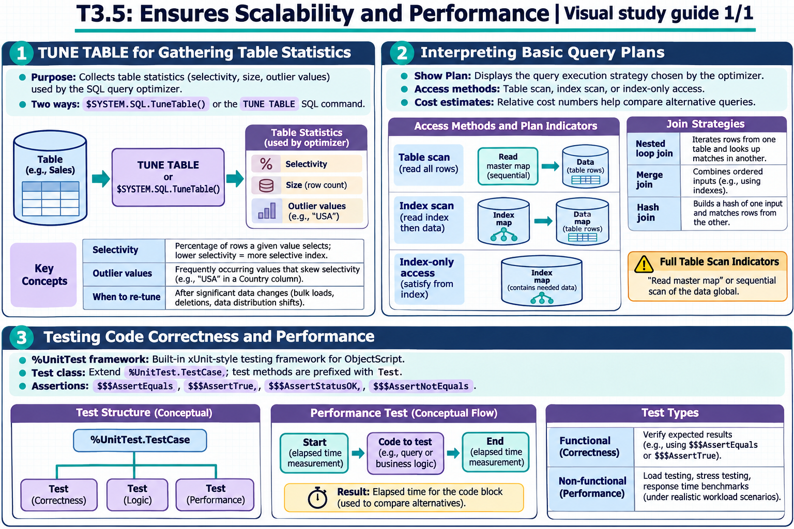

[Topic contents](../index.md) · [Full topic guide](../study.md) · [All topics](../../../index.md)

# T3.5: Ensures Scalability and Performance

Saved 2 November 2026 from [exam-prep.es](https://exam-prep.es/exams/objectscript/knowledge/T3.5.html). Reference links require internet access.

## 1. TUNE TABLE for gathering table statistics



*This diagram covers sections 1–3; use the matching numbered panel for this page.* [Chapter diagrams](../visuals.md) · [Technical review notes](../../../visual-technical-notes.md)

### Key Points

- **Purpose**: Collects table statistics (selectivity, size, outlier values) used by the SQL query optimizer
- **$SYSTEM.SQL.TuneTable()**: Programmatic method to tune a specific table
- **TUNE TABLE SQL command**: SQL DDL alternative for gathering statistics
- **Selectivity**: Percentage of rows a given value selects; lower selectivity = more selective index
- **Outlier values**: Frequently occurring values that skew selectivity (e.g., "USA" in Country column)
- **When to re-tune**: After significant data changes (bulk loads, deletions, data distribution shifts)

### Detailed Notes

#### Overview

The InterSystems IRIS SQL query optimizer uses table statistics to generate efficient query plans. Without accurate statistics, the optimizer may choose suboptimal access strategies (e.g., full table scan instead of using an available index). TUNE TABLE gathers these statistics by sampling the data and computing selectivity, average field size, and extent size.

#### Running TUNE TABLE

```objectscript
// Programmatic approach
DO $SYSTEM.SQL.TuneTable("MyApp.Patient")

// With verbose output
DO $SYSTEM.SQL.TuneTable("MyApp.Patient", 1)

// Tune all tables in the namespace
DO $SYSTEM.SQL.TuneAllTables()
```

```text
-- SQL approach
TUNE TABLE MyApp.Patient

-- Tune and update the class definition with statistics
TUNE TABLE MyApp.Patient %SAVE_VALUES
```

#### What TUNE TABLE Computes

1. **Extent Size**: Total number of rows in the table. The optimizer uses this to estimate query result sizes and choose between index access and table scan.

2. **Selectivity**: For each property/column, the percentage of rows that a single value typically selects. Calculated as `1/number_of_distinct_values * 100`:

```text
// Example: Patient table with 10,000 rows
// State column has 50 distinct values
// Selectivity = 1/50 * 100 = 2%
// This means any single state value selects ~2% of rows

// SSN column has 10,000 distinct values (unique)
// Selectivity = 1/10000 * 100 = 0.01%
// Very selective - ideal for index-based access
```

3. **Outlier Values**: Values that appear significantly more often than the average selectivity suggests. The optimizer uses outlier information to generate different plans depending on the parameter value:

```text
// Country column: 90% of rows have "USA", 10% have other countries
// Average selectivity suggests each country selects ~10% of rows
// But "USA" actually selects 90% - it's an outlier
// For "USA", a table scan is better; for "France", an index is better
```

#### Interpreting Statistics in the Class Definition

After TUNE TABLE with `%SAVE_VALUES`, statistics are stored in the class definition:

```objectscript
// View as class parameter or storage metadata
// Selectivity stored per property:
Property State As %String [ SqlSelectivity = "2%" ];
Property SSN As %String [ SqlSelectivity = "0.01%" ];
Property Country As %String [ SqlSelectivity = "10%",
    SqlOutlierSelectivity = "90%",
    SqlOutlierValue = "USA" ];
```

#### When to Re-Tune

- After bulk data imports that significantly change row count
- After large-scale DELETE operations
- When data distribution changes (e.g., new geographic regions added)
- After initial data load (production data vs development data)
- When query performance degrades unexpectedly
- **Best practice**: Purge cached queries after tuning so the optimizer uses new statistics

```objectscript
// Full optimization workflow
DO $SYSTEM.SQL.TuneTable("MyApp.Patient", 1)
DO $SYSTEM.SQL.PurgeForTable("MyApp.Patient")
```

### Documentation References

- [TUNE TABLE](https://docs.intersystems.com/irislatest/csp/docbook/DocBook.UI.Page.cls?KEY=RSQL_tunetable)
- [Table Statistics and Selectivity](https://docs.intersystems.com/irislatest/csp/docbook/DocBook.UI.Page.cls?KEY=GSQLOPT)
- [$SYSTEM.SQL.TuneTable](https://docs.intersystems.com/irislatest/csp/docbook/DocBook.UI.Page.cls?KEY=GSQLOPT)
