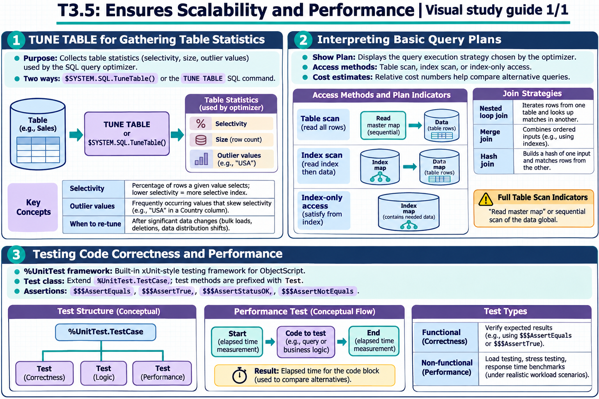

[Topic contents](../index.md) · [Full topic guide](../study.md) · [All topics](../../../index.md)

# T3.5: Ensures Scalability and Performance

Saved 2 November 2026 from [exam-prep.es](https://exam-prep.es/exams/objectscript/knowledge/T3.5.html). Reference links require internet access.

## 2. Interpreting basic query plans



*This diagram covers sections 1–3; use the matching numbered panel for this page.* [Chapter diagrams](../visuals.md) · [Technical review notes](../../../visual-technical-notes.md)

### Key Points

- **Show Plan**: Displays the query execution strategy chosen by the optimizer
- **Access methods**: Table scan (read all rows) vs index scan (read index then data) vs index-only access
- **Cost estimates**: Relative cost numbers help compare alternative query formulations
- **Full table scan indicators**: "Read master map" or sequential scan of the data global
- **Index usage indicators**: "Read index map" followed by data map lookup
- **Join strategies**: Nested loop join, merge join, hash join - chosen based on table sizes and indexes

### Detailed Notes

#### Overview

The query plan (also called the execution plan or Show Plan) reveals how the SQL optimizer intends to execute a query. Reading query plans is essential for diagnosing slow queries, validating that indexes are being used, and understanding query performance characteristics.

#### Accessing the Query Plan

**Via Management Portal:** Navigate to **System Explorer &gt; SQL**, enter a query, and click **Show Plan** (without executing).

**Via SQL EXPLAIN:**

```text
EXPLAIN SELECT Name, City FROM MyApp.Patient WHERE City = 'Boston'
```

The `EXPLAIN` statement returns the query plan without executing the query. It shows the access strategy, index usage, and optimization decisions made by the SQL engine.

**Via Dynamic SQL** (`%Display()` and `%GetImplementationDetails()` show only the implementation class name and statement text, **not** the query plan):

```objectscript
SET stmt = ##class(%SQL.Statement).%New()
SET sc = stmt.%Prepare("SELECT Name, City FROM MyApp.Patient WHERE City = ?")

// Shows implementation class and statement text (NOT the query plan)
DO stmt.%Display()

// Gets class name and SQL text programmatically (NOT the query plan)
SET ok = stmt.%GetImplementationDetails(.className, .text)
```

To see the actual query plan programmatically, use `EXPLAIN` via Dynamic SQL:

```objectscript
SET stmt = ##class(%SQL.Statement).%New()
SET sc = stmt.%Prepare("EXPLAIN SELECT Name, City FROM MyApp.Patient WHERE City = ?")
SET rs = stmt.%Execute()
WHILE rs.%Next() {
    WRITE rs.%GetData(1), !
}
```

#### Reading a Query Plan

A typical query plan shows the steps the engine will take:

```text
 Read index map MyApp.Patient.CityIdx,
   looping on City = ?,
   using the given %SQLUPPER value.
 For each row:
   Read master map MyApp.Patient.Default,
     using the ID found in the index map.
   Output the row.
```

**Key elements to identify:**

1. **Index scan** ("Read index map"): The query uses an index to find matching row IDs. This is efficient for selective queries.

2. **Master map read** ("Read master map"): After finding IDs from the index, the engine reads the actual data. This is a lookup by ID, which is fast.

3. **Full table scan** ("Read master map ... looping on ID"): If you see a sequential loop on the master map without an index reference, it means the optimizer chose a table scan.

```text
 // Full table scan - no index used
 Read master map MyApp.Patient.Default,
   looping on ID.
 For each row:
   Check WHERE condition: City = ?.
   If true, output the row.
```

4. **Index-only access**: When all needed columns are in the index, no master map read is needed:

```text
 // Index-only - very efficient
 Read index map MyApp.Patient.NameCityIdx,
   looping on Name, City.
 Output Name and City directly from the index.
```

#### Comparing Plans for Optimization

```objectscript
// Query without index on City - full table scan
// SELECT * FROM MyApp.Patient WHERE City = 'Boston'
// Plan shows: Read master map, looping on ID, check City = 'Boston'
// Cost: proportional to total rows in table

// After adding index on City:
// Plan shows: Read index map CityIdx WHERE City = 'Boston', then read master map by ID
// Cost: proportional to rows in Boston only

// After adding compound index on (City, Name):
// SELECT City, Name FROM MyApp.Patient WHERE City = 'Boston'
// Plan shows: Read index map CityNameIdx - index-only access
// Cost: lowest - no master map access needed
```

#### Cost Estimates

The optimizer assigns relative cost values to different plan alternatives:

- **Lower cost = expected to be faster**
- Costs are estimates based on table statistics (from TUNE TABLE)
- Without statistics, the optimizer may make poor choices
- **Important:** Cost values are relative and can only be meaningfully compared between different plans **for the same query on the same tables**. Comparing costs across different queries or different tables is not meaningful

#### Common Performance Red Flags in Plans

- Full table scan on a large table when an index exists (missing index or stale statistics)
- Temporary file creation for sorting (consider adding an index on the ORDER BY column)
- Nested loop join with a large inner table (may need an index on the join column)
- `%SQLUPPER` function preventing index use (case-sensitivity mismatch)

### Documentation References

- [Show Plan](https://docs.intersystems.com/irislatest/csp/docbook/DocBook.UI.Page.cls?KEY=GSQLOPT)
- [Query Plan Interpretation](https://docs.intersystems.com/irislatest/csp/docbook/DocBook.UI.Page.cls?KEY=GSQLOPT)
- [SQL Performance Optimization](https://docs.intersystems.com/irislatest/csp/docbook/DocBook.UI.Page.cls?KEY=GSQLOPT)
