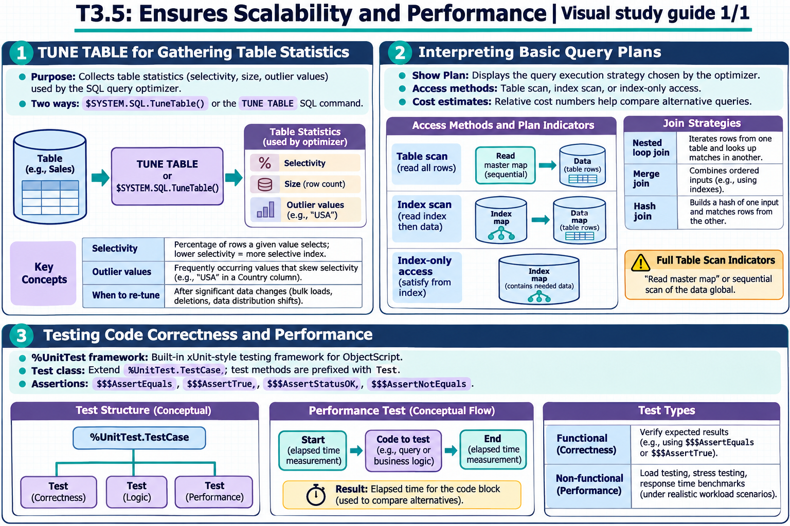

[Topic contents](../index.md) · [Full topic guide](../study.md) · [All topics](../../../index.md)

# T3.5: Ensures Scalability and Performance

Saved 2 November 2026 from [exam-prep.es](https://exam-prep.es/exams/objectscript/knowledge/T3.5.html). Reference links require internet access.

## 3. Testing code correctness and performance



*This diagram covers sections 1–3; use the matching numbered panel for this page.* [Chapter diagrams](../visuals.md) · [Technical review notes](../../../visual-technical-notes.md)

### Key Points

- **%UnitTest framework**: Built-in xUnit-style testing framework for ObjectScript
- **$ZH (or $ZHOROLOG)**: High-precision timestamp for measuring execution time
- **Test class structure**: Extend `%UnitTest.TestCase`, methods prefixed with `Test`
- **Assertions**: `$$$AssertEquals`, `$$$AssertTrue`, `$$$AssertStatusOK`, `$$$AssertNotEquals`
- **Performance testing**: Use `$ZH` before and after code blocks to measure elapsed time
- **Non-functional testing**: Load testing, stress testing, response time benchmarks

### Detailed Notes

#### Overview

Testing in InterSystems IRIS encompasses both functional testing (does the code produce correct results?) and non-functional testing (does it perform adequately?). The %UnitTest framework provides structured functional testing, while `$ZH` and related tools enable performance measurement.

#### %UnitTest Framework

The `%UnitTest.TestCase` class provides a structured testing framework. Test classes extend `%UnitTest.TestCase`, and test methods are prefixed with `Test`:

```objectscript
Class MyApp.Tests.PatientTest Extends %UnitTest.TestCase
{

Method TestCreatePatient()
{
    SET patient = ##class(MyApp.Patient).%New()
    SET patient.Name = "Test Patient"
    SET patient.SSN = "999-99-9999"

    // Assert the object was created
    DO $$$AssertNotEquals(patient, "", "Patient object created")

    // Save and assert success
    SET sc = patient.%Save()
    DO $$$AssertStatusOK(sc, "Patient saved successfully")

    // Verify ID was assigned
    SET id = patient.%Id()
    DO $$$AssertTrue(id > 0, "Patient ID assigned")

    // Verify retrieval
    SET loaded = ##class(MyApp.Patient).%OpenId(id)
    DO $$$AssertEquals(loaded.Name, "Test Patient", "Name matches")
    DO $$$AssertEquals(loaded.SSN, "999-99-9999", "SSN matches")

    // Cleanup
    SET sc = ##class(MyApp.Patient).%DeleteId(id)
    DO $$$AssertStatusOK(sc, "Patient deleted")
}

Method TestSSNUniqueness()
{
    SET p1 = ##class(MyApp.Patient).%New()
    SET p1.Name = "Patient 1"
    SET p1.SSN = "111-11-1111"
    SET sc = p1.%Save()
    DO $$$AssertStatusOK(sc, "First patient saved")

    SET p2 = ##class(MyApp.Patient).%New()
    SET p2.Name = "Patient 2"
    SET p2.SSN = "111-11-1111"  // Duplicate SSN
    SET sc = p2.%Save()
    DO $$$AssertStatusNotOK(sc, "Duplicate SSN rejected")

    // Cleanup
    DO ##class(MyApp.Patient).%DeleteId(p1.%Id())
}

/// Setup runs before each test method
Method OnBeforeOneTest(testname As %String) As %Status
{
    // Initialize test data
    RETURN $$$OK
}

/// Teardown runs after each test method
Method OnAfterOneTest(testname As %String) As %Status
{
    // Clean up test data
    RETURN $$$OK
}

}
```

#### Running Unit Tests

```objectscript
// Run all tests in a directory
DO ##class(%UnitTest.Manager).RunTest("MyApp/Tests")

// Run a specific test class
DO ##class(%UnitTest.Manager).RunTest("MyApp/Tests", "/run:MyApp.Tests.PatientTest")

// Run with debug output
DO ##class(%UnitTest.Manager).DebugRunTestCase("", "MyApp.Tests.PatientTest")
```

#### Key Assertion Macros

| Macro | Purpose | Example |
| --- | --- | --- |
| `$$$AssertTrue(expr, desc)` | Expression evaluates to true | `$$$AssertTrue(x>0, "Positive")` |
| `$$$AssertEquals(val1, val2, desc)` | Two values are equal | `$$$AssertEquals(name, "John", "Name check")` |
| `$$$AssertNotEquals(val1, val2, desc)` | Two values differ | `$$$AssertNotEquals(id, "", "ID assigned")` |
| `$$$AssertStatusOK(sc, desc)` | %Status is success | `$$$AssertStatusOK(sc, "Save OK")` |
| `$$$AssertStatusNotOK(sc, desc)` | %Status is error | `$$$AssertStatusNotOK(sc, "Expected failure")` |

#### Performance Testing with $ZH

`$ZH` (or `$ZHOROLOG`) returns a high-precision timestamp in seconds (with fractional seconds) since system startup. It is ideal for measuring elapsed time:

```objectscript
// Basic timing
SET start = $ZH
// ... code to measure ...
SET elapsed = $ZH - start
WRITE "Elapsed time: ", elapsed, " seconds", !

// Timing a query
SET start = $ZH
&sql(SELECT COUNT(*) INTO :cnt FROM MyApp.Patient WHERE City = 'Boston')
SET queryTime = $ZH - start
WRITE "Query time: ", queryTime, " seconds", !
WRITE "Rows: ", cnt, !

// Comparative performance testing
SET start1 = $ZH
FOR i = 1:1:10000 {
    SET x = $PIECE("A^B^C^D^E", "^", 3)
}
SET time1 = $ZH - start1

SET start2 = $ZH
FOR i = 1:1:10000 {
    SET x = $LISTGET($LISTBUILD("A","B","C","D","E"), 3)
}
SET time2 = $ZH - start2

WRITE "$PIECE: ", time1, " seconds", !
WRITE "$LIST:  ", time2, " seconds", !
WRITE "Ratio: ", $FN(time1/time2, "", 2), !
```

#### Non-Functional Testing Patterns

```objectscript
// Load testing: measure throughput
SET start = $ZH
SET operations = 0
FOR i = 1:1:1000 {
    SET patient = ##class(MyApp.Patient).%New()
    SET patient.Name = "Load Test " _ i
    SET sc = patient.%Save()
    IF $$$ISOK(sc) SET operations = operations + 1
}
SET elapsed = $ZH - start
WRITE "Throughput: ", $FN(operations/elapsed, "", 0), " operations/second", !

// Response time benchmarking
SET iterations = 100
SET totalTime = 0
FOR i = 1:1:iterations {
    SET start = $ZH
    SET obj = ##class(MyApp.Patient).%OpenId(1)
    SET totalTime = totalTime + ($ZH - start)
}
WRITE "Average open time: ", $FN(totalTime/iterations*1000, "", 3), " ms", !
```

#### $ZH vs $HOROLOG

- **$HOROLOG ($H)**: Returns date and time in `days,seconds` format; only second-level precision
- **$ZHOROLOG ($ZH)**: Returns high-precision elapsed seconds since system start; ideal for performance timing
- **For timing**: Always use `$ZH` - it provides sub-millisecond precision

### Documentation References

- [%UnitTest Framework](https://docs.intersystems.com/irislatest/csp/docbook/DocBook.UI.Page.cls?KEY=GUNITTEST)
- [%UnitTest.TestCase](https://docs.intersystems.com/irislatest/csp/docbook/DocBook.UI.Page.cls?KEY=GUNITTEST_about)
- [$ZHOROLOG Special Variable](https://docs.intersystems.com/irislatest/csp/docbook/DocBook.UI.Page.cls?KEY=RCOS_vzhorolog)
- [Running Unit Tests](https://docs.intersystems.com/irislatest/csp/docbook/DocBook.UI.Page.cls?KEY=GUNITTEST_execute)
