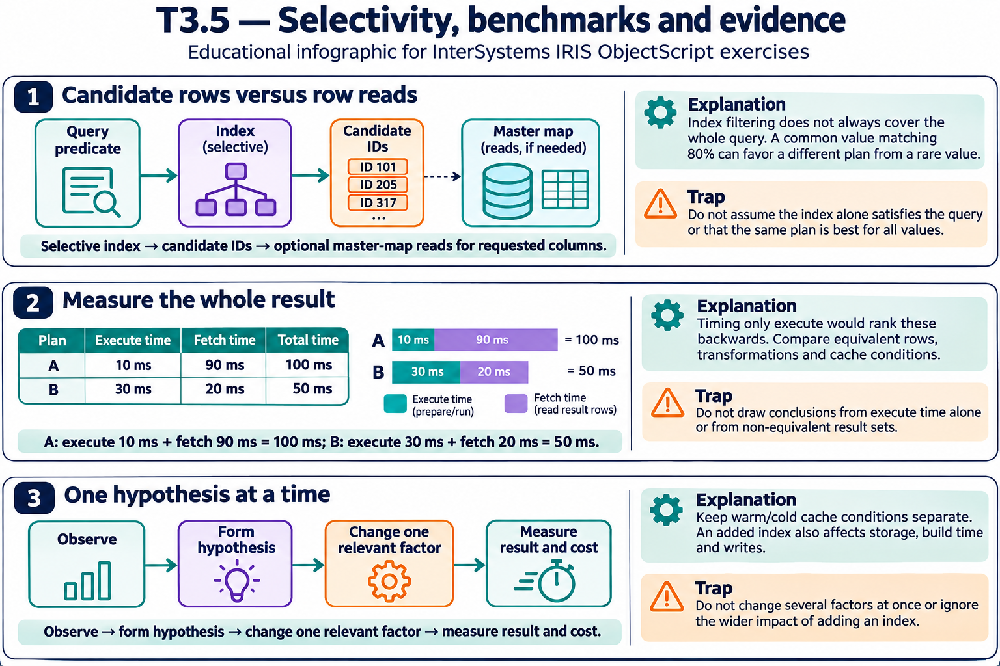

# T3.5 · 01 — Un indice selettivo risparmia candidati, non ogni lettura

[Indice degli approfondimenti](README.md) · [Quiz originale](../quiz.md) · [Teoria](../study.md)

**Esercizi di partenza:** [Q3](../quiz.md#question-3-single) · [Q4](../quiz.md#question-4-single) · [Q5](../quiz.md#question-5-single) · [Q9](../quiz.md#question-9-single) · [Q11](../quiz.md#question-11-single) · [Q14](../quiz.md#question-14-multiple) · [Q15](../quiz.md#question-15-single). L’approfondimento rielabora il concetto e aggiunge una variante; non riproduce soltanto la risposta del quiz.

## Il caso concreto

Su 100 righe, Active ricorre 80 volte: una media astratta di un terzo per stato nasconde una distribuzione molto sbilanciata.

## Ragionamento passo per passo

Un indice che restituisce 80 ID può ancora richiedere molte letture della riga se le colonne richieste non sono coperte. Un valore raro può avere un costo molto diverso. Valuta righe candidate, copertura, ordine richiesto e distribuzione. Un bitmap AND combina insiemi di ID ma non rende automaticamente gratuita la proiezione finale.

## Perché il distrattore è plausibile

Dedurre il costo dalla sola presenza di un indice o usare la selettività media come se tutti i valori fossero equiprobabili.

## Lo spunto da portare oltre l’esercizio

La domanda corretta è quanti candidati e quanti accessi effettivi produce questo piano per questo valore.

*Leggi il pannello 1; gli altri due collegano il caso agli altri approfondimenti del capitolo.*

## Variante: prova prima di leggere la soluzione

Status raro trova 2 righe, Active ne trova 80. Puoi aspettarti costi identici dallo stesso indice?

Soluzione ragionata

No: distribuzione, copertura e letture delle righe possono rendere i costi diversi.

## Riferimenti e precisazioni

- [TUNE TABLE](https://docs.intersystems.com/irislatest/csp/docbook/DocBook.UI.Page.cls?KEY=RSQL_tunetable)
- [Piani e query SQL](https://docs.intersystems.com/irislatest/csp/docbook/DocBook.UI.Page.cls?KEY=GSQL_queries)
- [$ZHOROLOG](https://docs.intersystems.com/irislatest/csp/docbook/DocBook.UI.Page.cls?KEY=RCOS_vzhorolog)

[Note specifiche del capitolo](README.md#precisazioni-rispetto-al-quiz) · [Metodo e limiti della revisione](../../../approfondimenti-esercizi.md#metodo-e-limiti)
