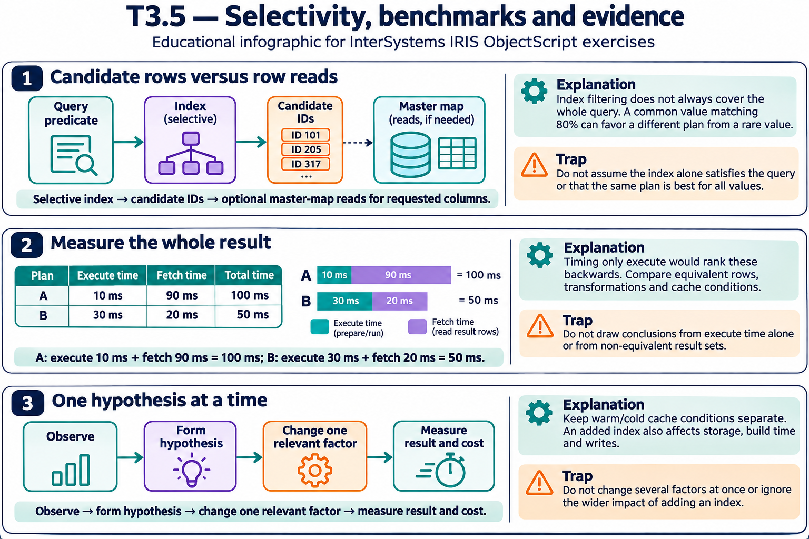

# T3.5 · 02 — Un benchmark deve separare preparazione ed esecuzione

[Indice degli approfondimenti](README.md) · [Quiz originale](../quiz.md) · [Teoria](../study.md)

**Esercizi di partenza:** [Q1](../quiz.md#question-1-single) · [Q6](../quiz.md#question-6-single) · [Q10](../quiz.md#question-10-single). L’approfondimento rielabora il concetto e aggiunge una variante; non riproduce soltanto la risposta del quiz.

## Il caso concreto

Vuoi confrontare il costo ripetuto di una query. Prepararla dentro ogni iterazione misura anche la preparazione.

```objectscript
set start = $ZHOROLOG
for i=1:1:100 {
  ; eseguire query già preparata e consumare i risultati
}
set avg = ($ZHOROLOG - start) / 100
```

## Ragionamento passo per passo

Definisci cosa misuri: prepare, execute, fetch o l’intero percorso utente. Esegui lo stesso lavoro e consuma i risultati in entrambe le alternative. La media di 100 prove non descrive il caso peggiore. Cache fredda e calda sono condizioni diverse da riportare.

## Perché il distrattore è plausibile

Confrontare una query che legge tutti i risultati con una che restituisce soltanto il primo, oppure confondere una compilazione sporadica con il costo costante.

## Lo spunto da portare oltre l’esercizio

Il confronto è valido solo se include lo stesso confine operativo e lo stesso carico.



*Leggi il pannello 2; gli altri due collegano il caso agli altri approfondimenti del capitolo.*

## Variante: prova prima di leggere la soluzione

A impiega 10 ms per execute ma altri 90 per fetch; B 30 e 20. Chi completa prima i dati?

<details>
<summary>Soluzione ragionata</summary>

B: 50 ms contro 100 ms. Il solo execute avrebbe suggerito il contrario.

</details>

## Riferimenti e precisazioni

- [TUNE TABLE](https://docs.intersystems.com/irislatest/csp/docbook/DocBook.UI.Page.cls?KEY=RSQL_tunetable)
- [Piani e query SQL](https://docs.intersystems.com/irislatest/csp/docbook/DocBook.UI.Page.cls?KEY=GSQL_queries)
- [$ZHOROLOG](https://docs.intersystems.com/irislatest/csp/docbook/DocBook.UI.Page.cls?KEY=RCOS_vzhorolog)

[Note specifiche del capitolo](README.md#precisazioni-rispetto-al-quiz) · [Metodo e limiti della revisione](../../../approfondimenti-esercizi.md#metodo-e-limiti)
