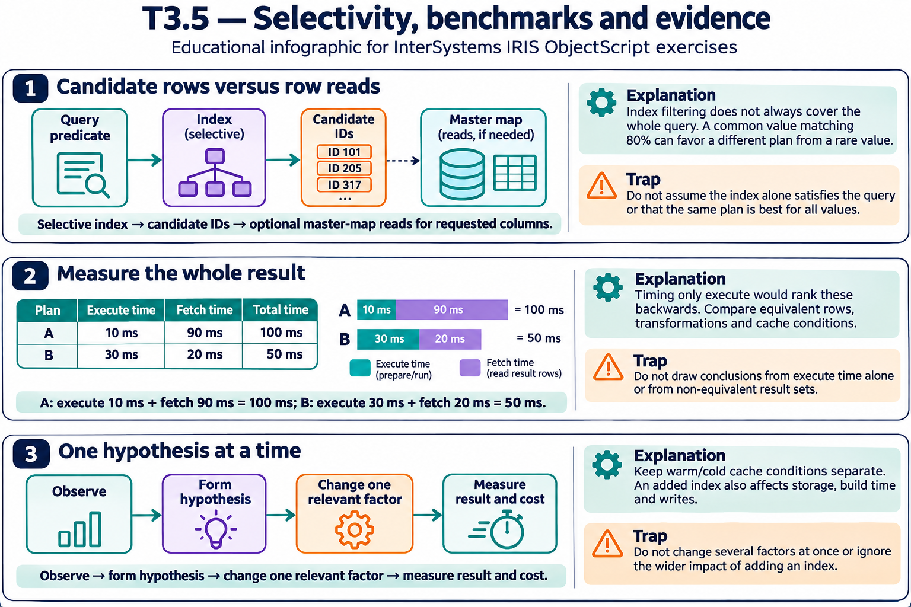

# T3.5 · 03 — Dal sintomo al piano, con una modifica verificabile

[Indice degli approfondimenti](README.md) · [Quiz originale](../quiz.md) · [Teoria](../study.md)

**Esercizi di partenza:** [Q2](../quiz.md#question-2-single) · [Q7](../quiz.md#question-7-single) · [Q8](../quiz.md#question-8-single) · [Q12](../quiz.md#question-12-single) · [Q13](../quiz.md#question-13-multiple). L’approfondimento rielabora il concetto e aggiunge una variante; non riproduce soltanto la risposta del quiz.

## Il caso concreto

In sviluppo la query è rapida; in produzione i dati sono più numerosi e distribuiti diversamente.

## Ragionamento passo per passo

Raccogli piano e statistiche sul carico rappresentativo. Individua scansioni grandi, candidati intermedi e accessi ripetuti; formula un’ipotesi concreta. Applica una modifica alla volta e confronta risultati e costo. L’ordine testuale delle clausole non dimostra da solo l’ordine fisico di esecuzione.

## Perché il distrattore è plausibile

Aggiungere indici indiscriminatamente o leggere WHERE dopo JOIN nel testo come prova che il motore filtri per forza soltanto alla fine.

## Lo spunto da portare oltre l’esercizio

La diagnosi collega un costo osservato a una causa testabile, non a una regola stilistica.

*Leggi il pannello 3; gli altri due collegano il caso agli altri approfondimenti del capitolo.*

## Variante: prova prima di leggere la soluzione

Un nuovo indice rallenta le scritture e non riduce il tempo della query. Basta il fatto che venga usato per tenerlo?

Soluzione ragionata

No: valuta il beneficio complessivo e il costo di manutenzione.

## Riferimenti e precisazioni

- [TUNE TABLE](https://docs.intersystems.com/irislatest/csp/docbook/DocBook.UI.Page.cls?KEY=RSQL_tunetable)
- [Piani e query SQL](https://docs.intersystems.com/irislatest/csp/docbook/DocBook.UI.Page.cls?KEY=GSQL_queries)
- [$ZHOROLOG](https://docs.intersystems.com/irislatest/csp/docbook/DocBook.UI.Page.cls?KEY=RCOS_vzhorolog)

[Note specifiche del capitolo](README.md#precisazioni-rispetto-al-quiz) · [Metodo e limiti della revisione](../../../approfondimenti-esercizi.md#metodo-e-limiti)
