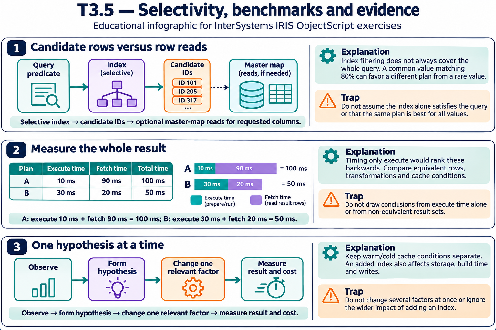
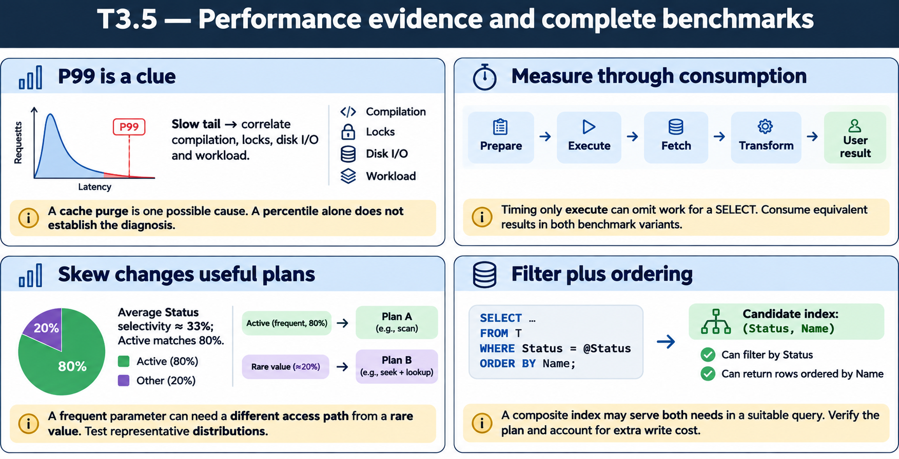

# T3.5 — Approfondimenti dagli esercizi

## Tutte le 15 domande approfondite

[Apri le schede domanda per domanda](<Domanda per domanda/README.md>) · [Tavole spiegate in inglese](tavole-esercizi.md)

Ogni domanda dispone ora di un commento specifico, un concetto ulteriore e una variante con soluzione. I tre casi seguenti sono percorsi tematici aggiuntivi. Le immagini sono in inglese.

[Teoria](../study.md) · [Quiz](../quiz.md) · [Tutti gli approfondimenti](../../../approfondimenti-esercizi.md)

Tre percorsi trasversali, da affiancare alle schede individuali, per capire il meccanismo dietro le risposte: scenario, ragionamento, distrattore, regola riutilizzabile e variante con soluzione. I riferimenti Q rimandano al quiz scaricato; la numerazione è locale al capitolo.

[Leggi esempi e spiegazioni dei pannelli](tavole-esercizi.md).

## Percorso consigliato

1. [Un indice selettivo risparmia candidati, non ogni lettura](<01 - Un indice selettivo risparmia candidati, non ogni lettura.md>) — Q3, Q4, Q5, Q9, Q11, Q14, Q15
2. [Un benchmark deve separare preparazione ed esecuzione](<02 - Un benchmark deve separare preparazione ed esecuzione.md>) — Q1, Q6, Q10
3. [Dal sintomo al piano, con una modifica verificabile](<03 - Dal sintomo al piano, con una modifica verificabile.md>) — Q2, Q7, Q8, Q12, Q13

[Indice di tutte le 15 domande del capitolo](mappa-domande.md). I percorsi sono tematici; ogni domanda ha inoltre una scheda individuale nella sottocartella dedicata.

## Precisazioni rispetto al quiz

Non assumere una soglia universale del 20% per aggiornare statistiche. I quiz Q7–9 semplificano troppo: TUNE TABLE gestisce normalmente la ricompilazione se cambiano statistiche; l’ottimizzatore può riordinare join e filtri e valutare combinazioni di indici. La misura del piano concreto prevale su regole assolute.

Queste precisazioni si applicano agli approfondimenti nuovi. Il testo delle risposte scaricate rimane una testimonianza della fonte e non viene riscritto silenziosamente.

## Documentazione

- [TUNE TABLE](https://docs.intersystems.com/irislatest/csp/docbook/DocBook.UI.Page.cls?KEY=RSQL_tunetable)
- [Piani e query SQL](https://docs.intersystems.com/irislatest/csp/docbook/DocBook.UI.Page.cls?KEY=GSQL_queries)
- [$ZHOROLOG](https://docs.intersystems.com/irislatest/csp/docbook/DocBook.UI.Page.cls?KEY=RCOS_vzhorolog)

Gli snippet sono frammenti didattici: quando usano classi di esempio o macro, presuppongono le relative definizioni e include. Non costituiscono implementazioni complete né sono stati eseguiti in IRIS.
