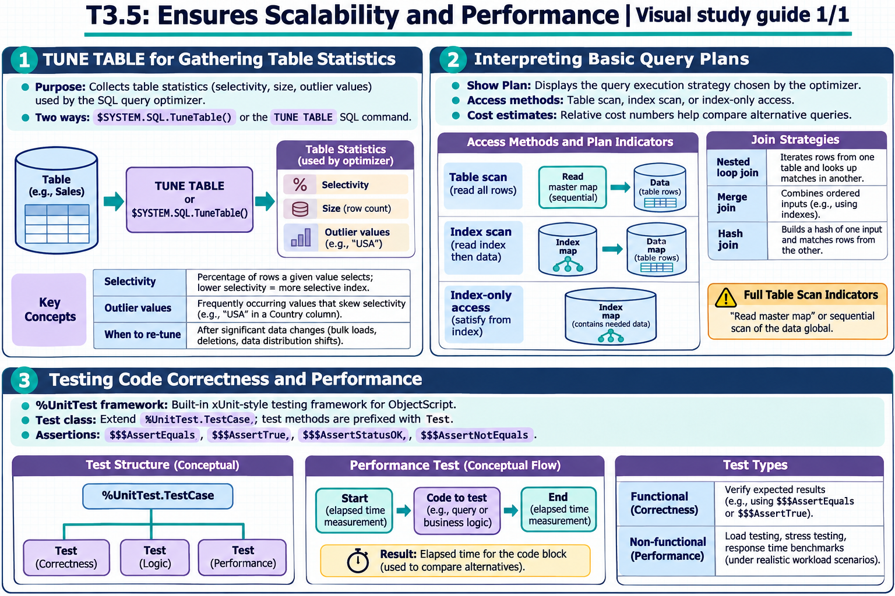

[All topics](../../index.md) · [Practice quiz](quiz.md)

# T3.5: Ensures Scalability and Performance

[Approfondimenti dagli esercizi](<Approfondimenti esercizi/README.md>)

Saved 2 November 2026 from [exam-prep.es](https://exam-prep.es/exams/objectscript/knowledge/T3.5.html). Reference links require internet access.

### Contents

1. [TUNE TABLE for gathering table statistics](#1-tune-table-for-gathering-table-statistics)
2. [Interpreting basic query plans](#2-interpreting-basic-query-plans)
3. [Testing code correctness and performance](#3-testing-code-correctness-and-performance)

### Visual study guide — sections 1–3



[View all chapter diagrams](visuals.md) · [Technical review notes](../../visual-technical-notes.md)

## 1. TUNE TABLE for gathering table statistics

### Key Points

- **Purpose**: Collects table statistics (selectivity, size, outlier values) used by the SQL query optimizer
- **$SYSTEM.SQL.TuneTable()**: Programmatic method to tune a specific table
- **TUNE TABLE SQL command**: SQL DDL alternative for gathering statistics
- **Selectivity**: Percentage of rows a given value selects; lower selectivity = more selective index
- **Outlier values**: Frequently occurring values that skew selectivity (e.g., "USA" in Country column)
- **When to re-tune**: After significant data changes (bulk loads, deletions, data distribution shifts)

### Detailed Notes

#### Overview

The InterSystems IRIS SQL query optimizer uses table statistics to generate efficient query plans. Without accurate statistics, the optimizer may choose suboptimal access strategies (e.g., full table scan instead of using an available index). TUNE TABLE gathers these statistics by sampling the data and computing selectivity, average field size, and extent size.

#### Running TUNE TABLE

```objectscript
// Programmatic approach
DO $SYSTEM.SQL.TuneTable("MyApp.Patient")

// With verbose output
DO $SYSTEM.SQL.TuneTable("MyApp.Patient", 1)

// Tune all tables in the namespace
DO $SYSTEM.SQL.TuneAllTables()
```

```text
-- SQL approach
TUNE TABLE MyApp.Patient

-- Tune and update the class definition with statistics
TUNE TABLE MyApp.Patient %SAVE_VALUES
```

#### What TUNE TABLE Computes

1. **Extent Size**: Total number of rows in the table. The optimizer uses this to estimate query result sizes and choose between index access and table scan.

2. **Selectivity**: For each property/column, the percentage of rows that a single value typically selects. Calculated as `1/number_of_distinct_values * 100`:

```text
// Example: Patient table with 10,000 rows
// State column has 50 distinct values
// Selectivity = 1/50 * 100 = 2%
// This means any single state value selects ~2% of rows

// SSN column has 10,000 distinct values (unique)
// Selectivity = 1/10000 * 100 = 0.01%
// Very selective - ideal for index-based access
```

3. **Outlier Values**: Values that appear significantly more often than the average selectivity suggests. The optimizer uses outlier information to generate different plans depending on the parameter value:

```text
// Country column: 90% of rows have "USA", 10% have other countries
// Average selectivity suggests each country selects ~10% of rows
// But "USA" actually selects 90% - it's an outlier
// For "USA", a table scan is better; for "France", an index is better
```

#### Interpreting Statistics in the Class Definition

After TUNE TABLE with `%SAVE_VALUES`, statistics are stored in the class definition:

```objectscript
// View as class parameter or storage metadata
// Selectivity stored per property:
Property State As %String [ SqlSelectivity = "2%" ];
Property SSN As %String [ SqlSelectivity = "0.01%" ];
Property Country As %String [ SqlSelectivity = "10%",
    SqlOutlierSelectivity = "90%",
    SqlOutlierValue = "USA" ];
```

#### When to Re-Tune

- After bulk data imports that significantly change row count
- After large-scale DELETE operations
- When data distribution changes (e.g., new geographic regions added)
- After initial data load (production data vs development data)
- When query performance degrades unexpectedly
- **Best practice**: Purge cached queries after tuning so the optimizer uses new statistics

```objectscript
// Full optimization workflow
DO $SYSTEM.SQL.TuneTable("MyApp.Patient", 1)
DO $SYSTEM.SQL.PurgeForTable("MyApp.Patient")
```

### Documentation References

- [TUNE TABLE](https://docs.intersystems.com/irislatest/csp/docbook/DocBook.UI.Page.cls?KEY=RSQL_tunetable)
- [Table Statistics and Selectivity](https://docs.intersystems.com/irislatest/csp/docbook/DocBook.UI.Page.cls?KEY=GSQLOPT)
- [$SYSTEM.SQL.TuneTable](https://docs.intersystems.com/irislatest/csp/docbook/DocBook.UI.Page.cls?KEY=GSQLOPT)

## 2. Interpreting basic query plans

### Key Points

- **Show Plan**: Displays the query execution strategy chosen by the optimizer
- **Access methods**: Table scan (read all rows) vs index scan (read index then data) vs index-only access
- **Cost estimates**: Relative cost numbers help compare alternative query formulations
- **Full table scan indicators**: "Read master map" or sequential scan of the data global
- **Index usage indicators**: "Read index map" followed by data map lookup
- **Join strategies**: Nested loop join, merge join, hash join - chosen based on table sizes and indexes

### Detailed Notes

#### Overview

The query plan (also called the execution plan or Show Plan) reveals how the SQL optimizer intends to execute a query. Reading query plans is essential for diagnosing slow queries, validating that indexes are being used, and understanding query performance characteristics.

#### Accessing the Query Plan

**Via Management Portal:** Navigate to **System Explorer &gt; SQL**, enter a query, and click **Show Plan** (without executing).

**Via SQL EXPLAIN:**

```text
EXPLAIN SELECT Name, City FROM MyApp.Patient WHERE City = 'Boston'
```

The `EXPLAIN` statement returns the query plan without executing the query. It shows the access strategy, index usage, and optimization decisions made by the SQL engine.

**Via Dynamic SQL** (`%Display()` and `%GetImplementationDetails()` show only the implementation class name and statement text, **not** the query plan):

```objectscript
SET stmt = ##class(%SQL.Statement).%New()
SET sc = stmt.%Prepare("SELECT Name, City FROM MyApp.Patient WHERE City = ?")

// Shows implementation class and statement text (NOT the query plan)
DO stmt.%Display()

// Gets class name and SQL text programmatically (NOT the query plan)
SET ok = stmt.%GetImplementationDetails(.className, .text)
```

To see the actual query plan programmatically, use `EXPLAIN` via Dynamic SQL:

```objectscript
SET stmt = ##class(%SQL.Statement).%New()
SET sc = stmt.%Prepare("EXPLAIN SELECT Name, City FROM MyApp.Patient WHERE City = ?")
SET rs = stmt.%Execute()
WHILE rs.%Next() {
    WRITE rs.%GetData(1), !
}
```

#### Reading a Query Plan

A typical query plan shows the steps the engine will take:

```text
 Read index map MyApp.Patient.CityIdx,
   looping on City = ?,
   using the given %SQLUPPER value.
 For each row:
   Read master map MyApp.Patient.Default,
     using the ID found in the index map.
   Output the row.
```

**Key elements to identify:**

1. **Index scan** ("Read index map"): The query uses an index to find matching row IDs. This is efficient for selective queries.

2. **Master map read** ("Read master map"): After finding IDs from the index, the engine reads the actual data. This is a lookup by ID, which is fast.

3. **Full table scan** ("Read master map ... looping on ID"): If you see a sequential loop on the master map without an index reference, it means the optimizer chose a table scan.

```text
 // Full table scan - no index used
 Read master map MyApp.Patient.Default,
   looping on ID.
 For each row:
   Check WHERE condition: City = ?.
   If true, output the row.
```

4. **Index-only access**: When all needed columns are in the index, no master map read is needed:

```text
 // Index-only - very efficient
 Read index map MyApp.Patient.NameCityIdx,
   looping on Name, City.
 Output Name and City directly from the index.
```

#### Comparing Plans for Optimization

```objectscript
// Query without index on City - full table scan
// SELECT * FROM MyApp.Patient WHERE City = 'Boston'
// Plan shows: Read master map, looping on ID, check City = 'Boston'
// Cost: proportional to total rows in table

// After adding index on City:
// Plan shows: Read index map CityIdx WHERE City = 'Boston', then read master map by ID
// Cost: proportional to rows in Boston only

// After adding compound index on (City, Name):
// SELECT City, Name FROM MyApp.Patient WHERE City = 'Boston'
// Plan shows: Read index map CityNameIdx - index-only access
// Cost: lowest - no master map access needed
```

#### Cost Estimates

The optimizer assigns relative cost values to different plan alternatives:

- **Lower cost = expected to be faster**
- Costs are estimates based on table statistics (from TUNE TABLE)
- Without statistics, the optimizer may make poor choices
- **Important:** Cost values are relative and can only be meaningfully compared between different plans **for the same query on the same tables**. Comparing costs across different queries or different tables is not meaningful

#### Common Performance Red Flags in Plans

- Full table scan on a large table when an index exists (missing index or stale statistics)
- Temporary file creation for sorting (consider adding an index on the ORDER BY column)
- Nested loop join with a large inner table (may need an index on the join column)
- `%SQLUPPER` function preventing index use (case-sensitivity mismatch)

### Documentation References

- [Show Plan](https://docs.intersystems.com/irislatest/csp/docbook/DocBook.UI.Page.cls?KEY=GSQLOPT)
- [Query Plan Interpretation](https://docs.intersystems.com/irislatest/csp/docbook/DocBook.UI.Page.cls?KEY=GSQLOPT)
- [SQL Performance Optimization](https://docs.intersystems.com/irislatest/csp/docbook/DocBook.UI.Page.cls?KEY=GSQLOPT)

## 3. Testing code correctness and performance

### Key Points

- **%UnitTest framework**: Built-in xUnit-style testing framework for ObjectScript
- **$ZH (or $ZHOROLOG)**: High-precision timestamp for measuring execution time
- **Test class structure**: Extend `%UnitTest.TestCase`, methods prefixed with `Test`
- **Assertions**: `$$$AssertEquals`, `$$$AssertTrue`, `$$$AssertStatusOK`, `$$$AssertNotEquals`
- **Performance testing**: Use `$ZH` before and after code blocks to measure elapsed time
- **Non-functional testing**: Load testing, stress testing, response time benchmarks

### Detailed Notes

#### Overview

Testing in InterSystems IRIS encompasses both functional testing (does the code produce correct results?) and non-functional testing (does it perform adequately?). The %UnitTest framework provides structured functional testing, while `$ZH` and related tools enable performance measurement.

#### %UnitTest Framework

The `%UnitTest.TestCase` class provides a structured testing framework. Test classes extend `%UnitTest.TestCase`, and test methods are prefixed with `Test`:

```objectscript
Class MyApp.Tests.PatientTest Extends %UnitTest.TestCase
{

Method TestCreatePatient()
{
    SET patient = ##class(MyApp.Patient).%New()
    SET patient.Name = "Test Patient"
    SET patient.SSN = "999-99-9999"

    // Assert the object was created
    DO $$$AssertNotEquals(patient, "", "Patient object created")

    // Save and assert success
    SET sc = patient.%Save()
    DO $$$AssertStatusOK(sc, "Patient saved successfully")

    // Verify ID was assigned
    SET id = patient.%Id()
    DO $$$AssertTrue(id > 0, "Patient ID assigned")

    // Verify retrieval
    SET loaded = ##class(MyApp.Patient).%OpenId(id)
    DO $$$AssertEquals(loaded.Name, "Test Patient", "Name matches")
    DO $$$AssertEquals(loaded.SSN, "999-99-9999", "SSN matches")

    // Cleanup
    SET sc = ##class(MyApp.Patient).%DeleteId(id)
    DO $$$AssertStatusOK(sc, "Patient deleted")
}

Method TestSSNUniqueness()
{
    SET p1 = ##class(MyApp.Patient).%New()
    SET p1.Name = "Patient 1"
    SET p1.SSN = "111-11-1111"
    SET sc = p1.%Save()
    DO $$$AssertStatusOK(sc, "First patient saved")

    SET p2 = ##class(MyApp.Patient).%New()
    SET p2.Name = "Patient 2"
    SET p2.SSN = "111-11-1111"  // Duplicate SSN
    SET sc = p2.%Save()
    DO $$$AssertStatusNotOK(sc, "Duplicate SSN rejected")

    // Cleanup
    DO ##class(MyApp.Patient).%DeleteId(p1.%Id())
}

/// Setup runs before each test method
Method OnBeforeOneTest(testname As %String) As %Status
{
    // Initialize test data
    RETURN $$$OK
}

/// Teardown runs after each test method
Method OnAfterOneTest(testname As %String) As %Status
{
    // Clean up test data
    RETURN $$$OK
}

}
```

#### Running Unit Tests

```objectscript
// Run all tests in a directory
DO ##class(%UnitTest.Manager).RunTest("MyApp/Tests")

// Run a specific test class
DO ##class(%UnitTest.Manager).RunTest("MyApp/Tests", "/run:MyApp.Tests.PatientTest")

// Run with debug output
DO ##class(%UnitTest.Manager).DebugRunTestCase("", "MyApp.Tests.PatientTest")
```

#### Key Assertion Macros

| Macro | Purpose | Example |
| --- | --- | --- |
| `$$$AssertTrue(expr, desc)` | Expression evaluates to true | `$$$AssertTrue(x>0, "Positive")` |
| `$$$AssertEquals(val1, val2, desc)` | Two values are equal | `$$$AssertEquals(name, "John", "Name check")` |
| `$$$AssertNotEquals(val1, val2, desc)` | Two values differ | `$$$AssertNotEquals(id, "", "ID assigned")` |
| `$$$AssertStatusOK(sc, desc)` | %Status is success | `$$$AssertStatusOK(sc, "Save OK")` |
| `$$$AssertStatusNotOK(sc, desc)` | %Status is error | `$$$AssertStatusNotOK(sc, "Expected failure")` |

#### Performance Testing with $ZH

`$ZH` (or `$ZHOROLOG`) returns a high-precision timestamp in seconds (with fractional seconds) since system startup. It is ideal for measuring elapsed time:

```objectscript
// Basic timing
SET start = $ZH
// ... code to measure ...
SET elapsed = $ZH - start
WRITE "Elapsed time: ", elapsed, " seconds", !

// Timing a query
SET start = $ZH
&sql(SELECT COUNT(*) INTO :cnt FROM MyApp.Patient WHERE City = 'Boston')
SET queryTime = $ZH - start
WRITE "Query time: ", queryTime, " seconds", !
WRITE "Rows: ", cnt, !

// Comparative performance testing
SET start1 = $ZH
FOR i = 1:1:10000 {
    SET x = $PIECE("A^B^C^D^E", "^", 3)
}
SET time1 = $ZH - start1

SET start2 = $ZH
FOR i = 1:1:10000 {
    SET x = $LISTGET($LISTBUILD("A","B","C","D","E"), 3)
}
SET time2 = $ZH - start2

WRITE "$PIECE: ", time1, " seconds", !
WRITE "$LIST:  ", time2, " seconds", !
WRITE "Ratio: ", $FN(time1/time2, "", 2), !
```

#### Non-Functional Testing Patterns

```objectscript
// Load testing: measure throughput
SET start = $ZH
SET operations = 0
FOR i = 1:1:1000 {
    SET patient = ##class(MyApp.Patient).%New()
    SET patient.Name = "Load Test " _ i
    SET sc = patient.%Save()
    IF $$$ISOK(sc) SET operations = operations + 1
}
SET elapsed = $ZH - start
WRITE "Throughput: ", $FN(operations/elapsed, "", 0), " operations/second", !

// Response time benchmarking
SET iterations = 100
SET totalTime = 0
FOR i = 1:1:iterations {
    SET start = $ZH
    SET obj = ##class(MyApp.Patient).%OpenId(1)
    SET totalTime = totalTime + ($ZH - start)
}
WRITE "Average open time: ", $FN(totalTime/iterations*1000, "", 3), " ms", !
```

#### $ZH vs $HOROLOG

- **$HOROLOG ($H)**: Returns date and time in `days,seconds` format; only second-level precision
- **$ZHOROLOG ($ZH)**: Returns high-precision elapsed seconds since system start; ideal for performance timing
- **For timing**: Always use `$ZH` - it provides sub-millisecond precision

### Documentation References

- [%UnitTest Framework](https://docs.intersystems.com/irislatest/csp/docbook/DocBook.UI.Page.cls?KEY=GUNITTEST)
- [%UnitTest.TestCase](https://docs.intersystems.com/irislatest/csp/docbook/DocBook.UI.Page.cls?KEY=GUNITTEST_about)
- [$ZHOROLOG Special Variable](https://docs.intersystems.com/irislatest/csp/docbook/DocBook.UI.Page.cls?KEY=RCOS_vzhorolog)
- [Running Unit Tests](https://docs.intersystems.com/irislatest/csp/docbook/DocBook.UI.Page.cls?KEY=GUNITTEST_execute)

## Exam Preparation Summary

### Critical Concepts to Master:

1. **TUNE TABLE purpose**: Gathers selectivity and extent size statistics for the query optimizer
2. **Selectivity**: Lower percentage = more selective = better candidate for index-based access
3. **Outlier values**: Commonly occurring values that require special handling by the optimizer
4. **Query plan reading**: Distinguish between full table scan, index scan, and index-only access
5. **$ZH for timing**: High-precision timing variable; always use for performance measurement, not $H
6. **%UnitTest basics**: Test class structure, assertion macros, setup/teardown lifecycle
7. **TUNE TABLE + Purge workflow**: Always purge cached queries after tuning so new statistics take effect

### Common Exam Scenarios:

- Explaining why a query is slow (missing statistics, need TUNE TABLE)
- Reading a query plan and identifying whether an index is being used
- Choosing between $ZH and $H for performance timing (always $ZH)
- Writing a unit test with appropriate assertions for a given scenario
- Identifying when to re-tune tables (after bulk loads, data distribution changes)
- Interpreting selectivity values to predict index effectiveness
- Recognizing full table scan indicators in a query plan

### Hands-On Practice Recommendations:

- Run TUNE TABLE on a table and inspect the stored selectivity values in the class definition
- Compare query plans before and after adding an index - observe the change from table scan to index scan
- Use $ZH to time various operations: object access, SQL queries, string operations
- Write unit tests using all major assertion macros
- Create a table with outlier data (e.g., 90% one value) and observe how TUNE TABLE reports it
- Execute Show Plan in the Management Portal for various query types (SELECT, JOIN, subquery)
- Compare query plans before and after TUNE TABLE to see how statistics affect optimizer decisions
- Measure the performance impact of purging cached queries (first execution vs subsequent)
