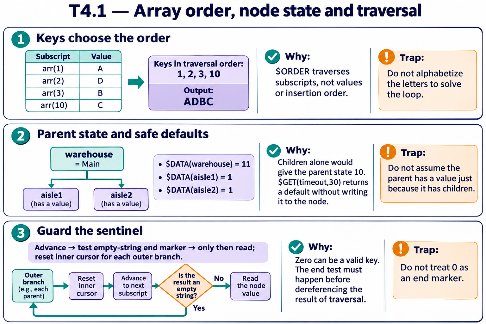

# T4.1 · 01 — Si ordinano le chiavi, poi si leggono i valori

[Indice degli approfondimenti](README.md) · [Quiz originale](../quiz.md) · [Teoria](../study.md)

**Esercizi di partenza:** [Q1](../quiz.md#question-1-single) · [Q3](../quiz.md#question-3-single) · [Q5](../quiz.md#question-5-single) · [Q6](../quiz.md#question-6-single) · [Q8](../quiz.md#question-8-single) · [Q10](../quiz.md#question-10-single) · [Q13](../quiz.md#question-13-single) · [Q18](../quiz.md#question-18-single). L’approfondimento rielabora il concetto e aggiunge una variante; non riproduce soltanto la risposta del quiz.

## Il caso concreto

arr(1)=A, arr(3)=B, arr(10)=C, arr(2)=D. L’inserimento non stabilisce l’ordine di attraversamento.

```objectscript
set key=""
for {
  set key=$ORDER(arr(key))
  quit:key=""
  write arr(key)
}
```

## Ragionamento passo per passo

Le chiavi numeriche canoniche vengono percorse 1,2,3,10. Leggendo i valori associati ottieni ADBC. Nello scenario con 1.10 numerico, quel subscript equivale a 1.1, non a una versione “uno punto dieci”.

## Perché il distrattore è plausibile

Stampare AB​CD perché si ricorda l’ordine del codice oppure confrontare numeri come testi arbitrari.

## Lo spunto da portare oltre l’esercizio

Costruisci una tabella chiave→valore e ordinala secondo le regole del contenitore prima di calcolare l’output.



*Leggi il pannello 1; gli altri due collegano il caso agli altri approfondimenti del capitolo.*

## Variante: prova prima di leggere la soluzione

Quali chiavi precedono 10: 2 e 3, oppure soltanto 1?

<details>
<summary>Soluzione ragionata</summary>

Anche 2 e 3: nell’ordinamento numerico 1<2<3<10.

</details>

## Riferimenti e precisazioni

- [$ORDER](https://docs.intersystems.com/irislatest/csp/docbook/DocBook.UI.Page.cls?KEY=RCOS_forder)
- [$DATA](https://docs.intersystems.com/irislatest/csp/docbook/DocBook.UI.Page.cls?KEY=RCOS_fdata)
- [$GET](https://docs.intersystems.com/irislatest/csp/docbook/DocBook.UI.Page.cls?KEY=RCOS_fget)

[Note specifiche del capitolo](README.md#precisazioni-rispetto-al-quiz) · [Metodo e limiti della revisione](../../../approfondimenti-esercizi.md#metodo-e-limiti)
