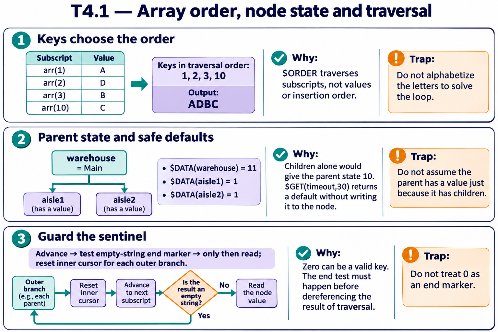

# T4.1 · 02 — Un nodo e i suoi figli sono informazioni indipendenti

[Indice degli approfondimenti](README.md) · [Quiz originale](../quiz.md) · [Teoria](../study.md)

**Esercizi di partenza:** [Q4](../quiz.md#question-4-single) · [Q9](../quiz.md#question-9-multiple) · [Q12](../quiz.md#question-12-single) · [Q14](../quiz.md#question-14-single) · [Q17](../quiz.md#question-17-single). L’approfondimento rielabora il concetto e aggiunge una variante; non riproduce soltanto la risposta del quiz.

## Il caso concreto

warehouse ha sia valore Main sia figli aisle1 e aisle2.

```objectscript
write $DATA(^inventory("warehouse"))
set timeout=$GET(^settings("timeout"),30)
```

## Ragionamento passo per passo

$DATA restituisce 11 quando esistono valore e figli. $GET permette un default per un valore mancante senza affermare che manchino anche i discendenti. Per verificare solo la presenza del valore considera $DATA(node)#2. Il default 30 non viene scritto automaticamente nello storage.

## Perché il distrattore è plausibile

Pensare che $GET crei il nodo, o trattare $DATA=10 come prova che il valore del padre sia leggibile.

## Lo spunto da portare oltre l’esercizio

Presenza del ramo, presenza del valore e assegnazione di un default sono operazioni diverse.



*Leggi il pannello 2; gli altri due collegano il caso agli altri approfondimenti del capitolo.*

## Variante: prova prima di leggere la soluzione

timeout non esiste. Dopo $GET(...,30), il global contiene automaticamente 30?

<details>
<summary>Soluzione ragionata</summary>

No: viene restituito un valore senza creare la configurazione persistente.

</details>

## Riferimenti e precisazioni

- [$ORDER](https://docs.intersystems.com/irislatest/csp/docbook/DocBook.UI.Page.cls?KEY=RCOS_forder)
- [$DATA](https://docs.intersystems.com/irislatest/csp/docbook/DocBook.UI.Page.cls?KEY=RCOS_fdata)
- [$GET](https://docs.intersystems.com/irislatest/csp/docbook/DocBook.UI.Page.cls?KEY=RCOS_fget)

[Note specifiche del capitolo](README.md#precisazioni-rispetto-al-quiz) · [Metodo e limiti della revisione](../../../approfondimenti-esercizi.md#metodo-e-limiti)
