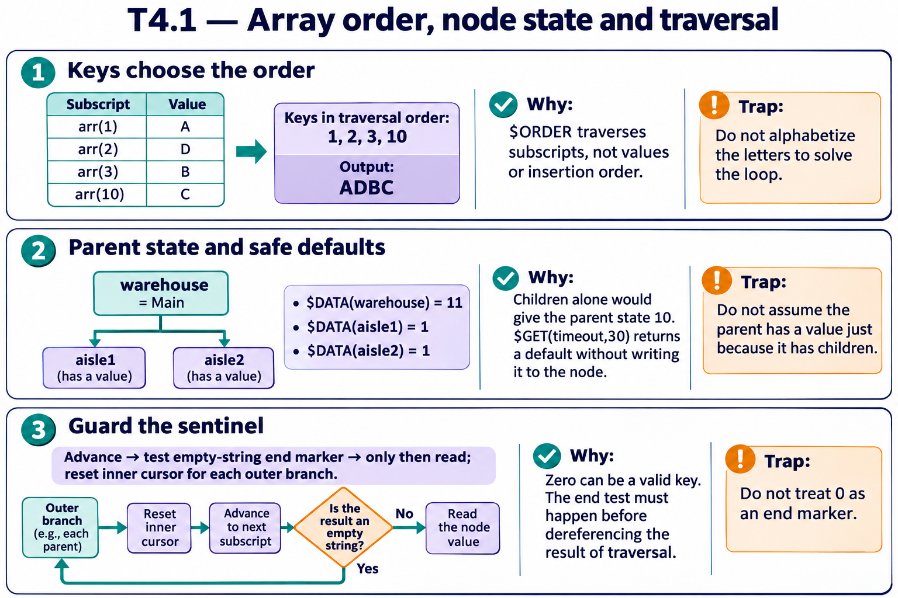

# T4.1 · 03 — Il controllo di fine precede l’accesso

[Indice degli approfondimenti](README.md) · [Quiz originale](../quiz.md) · [Teoria](../study.md)

**Esercizi di partenza:** [Q2](../quiz.md#question-2-single) · [Q7](../quiz.md#question-7-single) · [Q11](../quiz.md#question-11-single) · [Q15](../quiz.md#question-15-single) · [Q16](../quiz.md#question-16-multiple). L’approfondimento rielabora il concetto e aggiunge una variante; non riproduce soltanto la risposta del quiz.

## Il caso concreto

Un attraversamento multidimensionale richiede un cursore per ogni livello. Quando $ORDER restituisce "", il ciclo è terminato.

## Ragionamento passo per passo

Aggiorna la chiave, verifica il terminatore e soltanto allora leggi il valore. Nel ciclo annidato reimposta il cursore interno per ogni chiave esterna. Un typo ordKey invece di key introduce una variabile diversa, non un nuovo nome equivalente.

## Perché il distrattore è plausibile

Usare una chiave non inizializzata o leggere arr(key) prima di verificare key="".

## Lo spunto da portare oltre l’esercizio

La sentinella descrive lo stato del cursore; non è una normale riga da elaborare.

*Leggi il pannello 3; gli altri due collegano il caso agli altri approfondimenti del capitolo.*

## Variante: prova prima di leggere la soluzione

Al primo passo $ORDER restituisce "". Quante letture di arr(key) deve fare il ciclo corretto?

Soluzione ragionata

Zero.

## Riferimenti e precisazioni

- [$ORDER](https://docs.intersystems.com/irislatest/csp/docbook/DocBook.UI.Page.cls?KEY=RCOS_forder)
- [$DATA](https://docs.intersystems.com/irislatest/csp/docbook/DocBook.UI.Page.cls?KEY=RCOS_fdata)
- [$GET](https://docs.intersystems.com/irislatest/csp/docbook/DocBook.UI.Page.cls?KEY=RCOS_fget)

[Note specifiche del capitolo](README.md#precisazioni-rispetto-al-quiz) · [Metodo e limiti della revisione](../../../approfondimenti-esercizi.md#metodo-e-limiti)
